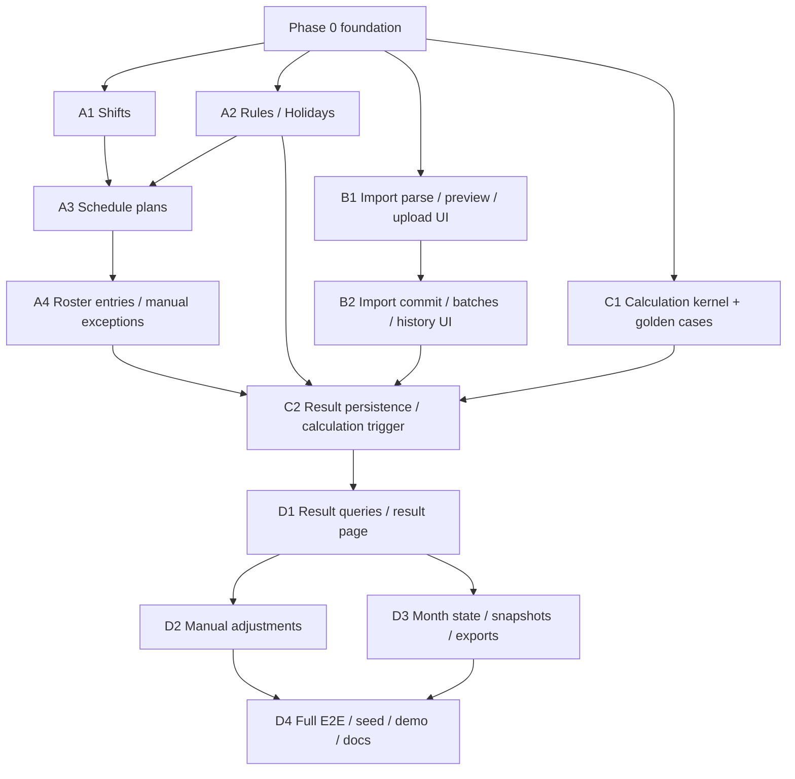

# Attendance Management Implementation Specification

- Status: Approved (2026-11-14)
- Date: 2026-11-14
- Scope: Shifts, monthly scheduling, roster entries, punch/OA imports, holidays, attendance rules, attendance calculation, day/shift results, month summaries, manual adjustments, month closing, exports, and the future payroll read contract
- Source decisions: [domain model and schedule expansion (#23)](https://github.com/nasa-du/anysys-hr/issues/23), [import pipeline (#24)](https://github.com/nasa-du/anysys-hr/issues/24), [calculation rules and results (#25)](https://github.com/nasa-du/anysys-hr/issues/25), [frontend IA and prototype (#26)](https://github.com/nasa-du/anysys-hr/issues/26), [API contract and implementation architecture (#27)](https://github.com/nasa-du/anysys-hr/issues/27), [implementation order and acceptance plan (#28)](https://github.com/nasa-du/anysys-hr/issues/28)
- Audience: implementers who should not need further product or architecture decisions

## Table of Contents

1. [Background and Goals](#1-background-and-goals)
2. [Scope and Non-Goals](#2-scope-and-non-goals)
3. [Terminology and References](#3-terminology-and-references)
4. [Domain Model](#4-domain-model)
5. [Scheduling](#5-scheduling)
6. [Import Pipeline](#6-import-pipeline)
7. [Calculation](#7-calculation)
8. [API Contract](#8-api-contract)
9. [Frontend Information Architecture](#9-frontend-information-architecture)
10. [Interface with Basic Management](#10-interface-with-basic-management)
11. [Implementation Architecture](#11-implementation-architecture)
12. [Migration Strategy](#12-migration-strategy)
13. [Implementation Order and Parallelism](#13-implementation-order-and-parallelism)
14. [Test Strategy](#14-test-strategy)
15. [Development Seed Data](#15-development-seed-data)
16. [CI Gates](#16-ci-gates)
17. [Acceptance Criteria and Demo Script](#17-acceptance-criteria-and-demo-script)
18. [Risks and Rollback](#18-risks-and-rollback)
19. [Future Extensions](#19-future-extensions)
20. [References](#20-references)

---

## 1. Background and Goals

AnySys HR is an employee management and payroll calculation system for small and medium-sized businesses. This effort covers **Attendance Management (考勤管理)** on top of the delivered Basic Management baseline.

Requirement source: [`docs/requirement/rx-hr-requirement.html`](../requirement/rx-hr-requirement.html), M7 / section 3.8 (shifts, scheduling, punches, OA requests, attendance results), with section 3.7 defining the monthly-import columns that attendance results must align with. Employee self-service H5 (section 3.13) is out of scope.

The goal of this specification is a handoff artifact that is complete enough to start implementation without further product or architecture decisions. It consolidates tickets #23–#28 into one standalone document. Source tickets remain the rationale record; this document is the implementation contract.

Deliverables of this effort:

- A finalized data model and database migration plan (24 tables, 4 migrations).
- A finalized scheduling model: shift templates, monthly schedule plans, expanded per-employee daily roster entries, manual exceptions, personnel sync, and copy-to-next-month.
- A finalized import pipeline for punches and three OA request types, with column mappings, data-quality rules, and auditable batches.
- A finalized calculation contract: punch matching, leave allocation, OA fusion, overtime, attendance fractions, month summaries, deduction suggestions, manual adjustments, and month closing.
- A finalized REST API contract (68 endpoints), error model, and generated-client contract.
- A finalized frontend information architecture and interaction model (Scheme A).
- An implementation order with parallel tracks, a test matrix, seed data, CI gates, acceptance criteria, risks, and rollback.
- No production code; implementation is a separate effort.

## 2. Scope and Non-Goals

### 2.1 In Scope

- Company-level shift templates with cross-day, break-segment, and unpaid-rest-deduction handling.
- Monthly schedule plans scoped to the whole company, departments, positions, or employees; one day may carry multiple shifts.
- Expansion of enabled plans into per-employee daily roster entries; calculation reads only roster entries.
- Manual exceptions (`source = manual`) that always win over plan expansion.
- Personnel sync preview/apply, conflict detection, plan archive/reactivate, and copy-to-next-month.
- Company-level holiday calendars with legal holidays and adjusted workdays; UI maintenance and copy-from-previous-year.
- Company default attendance rules plus per-plan overrides.
- Punch record import and OA import for trips/outings, overtime, and leave/comp-time; preview, commit, discard, revoke, batch history, and error reporting.
- Attendance calculation for a company + month: day results, per-shift results, month summaries, anomaly flags, and deduction suggestions.
- Manual adjustment of results with version history and re-application after recalculation.
- Month lifecycle: draft, calculated, confirmed, locked; unlock with a reason; immutable snapshots on lock.
- Result queries, anomaly filtering, four-way reconciliation (roster / punch / OA / result), and CSV exports.
- A future payroll read contract: attendance results are authoritative; payroll reads a stable query/export contract and never writes attendance.
- Simplified Chinese UI and API messages; existing JWT login; every logged-in user has full attendance access.
- Backend tests, golden-case runner, fixture regression, Playwright E2E, developer seed data, and acceptance criteria.

### 2.2 Out of Scope

The following work is explicitly outside this effort. It is not fog and must not be added to this document:

- Payroll management: compensation components, calculation schemes, workday parameters, formula engine, payroll calculation, payroll lists, payslips, reports. Attendance only produces the payroll read contract and suggestion values.
- Writing any payroll table or performing a payroll write-back; the requirement's “one-click backfill” is implemented as a query/export contract, not a payroll write.
- Account and role management: RBAC, department data scope, audit.
- Employee self-service H5 and release snapshots.
- DingTalk/OA API auto-collection; this phase imports exported files only.
- Approval flows (make-up punch, leave, overtime approval, etc.); only approved results are imported.
- Excel bulk import for holidays; this phase provides UI CRUD plus copy-from-previous-year.
- Bulk import of people/organizations (already excluded by Basic Management).
- Automatic cleanup/archival of attendance history; all attendance result data is retained.
- Byte-level archiving of original import files; only file metadata and per-row `raw_row` are retained.
- Scheduled archival jobs for import staging or superseded payloads; this phase uses lazy, batched cleanup.
- Payroll expense statistics and budget alerts.
- Production code implementation, deployment execution, and performance tuning beyond the stated budgets.
- Group–subsidiary multi-level company hierarchy, transfer history, and rehire.

## 3. Terminology and References

### 3.1 Canonical Terms

Use the terms defined in [`GLOSSARY.md`](../../GLOSSARY.md). Do not substitute synonyms such as 「排班表」「排班记录」「考勤期间」 for the canonical terms.

| Term | Meaning |
|---|---|
| Shift (班次) | Company-level reusable start/end time template; may cross midnight; may define a break segment and unpaid rest deduction. Expansion snapshots its fields into roster entries. |
| Schedule Plan (排班方案) | Monthly template for a company and scope (whole company / department / position / employee), with daily shifts and optional rule overrides. Saving expands it into roster entries. |
| Roster Entry (排班明细) | One employee × one day record stating work or rest; a work day carries one or more shift snapshots. Source is plan expansion or manual exception. |
| Rest (休息) | A day covered by a plan but with no shift. Distinct from unscheduled. |
| Unscheduled (未排班) | A day with no roster entry; it produces no absence or missing-punch expectation. |
| Manual Exception (人工例外) | A roster entry created or overridden by a user; expansion never overwrites it. |
| Schedule Expansion (排班展开) | Resolving enabled plans by scope priority into per-employee daily roster entries. |
| Holiday (节假日) | Company-level date classification: legal holiday or adjusted workday. |
| Adjusted Workday (调休上班) | A date marked as a working day even if it falls on a weekend. |
| Attendance Rule (考勤规则) | Effective rule after merging company defaults with plan-level overrides; controls punch windows, grace, overtime, and deduction suggestions. |
| Attendance Deduction Suggestion (考勤扣款建议值) | A negative amount computed by attendance for payroll to consume; attendance never deducts salary directly. |
| Attendance Month (考勤月) | The company + month state carrier: draft, calculated, confirmed, locked, and stale flag. |
| Month Closing (月结) | Confirming and locking an attendance month; locked data is immutable and unlocking requires a reason. |
| Punch Record (打卡记录) | One imported punch with attendance date, actual time, raw result, device, and address. |
| OA Request (OA 申请) | An imported approved trip/outing, overtime, or leave/comp-time request. |
| Approved (审批通过) | The OA export's approval result strictly equals 「审批通过」; the only condition for an OA request to count. |
| Import Batch (导入批次) | One import for a company + month + data type, with counts, mapping snapshot, and status; only one committed batch per scope. |
| Import Preview (导入预览) | A dry run that persists normalized rows under a preview batch and does not participate in calculation; expires after 24 hours. |
| Overwrite Refresh (覆盖式刷新) | Committing a new batch supersedes the previous committed batch for the same scope instead of merging rows. |
| Reference-only Field (参考字段) | A manually declared value retained for traceability but not used by calculation. |
| Attendance Day (考勤日) | The natural day a punch or OA request belongs to; the early-morning punch of a cross-day night shift still belongs to the shift's start day. |
| Attendance Day Result (日结果) | The calculated conclusion for one employee × one attendance day. |
| Attendance Shift Result (班次结果) | A per-shift breakdown under a day result. |
| Attendance Month Summary (月汇总) | The payroll-facing monthly totals for one employee. |
| Full Attendance Days (满勤天数) | Days scheduled as work with day type workday or weekend; the “should attend” denominator; leave does not reduce it. |
| Attended Days (出勤天数) | Actual attendance counted by day, supporting 0.5; includes trips, OA overtime without punches, and unscheduled attendance. |
| Attendance Fraction (出勤比例) | The 0–1 fraction credited for an attendance day. |
| Overtime Category (加班分类) | Workday / weekend / holiday bucketing for payroll multipliers; rest and unscheduled days fall into the weekend bucket. |
| Comp Time Offset (补休抵扣) | Offsetting overtime on the `work_start_date` by comp-time days × 8 hours; unused minutes do not carry over. |
| Manual Adjustment (人工调整) | A versioned override above the calculated result, retaining original value, adjusted value, reason, and operator. |
| Missing Punch (缺卡) | A scheduled day with some punches but a missing in, out, or break punch; distinct from full-day absence. |
| Absence (旷工) | A scheduled day with no valid punch and no leave, trip, or OA overtime coverage; 0 attendance and a per-day deduction suggestion. |
| Late (迟到) | An in-punch later than the shift start beyond the late grace. |
| Early Leave (早退) | An out-punch earlier than the shift end beyond the early grace. |
| Unscheduled Attendance (未排班出勤) | Punches on a day with no roster entry; counts as attendance but does not add full-attendance days or overtime. |

### 3.2 Architecture Decision Records

- [ADR-0001: UUID v7 for primary keys](../adr/0001-uuid-v7-primary-keys.md)
- [ADR-0002: Simplified Chinese only, no i18n framework](../adr/0002-chinese-only-no-i18n.md)
- [ADR-0003: UUID v7 primary keys with separate business codes](../adr/0003-uuid-v7-with-business-codes.md)
- [ADR-0004: Schedule plans expand into per-employee daily roster entries](../adr/0004-schedule-plan-expands-to-roster-entries.md)
- [ADR-0005: Import batches overwrite by company, month, and data type](../adr/0005-import-batches-overwrite-by-company-month-and-data-type.md)

### 3.3 Requirement, Prototype, and Fixture References

- Requirement source: [`docs/requirement/rx-hr-requirement.html`](../requirement/rx-hr-requirement.html), M7 / 3.8; monthly-import columns in 3.7; H5 in 3.13 (out of scope).
- Frontend prototype (approved Scheme A): [`docs/prototypes/attendance-ia/index.html`](../prototypes/attendance-ia/index.html)
- Prototype notes and screenshots: [`docs/prototypes/attendance-ia/README.md`](../prototypes/attendance-ia/README.md)
- Import fixtures: [`docs/specs/attendance-fixtures/`](attendance-fixtures/README.md)
- Golden cases: [`docs/specs/attendance-golden-cases/`](attendance-golden-cases/README.md)
- Basic Management spec (upstream module): [`docs/specs/basic-management.md`](basic-management.md)
- Wayfinder map: [#22](https://github.com/nasa-du/anysys-hr/issues/22)

### 3.4 Decision Provenance

| Section | Source ticket |
|---|---|
| Domain model, scheduling, month state, holidays, rules | #23 |
| Import pipeline, batches, column mappings, data quality | #24 |
| Calculation rules, result model, golden cases, exports, payroll read contract | #25 |
| Frontend IA and interaction | #26 |
| API contract, database tables, error codes, migrations, generated client | #27 |
| Implementation order, tests, seed, CI, acceptance, risks | #28 |

The source tickets remain the rationale record. This document is the implementation handoff. Where this document and a source ticket differ, this document is authoritative, and the difference is a consolidation correction recorded in section 4.7 or section 12.

## 4. Domain Model

### 4.1 Entity Overview

Attendance uses three layers: **shift template → monthly schedule plan → per-employee daily roster entry**. Plans are expanded on save; calculation reads only roster entries. Manual exceptions always win. Imports are organized as company + month + data-type batches; calculation reads only committed batches. Results are stored as day results, per-shift results, and month summaries, with a versioned adjustment layer above them.

```text
Company 1 ─── N Shift
Company 1 ─── N SchedulePlan 1 ─── N PlanScope
                                1 ─── N PlanDay ─── N ─── 1 Shift
                                1 ─── 1 PlanRuleOverride
                                1 ─── N RosterEntry (plan_id, nullable)
Company 1 ─── N Holiday
Company 1 ─── 1 AttendanceRule
Company 1 ─── N AttendanceMonth 1 ─── N CalcRun
                                1 ─── N AttendanceMonthSnapshot ─── 1 CalcRun
Company 1 ─── N ImportBatch 1 ─── N ImportBatchError
                            1 ─── N PunchRecord / OaTrip / OaOvertime / OaLeave
Company 1 ─── 1 ImportMappingTemplate per data type
Employee 1 ─── N RosterEntry 1 ─── N RosterEntryShift ─── N ─── 1 Shift
Employee 1 ─── N AttendanceDayResult 1 ─── N AttendanceDayShiftResult
Employee 1 ─── N AttendanceMonthSummary
Employee 1 ─── N AttendanceResultAdjustment
AttendanceMonth 1 ─── N AttendanceDayResult / AttendanceMonthSummary
```

- Every entity uses a UUID v7 primary key generated by the application (ADR-0001).
- Only `shift` carries a business code. All other attendance entities use UUIDs plus natural keys (ADR-0003).
- Company-scoped top-level attendance tables store `company_id` directly: `shift`, `schedule_plan`, `roster_entry`, `holiday`, `attendance_rule`, `attendance_month`, `import_batch`, `import_mapping_template`, `punch_record`, `oa_trip`, `oa_overtime`, `oa_overtime_day`, `oa_leave`, and the four result tables. Child/detail tables (`plan_scope`, `plan_day`, `plan_rule_override`, `roster_entry_shift`, `attendance_month_snapshot`, `calc_run`, `import_batch_error`) derive the company through their parent and do not duplicate a `company_id` column. An employee's company is derived from `dept_id`; expansion writes it into roster entries.
- All foreign keys reference UUIDs, never business codes.
- Enum columns are `VARCHAR + CHECK` via non-native `SAEnum(..., native_enum=False, create_constraint=True)`; no PostgreSQL native enum types.

### 4.2 Shift

| Field | Type | Required | Default | Constraints |
|---|---|---|---|---|
| `id` | UUID | yes | UUID v7 | Primary key |
| `company_id` | UUID | yes | — | FK `company.id`; immutable after creation |
| `shift_code` | str(32) | yes | — | Unique within company; immutable; uppercase `^[A-Z0-9_-]{1,32}$` |
| `shift_name` | str(100) | yes | — | Not unique |
| `start_time` | time | yes | — | Shift start (`HH:MM:SS`, no timezone) |
| `end_time` | time | yes | — | Shift end |
| `cross_day` | bool | yes | `false` | Explicit cross-day flag |
| `break_start` | time | no | `null` | Break start |
| `break_end` | time | no | `null` | Break end |
| `rest_minutes` | int | yes | `0` | Unpaid rest deduction; `>= 0`, not greater than the shift span |
| `color` | str(16) | no | `null` | Calendar color, `#RRGGBB` |
| `note` | str(500) | no | `null` | — |
| `is_active` | bool | yes | `true` | See lifecycle rules |
| `created_at` | timestamptz | yes | UTC now | — |
| `updated_at` | timestamptz | yes | UTC now | Refreshed by the service layer |

Rules:

- `uq_shift_company_shift_code (company_id, shift_code)`.
- `ck_shift_cross_day`: `(cross_day AND end_time <= start_time) OR (NOT cross_day AND end_time > start_time)`.
- `ck_shift_break_pair`: `(break_start IS NULL) = (break_end IS NULL)`.
- `ck_shift_rest_minutes`: `rest_minutes >= 0`; the span check (including cross-day normalization) is performed in the service layer.
- The break segment must fall inside the shift time range; `break_start < break_end`, with cross-day normalized to the next day.
- Shifts belong to one company and may be reused within that company; cross-company references are forbidden (409 `cross_company`).
- Expansion snapshots `shift_code`, `shift_name`, `start_time`, `end_time`, `cross_day`, `break_start`, `break_end`, and `rest_minutes` into `roster_entry_shift`. Later edits to the shift template never rewrite existing snapshots.
- `shift_code` is immutable after creation. Name, times, break, rest deduction, color, and note are editable.

Shift lifecycle:

| Operation | Rule |
|---|---|
| Deactivate | Blocked if any **enabled** plan references the shift. Archived-plan references and existing roster entries do not block. |
| Reactivate | Allowed. Reactivating an archived plan is blocked if any of its shifts is inactive; edit the plan or reactivate the shift first. |
| Delete | Blocked if any plan (including archived) or any `roster_entry_shift` references the shift; otherwise hard delete. |
| Edit | Allowed; does not change existing roster snapshots. The next expansion in draft/calculated months refreshes snapshots; confirmed/locked months never change. |

### 4.3 Schedule Plan

#### 4.3.1 `schedule_plan`

| Field | Type | Required | Default | Constraints |
|---|---|---|---|---|
| `id` | UUID | yes | UUID v7 | Primary key |
| `company_id` | UUID | yes | — | FK `company.id`; immutable after creation |
| `month` | date | yes | — | Must be the first day of a month; immutable after creation |
| `plan_name` | str(100) | yes | — | Not unique |
| `scope_type` | enum | yes | — | `all` / `dept` / `position` / `employee`; one type per plan |
| `status` | enum | yes | `enabled` | `enabled` / `archived`; no draft state |
| `copied_from_plan_id` | UUID | no | `null` | Self-referencing FK `schedule_plan.id`; copy provenance |
| `note` | str(500) | no | `null` | — |
| `created_at` | timestamptz | yes | UTC now | — |
| `updated_at` | timestamptz | yes | UTC now | Refreshed by the service layer |

Rules:

- `ck_schedule_plan_month_first_day`: `month` is the first day of its month.
- For the same company + month + `scope_type`, the same scope id may not appear in two enabled plans. The service validates this on save/activation and returns 409 `schedule_conflict`; a simple unique index cannot express the `status`-dependent rule.
- An `all` plan has no `plan_scope` rows; `dept` / `position` / `employee` plans have at least one row.
- Scope targets must exist in the same company. Departments and positions must be active when saved. Employees are validated against `hire_date` / `resign_date`.
- Saving validates and expands immediately; there is no draft plan state.

#### 4.3.2 `plan_scope`

| Field | Type | Required | Constraints |
|---|---|---|---|
| `id` | UUID | yes | Primary key |
| `plan_id` | UUID | yes | FK `schedule_plan.id`, `ON DELETE CASCADE` |
| `scope_id` | UUID | yes | Points to department / position / employee according to `scope_type`; service validates existence, same company, and type match |

- `uq_plan_scope_plan_scope_id (plan_id, scope_id)`.
- `all` plans have no child rows.

#### 4.3.3 `plan_day`

| Field | Type | Required | Constraints |
|---|---|---|---|
| `id` | UUID | yes | Primary key |
| `plan_id` | UUID | yes | FK `schedule_plan.id`, `ON DELETE CASCADE` |
| `day_of_month` | int | yes | `1..31`, not exceeding the actual days of the plan month |
| `seq` | int | yes | `>= 0`; ordering of multiple shifts on the same day |
| `shift_id` | UUID | yes | FK `shift.id`, `RESTRICT`; same company and active when saved |

- `uq_plan_day_plan_day_seq (plan_id, day_of_month, seq)`.
- `uq_plan_day_plan_day_shift (plan_id, day_of_month, shift_id)`: the same shift may not be duplicated on the same day.
- **A date with no `plan_day` row means rest.** The plan covers its entire month.
- The UI's “fill by weekday” writes per-date rows; storage is always by day-of-month.
- Overlapping multi-shift times and a cross-day shift meeting the next day's shift only produce warnings; they do not block saving.

#### 4.3.4 `plan_rule_override`

| Field | Type | Required | Constraints |
|---|---|---|---|
| `plan_id` | UUID | yes | Primary key, FK `schedule_plan.id`, `ON DELETE CASCADE` |
| Rule fields (see 4.6) | same types as `attendance_rule` | no | `null` inherits the company default; non-null values are range-checked |

### 4.4 Roster Entry and Shift Snapshot

#### 4.4.1 `roster_entry`

| Field | Type | Required | Default | Constraints |
|---|---|---|---|---|
| `id` | UUID | yes | UUID v7 | Primary key |
| `company_id` | UUID | yes | — | FK `company.id`; written from the employee's company during expansion |
| `employee_id` | UUID | yes | — | FK `employee.id`, `RESTRICT`; same company |
| `work_date` | date | yes | — | Must fall within `[hire_date, resign_date]` |
| `state` | enum | yes | — | `work` / `rest` |
| `source` | enum | yes | — | `plan` / `manual` |
| `plan_id` | UUID | no | `null` | FK `schedule_plan.id`, `ON DELETE SET NULL`; the plan that was overridden (manual exceptions only) |
| `note` | str(500) | no | `null` | — |
| `created_at` | timestamptz | yes | UTC now | — |
| `updated_at` | timestamptz | yes | UTC now | Refreshed by the service layer |

- `uq_roster_entry_employee_date (employee_id, work_date)`.
- Indexes: `ix_roster_entry_company_date (company_id, work_date)`, `ix_roster_entry_employee_date (employee_id, work_date)`, `ix_roster_entry_plan_id (plan_id)`.
- **Unscheduled means no row.** The database stores only `work` / `rest`; the month calendar API fills missing dates with `unscheduled`.
- `state = rest` requires no child shifts; `state = work` requires at least one child shift.

#### 4.4.2 `roster_entry_shift`

| Field | Type | Required | Constraints |
|---|---|---|---|
| `id` | UUID | yes | Primary key |
| `roster_entry_id` | UUID | yes | FK `roster_entry.id`, `ON DELETE CASCADE` |
| `seq` | int | yes | `>= 0` |
| `shift_id` | UUID | yes | FK `shift.id`, `RESTRICT` |
| `shift_code` | str(32) | yes | Snapshot |
| `shift_name` | str(100) | yes | Snapshot |
| `start_time` | time | yes | Snapshot |
| `end_time` | time | yes | Snapshot |
| `cross_day` | bool | yes | Snapshot |
| `break_start` | time | no | Snapshot |
| `break_end` | time | no | Snapshot |
| `rest_minutes` | int | yes | Snapshot |

- `uq_roster_entry_shift_entry_seq (roster_entry_id, seq)`.
- Snapshots are written when a roster entry is created or re-expanded. Later shift-template edits do not affect existing snapshots.

### 4.5 Holiday

| Field | Type | Required | Default | Constraints |
|---|---|---|---|---|
| `id` | UUID | yes | UUID v7 | Primary key |
| `company_id` | UUID | yes | — | FK `company.id` |
| `date` | date | yes | — | Unique within company |
| `name` | str(100) | yes | — | e.g. 「国庆节」「调休上班」 |
| `day_type` | enum | yes | — | `holiday` / `adjusted_workday` |
| `note` | str(500) | no | `null` | — |
| `created_at` | timestamptz | yes | UTC now | — |
| `updated_at` | timestamptz | yes | UTC now | Refreshed by the service layer |

- `uq_holiday_company_date (company_id, date)`; index `ix_holiday_company_date`.
- Company-level, not globally shared; different companies may maintain different calendars.
- Maintenance is UI CRUD plus 「复制上一年」. Excel bulk import is out of scope.
- Holiday changes mark only `draft` / `calculated` months of that company stale; `confirmed` / `locked` months do not change.

### 4.6 Attendance Rule

One company-default rule row per company:

| Field | Type | Default | Constraints |
|---|---|---|---|
| `id` | UUID | UUID v7 | Primary key |
| `company_id` | UUID | — | FK `company.id`; unique |
| `punch_window_min` | int | `120` | `>= 0`; how early an in-punch may be claimed |
| `late_cap_min` | int | `240` | `>= 0`; latest in-punch claim |
| `early_cap_min` | int | `240` | `>= 0`; earliest out-punch claim |
| `ot_max_min` | int | `600` | `>= 0`; overtime cap |
| `late_grace_min` | int | `5` | `>= 0`; late grace |
| `early_grace_min` | int | `5` | `>= 0`; early-leave grace |
| `ot_threshold_min` | int | `30` | `>= 0`; overtime start threshold |
| `absent_if_no_punch` | bool | `true` | No punch on a scheduled day means absence |
| `break_punch_required` | bool | `true` | Require four punches when a break segment exists |
| `break_punch_tolerance_min` | int | `60` | `>= 0`; break-punch matching tolerance |
| `absent_deduct_per_day` | Decimal(14,2) | `0` | `>= 0`; absence deduction suggestion |
| `late_deduct_per_occurrence` | Decimal(14,2) | `0` | `>= 0`; late deduction suggestion |
| `early_deduct_per_occurrence` | Decimal(14,2) | `0` | `>= 0`; early-leave deduction suggestion |
| `missing_punch_deduct_per_occurrence` | Decimal(14,2) | `0` | `>= 0`; missing-punch deduction suggestion |
| `created_at` / `updated_at` | timestamptz | UTC now | — |

- `uq_attendance_rule_company (company_id)`.
- `plan_rule_override` has the same rule fields, all nullable. `null` inherits the company default.
- Effective rule = `COALESCE(plan_override.field, company_default.field)`.
- Deduction amounts are written as **negative** values in results, meaning a deduction. Attendance never deducts salary directly.
- `GET` never creates a row; an absent row means the system defaults above.

### 4.7 Attendance Month, Snapshot, and Calculation Run

#### 4.7.1 `attendance_month`

| Field | Type | Required | Default | Constraints |
|---|---|---|---|---|
| `id` | UUID | yes | UUID v7 | Primary key |
| `company_id` | UUID | yes | — | FK `company.id` |
| `month` | date | yes | — | First day of the month |
| `status` | enum | yes | `draft` | `draft` / `calculated` / `confirmed` / `locked` |
| `is_stale` | bool | yes | `true` | Whether the current results are out of date |
| `calculated_at` | timestamptz | no | `null` | Last successful calculation |
| `confirmed_at` | timestamptz | no | `null` | — |
| `locked_at` | timestamptz | no | `null` | — |
| `unlock_reason` | str(500) | no | `null` | Most recent unlock reason |
| `created_at` / `updated_at` | timestamptz | yes | UTC now | — |

- `uq_attendance_month_company_month (company_id, month)`.
- Lazily created per company + month on the first plan save, import, manual exception, or calculation; initial state `draft`, `is_stale = true`.

#### 4.7.2 `attendance_month_snapshot`

| Field | Type | Required | Constraints |
|---|---|---|---|
| `id` | UUID | yes | Primary key |
| `attendance_month_id` | UUID | yes | FK `attendance_month.id`, `ON DELETE CASCADE` |
| `calc_run_id` | UUID | yes | FK `calc_run.id`, `RESTRICT`; the calculation snapshot the lock is based on |
| `version` | int | yes | Monotonic per month |
| `locked_at` | timestamptz | yes | — |
| `locked_by` | UUID | yes | FK `user.id`, `RESTRICT`; the operator who locked the month |
| `payload` | JSONB | yes | Full locked result payload (structure in 7.12) |

- `uq_attendance_month_snapshot_month_version (attendance_month_id, version)`.
- Migration 1 creates `calc_run_id` and `locked_by` as `NOT NULL`; the table is new, so no backfill is needed.
- `locked_by_name` is not stored; the API resolves it from `user`.
- Each lock appends a row; unlocking never deletes snapshots. Historical versions remain available.

> Consolidation note: `calc_run_id` comes from ticket #27; `locked_by` is added here because ticket #27's `AttendanceMonthSnapshotPublic` exposes `locked_by` / `locked_by_name`, while tickets #23 and #25 only stored `locked_by` inside `payload`. The column keeps the API contract resolvable without parsing payload JSON.

#### 4.7.3 `calc_run`

| Field | Type | Required | Constraints |
|---|---|---|---|
| `id` | UUID | yes | Primary key |
| `attendance_month_id` | UUID | yes | FK `attendance_month.id`, `ON DELETE CASCADE` |
| `trigger` | enum | yes | `initial` / `manual` / `reimport` / `roster_change` / `rule_change` / `holiday_change` |
| `status` | enum | yes | `success` / `failed` |
| `calc_version` | str(32) | yes | e.g. `attendance-calc-v1` |
| `rules_version` | str(64) | yes | SHA-256 of the normalized rule snapshot |
| `roster_version` | str(64) | yes | SHA-256 of the normalized roster input |
| `rules_snapshot` | JSONB | yes | Effective rules, plan overrides, and holiday calendar |
| `input_batches` | JSONB | yes | Four batch ids + `committed_at` |
| `summary` | JSONB | no | Counts and error summary (fields in 7.12) |
| `error_code` / `error_message` | str | no | Failure reason |
| `started_at` / `finished_at` | timestamptz | yes | — |

- One row per explicit calculation; there is no automatic recalculation.
- Unique calculations are not re-used; repeated identical inputs still create a new `calc_run` for audit, while results are replaced idempotently.

### 4.8 Import Batches and Imported Records

The four import record tables (`punch_record`, `oa_trip`, `oa_overtime`, `oa_leave`) store `company_id`, `batch_id`, `source_row_number`, `raw_row`, and `created_at`; `oa_overtime_day` is a derived per-day table that stores `company_id` and `created_at` and resolves batch/row provenance through `oa_overtime`. Preview rows live in the same final tables and are isolated by batch status; calculation reads only `status = 'committed'` batches.

#### 4.8.1 `import_batch`

| Field | Type | Constraints |
|---|---|---|
| `id` | UUID PK | UUID v7 |
| `company_id` | UUID | FK `company.id`; immutable |
| `data_type` | enum | `punch` / `trip` / `ot` / `leave` |
| `month` | date | First day of the month; immutable |
| `status` | enum | `preview` / `committed` / `superseded` / `discarded` / `revoked` |
| `source` | enum | `upload` / `paste` |
| `file_name` | str(255) | Nullable for paste |
| `file_size` | int | Nullable |
| `file_sha256` | str(64) | Nullable |
| `sheet_name` | str(100) | Nullable |
| `header_row_number` | int | Nullable |
| `header_columns` | JSONB | Full header |
| `column_mapping` | JSONB | Normalized field → source column/index snapshot |
| `parser_version` | str(32) | — |
| `source_rows` | int | Source data rows |
| `valid_records` | int | Imported records |
| `skipped_records` | int | Skipped records |
| `error_records` | int | Data-error records |
| `warning_records` | int | Records with at least one warning |
| `skip_counts` | JSONB | Reason → count |
| `warning_counts` | JSONB | Warning code → count |
| `operator_id` | UUID | FK `user.id` |
| `created_at` / `committed_at` / `superseded_at` / `discarded_at` / `revoked_at` / `expires_at` | timestamptz | Status timestamps; `expires_at` only for preview |
| `superseded_by_batch_id` | UUID | Self-referencing FK |
| `discard_reason` | str(32) | `user` / `expired` |

- Partial unique index `(company_id, data_type, month) WHERE status = 'committed'` guarantees one active batch per scope.
- `ck_import_batch_month_first_day`: `month` is the first day of its month.
- Indexes: `ix_import_batch_company_type_month_status`, `ix_import_batch_expires_at`.

#### 4.8.2 `import_batch_error`

| Field | Type | Constraints |
|---|---|---|
| `id` | UUID PK | UUID v7 |
| `batch_id` | UUID | FK `import_batch.id`, `ON DELETE CASCADE` |
| `source_row_number` | int | Source row number including header, starting at 1 |
| `column_name` | str(100) | Nullable |
| `code` | str(50) | Error / warning code |
| `message` | str(500) | Chinese message |
| `severity` | enum | `error` / `warning` |
| `raw_row` | JSONB | Full original row for errors/warnings |
| `created_at` | timestamptz | — |

Indexes: `ix_import_batch_error_batch_severity`, `ix_import_batch_error_batch_row`.

#### 4.8.3 `import_mapping_template`

| Field | Type | Constraints |
|---|---|---|
| `id` | UUID PK | UUID v7 |
| `company_id` | UUID | FK `company.id` |
| `data_type` | enum | Same as batch |
| `mapping` | JSONB | Normalized field → source column/index |
| `header_columns` | JSONB | Header of the most recent successful commit |
| `updated_by` | UUID | FK `user.id` |
| `created_at` / `updated_at` | timestamptz | — |

Unique `(company_id, data_type)`.

#### 4.8.4 `punch_record`

| Field | Type | Constraints |
|---|---|---|
| `id` | UUID PK | UUID v7 |
| `company_id` | UUID | FK `company.id` |
| `batch_id` | UUID | FK `import_batch.id`, `ON DELETE CASCADE` |
| `source_row_number` | int | — |
| `employee_id` | UUID | FK `employee.id`, `RESTRICT` |
| `employee_no_raw` / `employee_name_raw` / `department_raw` | str | Original values |
| `attendance_date` | date | Month-attribution key |
| `punch_time` | timestamptz | Actual time, truncated to minute |
| `punch_result_raw` | str(50) | Original result |
| `device_raw` / `address_raw` | str(200) | Nullable |
| `raw_row` | JSONB | Mapped columns for valid rows; full row for errors/warnings |
| `created_at` | timestamptz | — |

Unique `(batch_id, employee_id, attendance_date, punch_time)` and `(batch_id, source_row_number)`; indexes `ix_punch_record_company_employee_date`, `ix_punch_record_company_date`, `ix_punch_record_batch_id`.

#### 4.8.5 `oa_trip`

| Field | Type | Constraints |
|---|---|---|
| `id` | UUID PK | UUID v7 |
| `company_id` / `batch_id` / `employee_id` | UUID | As in `punch_record` |
| `source_row_number` | int | — |
| `split_index` | int | Multi-person row index, starting at 0 |
| `approval_no` | str(100) | Nullable |
| `employee_name_raw` / `department_raw` | str | — |
| `application_type_raw` | str(100) | Nullable |
| `approval_result_raw` / `approval_status_raw` | str(50) | — |
| `start_at` / `end_at` | timestamptz | Full range |
| `start_date` / `end_date` | date | Derived |
| `days_declared` | Decimal(6,2) | Nullable; reference only |
| `reason` | str(500) | Nullable |
| `raw_row` | JSONB | — |
| `created_at` | timestamptz | — |

Unique `(batch_id, source_row_number, split_index)`; partial unique `(batch_id, approval_no, employee_id) WHERE approval_no IS NOT NULL`; indexes `ix_oa_trip_company_dates`, `ix_oa_trip_batch_id`.

#### 4.8.6 `oa_overtime`

| Field | Type | Constraints |
|---|---|---|
| `id` | UUID PK | UUID v7 |
| `company_id` / `batch_id` / `employee_id` | UUID | — |
| `source_row_number` | int | — |
| `approval_no` | str(100) | Nullable |
| `employee_name_raw` / `department_raw` | str | — |
| `approval_result_raw` / `approval_status_raw` | str(50) | — |
| `start_at` / `end_at` | timestamptz | Full range |
| `declared_raw` | str(50) | Reference only |
| `reason` | str(500) | Nullable |
| `raw_row` | JSONB | — |
| `created_at` | timestamptz | — |

Unique `(batch_id, source_row_number)`; partial unique `(batch_id, approval_no, employee_id) WHERE approval_no IS NOT NULL`; indexes `ix_oa_overtime_company_range`, `ix_oa_overtime_batch_id`.

#### 4.8.7 `oa_overtime_day`

| Field | Type | Constraints |
|---|---|---|
| `id` | UUID PK | UUID v7 |
| `company_id` | UUID | FK `company.id` |
| `overtime_id` | UUID | FK `oa_overtime.id`, `ON DELETE CASCADE` |
| `work_date` | date | Natural day |
| `minutes` | int | `0 <= minutes <= 480` |
| `created_at` | timestamptz | — |

Unique `(overtime_id, work_date)`; indexes `ix_oa_overtime_day_company_date`, `ix_oa_overtime_day_overtime_id`.

#### 4.8.8 `oa_leave`

| Field | Type | Constraints |
|---|---|---|
| `id` | UUID PK | UUID v7 |
| `company_id` / `batch_id` / `employee_id` | UUID | — |
| `source_row_number` | int | — |
| `approval_no` | str(100) | Nullable |
| `employee_name_raw` / `department_raw` | str | — |
| `leave_type_raw` | str(100) | Original type |
| `leave_kind` | enum | `paid` / `unpaid` / `comp` |
| `days` | Decimal(5,2) | `> 0` |
| `rest_start_at` / `rest_end_at` | timestamptz | — |
| `rest_start_date` / `rest_end_date` | date | Derived |
| `work_start_at` / `work_end_at` | timestamptz | Nullable |
| `work_start_date` / `work_end_date` | date | Nullable |
| `balance_days_declared` | Decimal(6,2) | Nullable; reference only |
| `reason` | str(500) | Nullable |
| `approval_result_raw` / `approval_status_raw` | str(50) | — |
| `raw_row` | JSONB | — |
| `created_at` | timestamptz | — |

Unique `(batch_id, source_row_number)`; partial unique `(batch_id, approval_no, employee_id) WHERE approval_no IS NOT NULL`; indexes `ix_oa_leave_company_dates`, `ix_oa_leave_batch_id`.

### 4.9 Result Model

#### 4.9.1 `attendance_day_result`

| Field | Type | Notes |
|---|---|---|
| `id` | UUID PK | UUID v7 |
| `company_id` | UUID | FK `company.id` |
| `attendance_month_id` | UUID | FK `attendance_month.id` |
| `calc_run_id` | UUID | FK `calc_run.id`, `RESTRICT`; results only reference a calculation |
| `employee_id` | UUID | FK `employee.id`, `RESTRICT` |
| `work_date` | date | Attendance day |
| `day_type` | enum | `workday` / `weekend` / `holiday` |
| `roster_state` | enum | `work` / `rest` / `unscheduled` |
| `day_status` | enum | See 7.8 |
| `day_flags` | JSONB | Flag array, see 7.8 |
| `attendance_fraction` | Decimal(3,1) | `0..1` |
| `scheduled_minutes` | int | Sum of scheduled net minutes |
| `worked_minutes` | int | Actual / credited work minutes, excluding overtime |
| `late_minutes` / `early_minutes` | int | Minutes |
| `late_count` / `early_count` | int | Per-shift counts |
| `missing_punch_count` | int | Number of missing punches |
| `leave_kind` | enum | `paid` / `unpaid` / `comp` / null; dominant kind |
| `leave_days` | Decimal(3,1) | Total leave fraction for the day, `0..1` |
| `paid_leave_days` / `unpaid_leave_days` / `comp_leave_days` | Decimal(3,1) | Split by kind; sum equals `leave_days` on scheduled work days |
| `trip_kind` | enum | `out` / `business` / null |
| `trip_fraction` | Decimal(3,1) | `0..1` |
| `ot_weekday_minutes` / `ot_weekend_minutes` / `ot_holiday_minutes` | int | Net of comp-time offset |
| `comp_offset_minutes` | int | Applied offset |
| `comp_offset_unused_minutes` | int | Unused offset |
| `absent_deduct_amount` / `late_deduct_amount` / `early_deduct_amount` / `missing_punch_deduct_amount` | Decimal(14,2) | Negative or 0 |
| `deduction_total` | Decimal(14,2) | Negative or 0 |
| `is_adjusted` | bool | Whether a manual adjustment applies |
| `adjustment_id` | UUID | Nullable |
| `note` | str(500) | Nullable |
| `created_at` / `updated_at` | timestamptz | — |

Unique `(attendance_month_id, employee_id, work_date)`; indexes `ix_attendance_day_result_company_date`, `ix_attendance_day_result_employee_date`, `ix_attendance_day_result_calc_run`.

#### 4.9.2 `attendance_day_shift_result`

`id`, `company_id`, `day_result_id` (FK `attendance_day_result.id`, `CASCADE`), `calc_run_id` (`RESTRICT`), `employee_id`, `work_date`, `seq`, `shift_id`, shift snapshot (`shift_code`, `shift_name`, `start_time`, `end_time`, `cross_day`, `break_start`, `break_end`, `rest_minutes`), `shift_status`, `shift_flags`, `punch_in_at`, `punch_out_at`, `break_out_at`, `break_in_at`, `scheduled_minutes`, `worked_minutes`, `late_minutes`, `early_minutes`, `missing_punch_count`, `ot_minutes`, `comp_offset_minutes`, `leave_days`, `note`.

Unique `(day_result_id, seq)`; indexes `ix_attendance_day_shift_result_calc_run`, `ix_attendance_day_shift_result_employee_date`.

#### 4.9.3 `attendance_month_summary`

`id`, `company_id`, `attendance_month_id`, `calc_run_id` (`RESTRICT`), `employee_id`, `weekday_full`, `weekend_full`, `weekday_attended`, `weekend_attended`, `paid_leave_days`, `unpaid_leave_days`, `comp_leave_days`, `trip_days`, `ot_weekday_minutes` / `ot_weekend_minutes` / `ot_holiday_minutes` (exact minutes), `ot_weekday_hours` / `ot_weekend_hours` / `ot_holiday_hours` (2 decimal places), `comp_leave_used_hours`, `comp_offset_unused_minutes`, `late_count`, `late_minutes`, `early_count`, `early_minutes`, `missing_punch_count`, `absent_days`, `worked_minutes`, `attendance_deduct`, `is_adjusted`, `calc_version`, `rules_version`, `created_at`.

Unique `(attendance_month_id, employee_id)`; indexes `ix_attendance_month_summary_calc_run`, `ix_attendance_month_summary_company_employee`. `rules_version` is redundantly stored on result rows for comparison; golden cases do not assert its hash.

> Golden-case day results and month summaries assert only calculation fields; database ids, foreign keys, and audit timestamps are omitted. The full set of persisted fields is the tables in this section.

#### 4.9.4 `attendance_result_adjustment`

| Field | Notes |
|---|---|
| `id` | UUID PK |
| `company_id` / `attendance_month_id` / `employee_id` / `work_date` | Locator |
| `version` | Version number |
| `status` | `active` / `superseded` / `orphaned` |
| `original_values` / `adjusted_values` | JSONB; original and adjusted values |
| `reason` | Reason |
| `adjusted_by` / `adjusted_at` | Operator and time |
| `calc_run_id` | Calculation the adjustment was made against |

Partial unique `(attendance_month_id, employee_id, work_date) WHERE status = 'active'`; historical versions remain `superseded`. Adjustments apply only to the result layer; adjustable fields are `day_status`, `attendance_fraction`, `worked_minutes`, the three overtime minute fields, `late_minutes`, `early_minutes`, `missing_punch_count`, `leave_days`, and `note`. After recalculation, adjustments are re-applied by `(employee_id, work_date)`; if that day is no longer in the result set, the adjustment becomes `orphaned` and is never silently deleted.

### 4.10 Relationships and Foreign-Key Behavior

| Relationship | Foreign key | Delete behavior |
|---|---|---|
| `shift.company_id` → `company.id` | Required | RESTRICT |
| `schedule_plan.company_id` → `company.id` | Required | RESTRICT |
| `plan_scope.plan_id` → `schedule_plan.id` | Required | CASCADE |
| `plan_day.plan_id` → `schedule_plan.id` | Required | CASCADE |
| `plan_day.shift_id` → `shift.id` | Required | RESTRICT |
| `plan_rule_override.plan_id` → `schedule_plan.id` | Required | CASCADE |
| `roster_entry.company_id` → `company.id` | Required | RESTRICT |
| `roster_entry.employee_id` → `employee.id` | Required | RESTRICT |
| `roster_entry.plan_id` → `schedule_plan.id` | Nullable | SET NULL |
| `roster_entry_shift.roster_entry_id` → `roster_entry.id` | Required | CASCADE |
| `roster_entry_shift.shift_id` → `shift.id` | Required | RESTRICT |
| `holiday.company_id` → `company.id` | Required | RESTRICT |
| `attendance_rule.company_id` → `company.id` | Required | RESTRICT |
| `attendance_month.company_id` → `company.id` | Required | RESTRICT |
| `attendance_month_snapshot.attendance_month_id` → `attendance_month.id` | Required | CASCADE |
| `attendance_month_snapshot.calc_run_id` → `calc_run.id` | Required | RESTRICT |
| `attendance_month_snapshot.locked_by` → `user.id` | Required | RESTRICT |
| `calc_run.attendance_month_id` → `attendance_month.id` | Required | CASCADE |
| `import_batch.company_id` → `company.id` | Required | RESTRICT |
| `import_batch_error.batch_id` → `import_batch.id` | Required | CASCADE |
| `import_mapping_template.company_id` → `company.id` | Required | RESTRICT |
| `punch_record.batch_id` → `import_batch.id` | Required | CASCADE |
| `punch_record.employee_id` → `employee.id` | Required | RESTRICT |
| `oa_trip.batch_id` / `oa_overtime.batch_id` / `oa_leave.batch_id` → `import_batch.id` | Required | CASCADE |
| `oa_trip.employee_id` / `oa_overtime.employee_id` / `oa_leave.employee_id` → `employee.id` | Required | RESTRICT |
| `oa_overtime_day.overtime_id` → `oa_overtime.id` | Required | CASCADE |
| `oa_overtime_day.company_id` → `company.id` | Required | RESTRICT |
| `attendance_day_result.attendance_month_id` → `attendance_month.id` | Required | CASCADE |
| `attendance_day_result.calc_run_id` → `calc_run.id` | Required | RESTRICT |
| `attendance_day_result.employee_id` → `employee.id` | Required | RESTRICT |
| `attendance_day_shift_result.day_result_id` → `attendance_day_result.id` | Required | CASCADE |
| `attendance_day_shift_result.calc_run_id` → `calc_run.id` | Required | RESTRICT |
| `attendance_day_shift_result.employee_id` → `employee.id` | Required | RESTRICT |
| `attendance_month_summary.attendance_month_id` → `attendance_month.id` | Required | CASCADE |
| `attendance_month_summary.calc_run_id` → `calc_run.id` | Required | RESTRICT |
| `attendance_month_summary.employee_id` → `employee.id` | Required | RESTRICT |
| `attendance_result_adjustment.attendance_month_id` → `attendance_month.id` | Required | CASCADE |
| `attendance_result_adjustment.calc_run_id` → `calc_run.id` | Required | RESTRICT |
| `attendance_result_adjustment.employee_id` → `employee.id` | Required | RESTRICT |

- The application performs full reference checks before deleting and returns Chinese 409 errors; database behavior is the backstop.
- Result tables use `attendance_month` `CASCADE`, `calc_run_id` `RESTRICT`, and `employee_id` `RESTRICT`.
- Audit references to `user.id` (`operator_id`, `locked_by`, `updated_by`, `adjusted_by`) use `RESTRICT`; deleting a user who appears in attendance history is blocked.

### 4.11 Enums

| Enum | Codes | Chinese labels |
|---|---|---|
| `ScheduleScopeType` | `all`, `dept`, `position`, `employee` | 全公司, 部门, 岗位, 员工 |
| `PlanStatus` | `enabled`, `archived` | 启用, 已归档 |
| `RosterState` | `work`, `rest` (API adds `unscheduled`) | 上班, 休息 (未排班) |
| `RosterSource` | `plan`, `manual` | 方案, 人工例外 |
| `HolidayDayType` | `holiday`, `adjusted_workday` | 法定节假日, 调休上班 |
| `AttendanceMonthStatus` | `draft`, `calculated`, `confirmed`, `locked` | 草稿, 已计算, 已确认, 已锁定 |
| `CalcRunTrigger` | `initial`, `manual`, `reimport`, `roster_change`, `rule_change`, `holiday_change` | 首次, 手动, 重新导入, 排班变化, 规则变化, 节假日变化 |
| `CalcRunStatus` | `success`, `failed` | 成功, 失败 |
| `DayType` | `workday`, `weekend`, `holiday` | 工作日, 周末, 节假日 |
| `DayStatus` | `normal`, `late`, `early`, `missing_punch`, `absent`, `overtime`, `trip_out`, `trip_business`, `personal_leave`, `paid_leave`, `comp_leave`, `rest`, `unscheduled_attendance` | 正常, 迟到, 早退, 缺卡, 旷工, 加班, 外出, 出差, 事假, 带薪假, 补休, 休息, 未排班出勤 |
| `LeaveKind` | `paid`, `unpaid`, `comp` | 带薪假, 事假, 补休 |
| `TripKind` | `out`, `business` | 外出, 出差 |
| `AdjustmentStatus` | `active`, `superseded`, `orphaned` | 生效, 已替代, 已孤立 |
| `ImportDataType` | `punch`, `trip`, `ot`, `leave` | 打卡, 外出/出差, 加班单, 请假/补休 |
| `ImportBatchStatus` | `preview`, `committed`, `superseded`, `discarded`, `revoked` | 预览, 生效, 已替代, 已丢弃, 已撤销 |
| `ImportSeverity` | `error`, `warning` | 错误, 告警 |

- Database and API store English codes.
- Backend enum definitions live in `backend/app/enums.py`.
- Frontend labels and option arrays live in `frontend/src/lib/enums.ts`; components import from there and do not hardcode Chinese labels.
- No i18n framework (ADR-0002).

### 4.12 Database Constraints and Indexes

Naming follows the Basic Management convention: unique constraints `uq_<table>_<columns>`, foreign keys `fk_<table>_<column>_<target>`, indexes `ix_<table>_<columns>`, check constraints `ck_<table>_<rule>`.

Key unique constraints and indexes:

| Table | Key unique constraint(s) | Key indexes / checks |
|---|---|---|
| `shift` | `uq_shift_company_shift_code (company_id, shift_code)` | `ck_shift_cross_day`, `ck_shift_break_pair`, `ck_shift_rest_minutes` |
| `schedule_plan` | — | `ix_schedule_plan_company_month_status (company_id, month, status)`; `ck_schedule_plan_month_first_day` |
| `plan_scope` | `uq_plan_scope_plan_scope_id (plan_id, scope_id)` | `plan_id` FK CASCADE |
| `plan_day` | `uq_plan_day_plan_day_seq (plan_id, day_of_month, seq)`; `uq_plan_day_plan_day_shift (plan_id, day_of_month, shift_id)` | `shift_id` FK RESTRICT |
| `plan_rule_override` | PK `plan_id` | `plan_id` FK CASCADE |
| `roster_entry` | `uq_roster_entry_employee_date (employee_id, work_date)` | `ix_roster_entry_company_date`, `ix_roster_entry_employee_date`, `ix_roster_entry_plan_id` |
| `roster_entry_shift` | `uq_roster_entry_shift_entry_seq (roster_entry_id, seq)` | `roster_entry_id` FK CASCADE; `shift_id` FK RESTRICT |
| `holiday` | `uq_holiday_company_date (company_id, date)` | `ix_holiday_company_date` |
| `attendance_rule` | `uq_attendance_rule_company (company_id)` | All numeric rule fields `>= 0` |
| `attendance_month` | `uq_attendance_month_company_month (company_id, month)` | `ix_attendance_month_company_status (company_id, status)` |
| `attendance_month_snapshot` | `uq_attendance_month_snapshot_month_version (attendance_month_id, version)` | `attendance_month_id` FK CASCADE; `calc_run_id` / `locked_by` FK RESTRICT |
| `calc_run` | — | `ix_calc_run_month_started (attendance_month_id, started_at)` |
| `import_batch` | Partial unique `(company_id, data_type, month) WHERE status = 'committed'` | `ix_import_batch_company_type_month_status`, `ix_import_batch_expires_at`; `ck_import_batch_month_first_day` |
| `import_batch_error` | — | `ix_import_batch_error_batch_severity`, `ix_import_batch_error_batch_row` |
| `import_mapping_template` | `uq_import_mapping_template_company_type (company_id, data_type)` | — |
| `punch_record` | `uq_punch_record_batch_employee_date_time (batch_id, employee_id, attendance_date, punch_time)`; `uq_punch_record_batch_row (batch_id, source_row_number)` | `ix_punch_record_company_employee_date`, `ix_punch_record_company_date`, `ix_punch_record_batch_id` |
| `oa_trip` | `uq_oa_trip_batch_row_split (batch_id, source_row_number, split_index)`; partial unique `(batch_id, approval_no, employee_id) WHERE approval_no IS NOT NULL` | `ix_oa_trip_company_dates`, `ix_oa_trip_batch_id` |
| `oa_overtime` | `uq_oa_overtime_batch_row (batch_id, source_row_number)`; partial unique `(batch_id, approval_no, employee_id) WHERE approval_no IS NOT NULL` | `ix_oa_overtime_company_range`, `ix_oa_overtime_batch_id` |
| `oa_overtime_day` | `uq_oa_overtime_day_overtime_date (overtime_id, work_date)` | `ix_oa_overtime_day_company_date`, `ix_oa_overtime_day_overtime_id`; `minutes BETWEEN 0 AND 480` |
| `oa_leave` | `uq_oa_leave_batch_row (batch_id, source_row_number)`; partial unique `(batch_id, approval_no, employee_id) WHERE approval_no IS NOT NULL` | `ix_oa_leave_company_dates`, `ix_oa_leave_batch_id`; `days > 0` |
| `attendance_day_result` | `uq_attendance_day_result_month_employee_date (attendance_month_id, employee_id, work_date)` | `ix_attendance_day_result_company_date`, `ix_attendance_day_result_employee_date`, `ix_attendance_day_result_calc_run` |
| `attendance_day_shift_result` | `uq_attendance_day_shift_result_day_seq (day_result_id, seq)` | `ix_attendance_day_shift_result_calc_run`, `ix_attendance_day_shift_result_employee_date` |
| `attendance_month_summary` | `uq_attendance_month_summary_month_employee (attendance_month_id, employee_id)` | `ix_attendance_month_summary_calc_run`, `ix_attendance_month_summary_company_employee` |
| `attendance_result_adjustment` | Partial unique `(attendance_month_id, employee_id, work_date) WHERE status = 'active'` | Historical versions retained |

- All primary keys are application-generated UUID v7; timestamps are `TIMESTAMPTZ`.
- All top-level attendance tables store `company_id` directly; child/detail tables derive it through their parent. The employee's company is derived from `dept_id`.
- Enums and checks are backstops; the application still returns Chinese 409/422 messages and never exposes database text.

## 5. Scheduling

### 5.1 Expansion Algorithm

Plan save, scope changes, and the explicit 「同步人员」 action run a **company + month-level full re-expansion**:

```text
expand_month(company_id, month):
  m = get_or_create_attendance_month(company_id, month)
  assert m.status in (draft, calculated)

  plans = enabled schedule_plan of (company_id, month)
  for each employee of company:
    for each date in month:
      if date < employee.hire_date or (employee.resign_date and date > employee.resign_date):
        delete plan-generated roster_entry for (employee, date)
        continue
      if roster_entry exists with source = manual:
        continue
      winner = resolve_plan(plans, employee, date)
      if winner is null:
        delete plan-generated roster_entry (if any)
        continue
      shifts = winner.plan_day rows for date, ordered by seq
      upsert roster_entry(state = work if shifts else rest,
                          source = plan, plan_id = winner.id)
      if work: rebuild roster_entry_shift snapshots
      else: delete child shifts

  if m.status == calculated:
    m.is_stale = true
```

`resolve_plan`:

- A candidate plan must cover the employee on that date: an `employee` scope hits the employee, a `position` scope hits the employee's position, a `dept` scope hits the employee's department, and `all` covers the whole company.
- Priority: `employee > position > dept > all`. A higher-specificity plan wins even if it has no shifts that day (i.e. rest); lower-specificity plans no longer generate an entry.
- At the same specificity, scope-id uniqueness guarantees that no employee/day matches two plans. If it happens, treat it as a data error and return 409 `schedule_conflict`.
- If no plan covers the date, no entry is generated: the date is unscheduled.

Saving a plan:

1. Validate plan fields, scope targets, same-company active shifts, and `day_of_month` values.
2. Validate that the same-precision scope id is not already occupied by another enabled plan in the same month.
3. Save the plan and child rows in one transaction.
4. Call `expand_month`; if the month is `calculated`, mark it stale.

### 5.2 Plan Editing, Archive, and Delete

- `month` and `company_id` are immutable after creation.
- In `PATCH`, `scope_ids`, `days`, and `rule_overrides` are replaced wholesale when present; omitted fields are unchanged.
- Saving a plan expands immediately. `expand-preview` / `expand` are used for manual re-expansion after a shift template changes.
- Archiving an enabled plan re-expands the whole month and preserves manual exceptions; confirmed/locked months return 409.
- Unarchiving requires all referenced shifts to be active; otherwise 409 `activation_blocked`.
- `DELETE` is the exception path; normal retirement uses archive. Delete is allowed only when no `roster_entry.plan_id` references the plan; otherwise 409 `referenced`.
- Editing/expanding an archived plan returns 409 `plan_archived`.

### 5.3 Manual Exceptions

- A manual exception is a `roster_entry` with `source = manual`.
- It may set any employee-day to `work` (1..N shifts) or `rest`, including a day that was previously unscheduled.
- Validation: employee in the same company; `hire_date <= work_date <= resign_date`; month not `confirmed` / `locked`.
- When overriding a plan entry, retain `plan_id` to record which plan was overridden; when the day was unscheduled, `plan_id = null`.
- Deleting a manual exception immediately re-resolves that employee-day against the current enabled plans: restore the `plan` entry (`work` or `rest`) if covered, otherwise delete the row (back to unscheduled).
- Batch exceptions accept multiple employees × dates × target states in one transaction, all-or-nothing.
- Re-expansion never modifies `source = manual` rows; archiving/deleting a plan preserves manual exceptions.
- `draft` / `calculated` months allow edits (`calculated` becomes stale); `confirmed` must be unconfirmed first; `locked` is blocked.
- Only `source`, timestamps, and a note are retained; there is no general audit module.

### 5.4 Personnel Sync

- Employee hire/resignation/transfer does **not** automatically change attendance.
- 「同步人员」 first computes an add/remove/change preview using the expansion algorithm, listing affected manual exceptions (which are never overwritten). The user confirms, then the service applies the changes in one transaction.
- Because Basic Management has no transfer history, re-expansion uses the employee's **current** department and position for the whole month. Historical intent is preserved only through manual exceptions. This limitation is repeated in section 10.
- Preview response: `added`, `removed`, `changed`, `entries_added`, `entries_updated`, `entries_deleted`, `manual_preserved`.

### 5.5 Copy to Next Month

- Copy the **plan definition**, not expanded roster entries: create a new plan in the target month with the same scope, per-day shifts (mapped by day-of-month), plan-level rule overrides, and `copied_from_plan_id`; then re-expand.
- Target must be the **next natural month**; one plan per copy action.
- Big/small month handling:
  - Dates in the target month with no source `plan_day` row become rest, with a reminder to fill them.
  - Extra source dates beyond the target month are dropped, with a summary.
- Manual exceptions are not copied by default. An optional 「同时复制人工例外（仅目标月存在的日期号）」 copies them, re-validating hire/resign dates; they remain `manual`.
- If the target month already has an enabled plan with the same specificity scope, copy is blocked with 409 `schedule_conflict`; edit or archive it first.
- Other plans' entries are recalculated by priority; manual exceptions always win and are listed as conflicts in the preview.
- If any plan-generated entries would be overwritten, the user must explicitly confirm 「覆盖」 after seeing added/updated/deleted counts; manual exceptions are never silently overwritten.
- Target month must be `draft` / `calculated` (`calculated` becomes stale); `confirmed` / `locked` block copy.
- The whole copy (new plan + days + optional exceptions + expansion) is one transaction.
- Holidays are not copied; the target month uses its own holiday calendar and current company default rules.

### 5.6 Month State Machine

| From | Event | To | Condition |
|---|---|---|---|
| `draft` | Calculation succeeds | `calculated` | Creates a `calc_run`; `is_stale = false` |
| `calculated` | Recalculation succeeds | `calculated` | `is_stale = false` |
| `calculated` | Confirm | `confirmed` | `is_stale = false` |
| `confirmed` | Unconfirm | `calculated` | Editing allowed; no reason required |
| `confirmed` | Lock | `locked` | Saves an `attendance_month_snapshot` |
| `locked` | Unlock | `calculated` | Reason required; snapshot retained; `is_stale = true` |
| `draft` / `calculated` | Roster, import, manual exception, rule, or holiday change | unchanged | `is_stale = true` |
| `confirmed` | Any attendance data change | — | Blocked; unconfirm first |
| `locked` | Any attendance data change | — | Blocked; unlock first |

- There is no separate “unlocked” state; unlock returns to `calculated`.
- Confirm requires `calculated` and `is_stale = false`.
- Lock requires `confirmed`; a result snapshot is saved before locking.
- After unlock, recalculation is required before confirm again.
- **No automatic recalculation.** Every recalculation is explicitly triggered.
- While locked, scheduling, imports, manual exceptions, and plan archive/delete/re-expansion are blocked; shift-template edits are allowed but do not affect locked results; company default rules and holidays may be maintained but locked results do not change.
- Each lock appends an `attendance_month_snapshot`; unlock does not delete it. Historical versions remain.

### 5.7 Holiday and Day Type

```text
if holiday(date) == adjusted_workday: day_type = workday
elif holiday(date) == holiday:        day_type = holiday
elif weekday in (Saturday, Sunday):   day_type = weekend
else:                                 day_type = workday
```

- Adjusted workday beats weekend; legal holiday beats weekend.
- Holidays are company-level; `(company_id, date)` is unique.
- Maintenance is UI CRUD plus copy-from-previous-year; Excel bulk import is out of scope.
- Holiday changes affect only `draft` / `calculated` months; `confirmed` / `locked` results do not change.

## 6. Import Pipeline

### 6.1 Files and Parsing

| Item | Decision |
|---|---|
| Formats | `.csv`, `.tsv`, `.xlsx`; legacy `.xls` is not supported |
| Encoding | Try `utf-8-sig`, then `gb18030`; if both fail, return a parse error |
| Limits | 10 MB / 100,000 data rows; reject before parsing when exceeded |
| Header | Required; detect within the first 10 non-empty rows; **no positional fallback in production** |
| XLSX | Use the first non-empty sheet by default; if multiple non-empty sheets exist, return the sheet list and require `sheet_name` |
| Paste | Tab, comma, or pipe; header required; compact pipe format is fixture-only, not a production input |
| Cleaning | Drop fully empty rows/columns; trim cells; normalize full-width/half-width headers |
| Parsing location | Server-side |
| Original file | **Bytes are not retained**; the batch keeps file name, size, SHA-256, and source (`upload` / `paste`) |
| Raw row | Valid rows keep only mapped source columns in `raw_row`; error/warning rows keep the full original row |

All imports require `company_id` (the current company); employee matching, batch overwrite, and data rows are scoped to that company.

### 6.2 Column Mapping

General rules:

- Built-in canonical-field + alias mapping; preview shows the detected mapping and allows `column_mapping` overrides.
- A missing required column, or two source columns mapped to the same canonical field, is a fatal preview error listing the problematic columns.
- Extra columns are ignored and listed as 「已忽略列」 in the preview.
- Save the most recent **successful commit** mapping per company + data type in `import_mapping_template`; prefill it next time. Each batch snapshots its mapping in `import_batch.column_mapping`.
- No positional fallback.

#### 6.2.1 Punch (`punch`)

| Canonical field | Source column / aliases | Required | Notes |
|---|---|---|---|
| `employee_no` | 工号 / 员工工号 / 员工编号 | yes | Sole matching key |
| `employee_name` | 姓名 / 员工姓名 | no | Display; warn when it disagrees with the employee number |
| `department_raw` | 部门 / 考勤部门 | no | Raw trace |
| `attendance_date` | 考勤日期 / 日期 | yes | Month-attribution key; use this column for cross-day night shifts |
| `punch_time` | 打卡时间 / 实际打卡时间 | yes | Actual time; concatenate with `attendance_date` when date is absent |
| `scheduled_time` | 考勤时间 / 应打卡时间 | no | Reference only; **never a fallback for punch time** |
| `punch_result` | 打卡结果 / 结果 | yes | Filter key |
| `device_raw` | 打卡设备 / 设备 | no | Trace |
| `address_raw` | 打卡地址 / 地址 | no | Trace |

#### 6.2.2 Trip/Outing (`trip`)

| Canonical field | Source column / aliases | Required | Notes |
|---|---|---|---|
| `employee_name` | 出差人 | yes | Multiple people split on `;` `；` `、` `,` `，` |
| `application_type_raw` | 申请类型 | no | Raw trace |
| `department_raw` | 出差人部门 / 部门 | no | — |
| `start_at` | 开始时间 / 出差开始时间 | yes | — |
| `end_at` | 结束时间 / 出差结束时间 | yes | Must be later than start |
| `days_declared` | 出差天数 | no | Reference only |
| `reason` | 外出事由 / 事由 | no | — |
| `approval_result` | 审批结果 | yes | Must strictly equal 「审批通过」 |
| `approval_status` | 审批状态 | no | Counting and display |
| `approval_no` | 审批编号 / 单号 | no | Dedup key within batch |

#### 6.2.3 Overtime (`ot`)

| Canonical field | Source column / aliases | Required | Notes |
|---|---|---|---|
| `employee_name` | 创建人 | yes | — |
| `department_raw` | 部门 / 创建人部门 | no | — |
| `start_at` | 加班开始时间 / 开始时间 | yes | — |
| `end_at` | 加班结束时间 / 结束时间 | yes | Must be later than start |
| `declared_raw` | 加班时长（天/小时）/ 加班时长 | no | Reference only; warn when it differs from the computed value by more than 20% |
| `reason` | 加班原因 | no | — |
| `approval_result` | 审批结果 | yes | Must strictly equal 「审批通过」 |
| `approval_status` | 审批状态 | no | — |
| `approval_no` | 审批编号 / 单号 | no | Dedup key within batch |

#### 6.2.4 Leave/Comp Time (`leave`)

| Canonical field | Source column / aliases | Required | Notes |
|---|---|---|---|
| `employee_name` | 创建人 | yes | — |
| `department_raw` | 部门 / 创建人部门 | no | — |
| `leave_type_raw` | 请假类型 | yes | Classification key |
| `days` | 请假天数 | yes | Must be `> 0` |
| `rest_start_at` | 休息开始时间 | yes | — |
| `rest_end_at` | 休息结束时间 | yes | Must be later than start |
| `work_start_at` | 上班开始时间 | no (recommended for comp time) | Comp-time offset date |
| `work_end_at` | 上班结束时间 | no | — |
| `balance_days_declared` | 结余补休天数 | no | Reference only |
| `reason` | 请假说明 / 说明 | no | — |
| `approval_result` | 审批结果 | yes | Must strictly equal 「审批通过」 |
| `approval_status` | 审批状态 | no | — |
| `approval_no` | 审批编号 / 单号 | no | Dedup key within batch |

### 6.3 Employee Matching

- **Punch is matched by employee number only.** The number must exist and belong to the current company. If not found, skip as `unknown_employee`; **never fall back to name**. The name column is for display and mismatch warnings only.
- **OA is matched by exact name within the company.** A duplicate name skips as `duplicate_name` and asks for an employee number; an unknown name skips as `unknown_employee`. Multi-person cells are split and matched one by one; one failure does not affect the others.
- Resigned employees may match, but the row date must fall within `[hire_date, resign_date]`. Dates before hire or after resignation skip as `out_of_employment`. Probation employees match normally.
- Unknown employees are skipped, counted, and shown in the preview; **employees are never auto-created**.

### 6.4 Month Attribution and Cross-Month

- Each batch fixes one company + month + data type, chosen before import. The batch is the overwrite-refresh boundary.
- **Punch**: the month key is `attendance_date`. `punch_time` keeps the real timestamp; an early-morning punch of a cross-day night shift still belongs to the previous attendance date. A difference of more than one day between `attendance_date` and the punch date only warns; it is not blocked.
- **Trip/overtime**: include the request when its start/end range intersects the target month. Overtime stores per-day minute rows inside the target month; the request row keeps the full range.
- **Leave**: include when the rest range intersects the target month **or** the work start/end dates intersect it (the comp-time offset date also needs month attribution).
- Rows unrelated to the target month skip as `not_in_month`.
- Cross-month OA requests must be imported separately for each affected month; each month's batch is an independent snapshot. **There is no automatic cross-month splitting.**

### 6.5 Filters and Data Quality

#### 6.5.1 Punch

- Supported time formats: `YYYY-MM-DD HH:MM(:SS)`, `YYYY/MM/DD HH:MM(:SS)`, ISO `T`, and XLSX date serials. Treat timezone-less values as `Asia/Shanghai`; truncate to minute.
- `打卡结果` containing `打卡无效`, `已被更新`, or `需审批` skips as `invalid_punch`.
- Known valid results: `正常`, `迟到`, `早退`, `补卡审批通过`, `外勤`, `旷工迟到`.
- Empty result: import + warn `empty_result`; unknown non-empty result: import + warn `unknown_result`.
- After filtering, deduplicate by `(employee_id, attendance_date, punch_time)`, keeping the first; skip as `duplicate_punch`. When results differ at the same instant, warn `result_conflict`.
- Missing `punch_time` is an error `missing_punch_time`; `scheduled_time` never fills in.

#### 6.5.2 OA Common

- Import only when `审批结果`, after trimming, strictly equals `审批通过`. `审批中`, `终止`, `审批未通过`, `--`, and empty values are counted separately for batch statistics and preview.
- Deduplicate within a batch: by `(approval_no, employee_id)` when an approval number exists, otherwise by source row + split index; skip duplicates as `duplicate_approval`.
- End time must be later than start time; otherwise error `invalid_range`.
- Missing required fields: error `missing_required`.

#### 6.5.3 Overtime

- Split by natural day, take the overlapping minutes per day, and **cap each day at 480 minutes**; store integer minutes and display hours.
- `加班时长（天/小时）` stores the raw string only and never participates in calculation. When both the computed value and the declared value parse and differ by more than 20%, warn `amount_mismatch` without blocking.

#### 6.5.4 Leave

- Classification: type containing `补休` or `调休` → `comp`; containing `带薪` → `paid`; containing `事假` → `unpaid`.
- **Unrecognized types are row errors `invalid_leave_type`; never silently default to unpaid.**
- A comp-time request missing `上班开始时间` is still imported + warns `missing_work_start`; offset amount and order are defined in section 7.
- `days` must be `> 0`; per-day allocation is defined in section 7.

#### 6.5.5 Error and Warning Boundary

- Row-level errors skip only that row, not the whole batch. At least one valid record is required to commit; zero valid records blocks commit.
- File/format/missing-column issues are fatal and returned before a batch is created. A confirmed/locked month is **not** a parse failure: preview succeeds with `can_commit = false` and a `commit_blocked_reason` (section 6.7.1).
- Counts: `source_rows` is the number of source data rows; `valid_records` / `skipped_records` / `error_records` / `warning_records` count **split request records** (punch is 1:1; a multi-person trip row splits). `warning_records` counts records with at least one warning (including skipped records).
- Error codes: `unknown_employee`, `duplicate_name`, `out_of_employment`, `missing_required`, `invalid_time`, `invalid_range`, `invalid_leave_type`, `missing_punch_time`.
- Skip reasons: `invalid_punch`, `not_in_month`, `duplicate_punch`, `duplicate_approval`, `pending`, `terminated`, `rejected`, `unknown_approval`.
- Warning codes: `empty_result`, `unknown_result`, `name_mismatch`, `date_mismatch`, `result_conflict`, `amount_mismatch`, `missing_work_start`.

### 6.6 Batch Model, State Machine, and Retention

Batch fields are defined in 4.8.1. State machine:

```text
preview ──commit──▶ committed ──new commit──▶ superseded
   │                     │
   ├─discard/expire──▶ discarded
   │                     └─revoke──▶ revoked
```

- `preview`: committable or discardable; expires after 24 hours.
- `committed`: active; may be superseded by a new commit, or revoked in a `draft` / `calculated` month.
- `superseded` / `discarded` / `revoked`: terminal; never read by calculation.
- Exactly one `committed` batch exists per `(company_id, data_type, month)`.

Retention and cleanup:

| Object | Policy |
|---|---|
| Preview batch | 24-hour TTL; on expiry or user discard, delete rows/errors/`raw_row` immediately and set status `discarded`; batch metadata hard-deleted after 90 days |
| Committed batch | Fully retained |
| Superseded batch | Batch metadata retained permanently; normalized rows retained permanently; `raw_row` and error details cleared after 90 days |
| Revoked batch | Batch metadata retained permanently; rows/errors/`raw_row` deleted immediately on revoke |
| Original file bytes | Never retained |

- Cleanup is **lazy and batched**: on preview/commit/list entry points, clean expired previews, at most 5,000 rows per call, avoiding long transactions; no scheduler is introduced.
- The map's “no automatic attendance-history cleanup” refers to results; this policy covers only import staging and superseded raw payloads.

### 6.7 Preview, Commit, Discard, Revoke

#### 6.7.1 `POST /attendance/imports/preview`

Multipart request: `company_id`, `data_type`, `month`, `file` or `text`, optional `sheet_name`, optional `column_mapping` (JSON).

Response:

| Field | Content |
|---|---|
| `batch` | `id`, `status = preview`, `expires_at`, file metadata, header, mapping, `parser_version` |
| `stats` | `source_rows`, `valid_records`, `skipped_records`, `error_records`, `warning_records`, `skip_counts`, `warning_counts` |
| `employees` | matched / unknown / duplicate-name / affected counts |
| `errors` | First 100: `source_row_number`, `column_name`, `code`, `message`, `severity`; `error_total` |
| `samples` | First 20 normalized rows |
| `impact` | Current committed batch summary (id, `committed_at`, file name, counts), row-count change, employee overlap, net add/remove |
| `can_commit` | Boolean |
| `commit_blocked_reason` | Month `confirmed` / `locked`, zero valid records, etc. |

- Preview is allowed for `confirmed` / `locked` months, but `can_commit = false`.
- Fatal parse errors (format, encoding, missing required column, ambiguous sheets) return 4xx and create no batch.

#### 6.7.2 `POST /attendance/imports/{batch_id}/commit`

- No body.
- One transaction: validate the batch is still `preview` and not expired; validate the month is `draft` / `calculated`; set the old `committed` batch to `superseded`; set this batch to `committed`; set `committed_at`; mark the attendance month `is_stale = true`.
- Response: batch summary, `superseded_batch_id`, month status, `is_stale = true`.
- **Idempotent**: committing an already `committed` batch returns 200 with current state and does not write again; `superseded` / `revoked` / `discarded` return 409.
- Concurrency: partial unique index + `SELECT ... FOR UPDATE` on the attendance month; the second concurrent commit returns 409 `import_commit_conflict`.
- Commit failure rolls back the whole transaction; the preview batch remains `preview` and can be retried or discarded.

#### 6.7.3 `POST /attendance/imports/{batch_id}/discard`

- Only `preview`; deletes rows/errors/`raw_row`, sets `discarded`, `discard_reason = user`.

#### 6.7.4 `POST /attendance/imports/{batch_id}/revoke`

- Only an active `committed` batch, and only in a `draft` / `calculated` month.
- Deletes its rows/errors/`raw_row`, sets `revoked`, marks the month `is_stale = true`; the previous batch is not restored automatically.

#### 6.7.5 Queries

- `GET /attendance/imports`: paginated by `company_id`, `data_type`, `month`, `status`.
- `GET /attendance/imports/{id}`: batch detail + counts + mapping + the first 20 normalized `samples`; paged errors come from `/errors` and paged normalized records from `/records`.
- `GET /attendance/imports/{id}/errors`: paged errors/warnings.
- `GET /attendance/imports/{id}/records`: typed union by `data_type`.
- `GET /attendance/imports/mapping-template`: saved mapping for company + data type; 404 when absent.

### 6.8 Relationship to Calculation and Month Closing

- Commit only marks the attendance month `is_stale = true`; it **never recalculates automatically**. Every recalculation is explicit (section 5.6).
- Committing to a `confirmed` month returns 409 `month_confirmed`; a `locked` month returns 409 `month_locked`. Preview remains viewable with `can_commit = false`.
- Any `draft` / `calculated` month may be imported, including historical months; the first import lazily creates a `draft` attendance month.
- Calculation reads only the four `committed` batches (punch / trip / ot / leave); `preview` / `superseded` / `revoked` / `discarded` are ignored.
- `calc_run.input_batches` records the four batch ids and `committed_at`, making results traceable.
- Punch calculation uses `attendance_date` + `punch_time`; overtime uses `oa_overtime_day.minutes`; leave and trips use request ranges and `leave_kind`.

## 7. Calculation

### 7.1 Inputs and Employee Scope

Calculation reads only:

| Input | Source |
|---|---|
| Roster entries + shift snapshots | `roster_entry` / `roster_entry_shift` |
| Punch records | `punch_record`, committed batches only |
| Trips/outings | `oa_trip`, committed batches only |
| OA overtime by day | `oa_overtime_day`, committed batches only |
| Leave/comp time | `oa_leave`, committed batches only |
| Holidays | `holiday` (company-level) |
| Rules | Effective company default + plan overrides |

- Timezone is fixed to `Asia/Shanghai`; punch times are already truncated to minute by import.
- Calculation reads roster entries only and never re-resolves plans (ADR-0004).
- Calculation reads only the four `committed` batches (ADR-0005).
- Only `draft` / `calculated` months may be calculated; `confirmed` must be unconfirmed first; `locked` must be unlocked first.

Employee scope:

- Employees whose `[hire_date, resign_date]` intersects the month and who have at least one roster entry, punch, or OA record in the month; both date ends are inclusive.
- Generate day results only for dates with a roster entry or with punch/OA data; do not create zero rows for completely empty dates.
- Dates with no roster entry but with punch/OA data produce a day result with `roster_state = unscheduled`.
- Employees with no roster, punch, or OA data for the whole month get no month summary; `calc_run.summary` records skipped employees and reasons.
- Probation employees are calculated normally; resigned employees only up to `resign_date`; new hires only from `hire_date`; cross-company employees are not included (employee company is derived from department).

### 7.2 Day Type

```text
if holiday(date) == adjusted_workday: day_type = workday
elif holiday(date) == holiday:        day_type = holiday
elif weekday in (Saturday, Sunday):   day_type = weekend
else:                                 day_type = workday
```

Adjusted workday beats weekend; legal holiday beats weekend.

### 7.3 Punch-to-Shift Matching

#### 7.3.1 Windows

| Shift | In-punch window | Out-punch window |
|---|---|---|
| Not the last shift of the day | `[start − punch_window_min, start + late_cap_min]` | `[end − early_cap_min, end]` |
| Last shift of the day | Same | `[end − early_cap_min, end + ot_cap]` |

```text
ot_cap = ot_max_min
if next shift exists:
    ot_cap = min(ot_max_min, (next shift start − this shift end) − punch_window_min − 1)
ot_cap = max(0, ot_cap)
```

- Use the **earliest** in-punch in the window and the **latest** out-punch in the window.
- The same punch may serve as the previous shift's out-punch and the next shift's in-punch when shifts are back-to-back; when windows do not overlap, a punch may not be reused across shifts.
- A non-last shift's out window ends strictly at shift end; punches after shift end and before the next shift start are treated as “off-duty punches”, contributing neither work minutes nor overtime.
- The last shift's out window is bounded by the next shift's in-punch window: `next shift start − punch_window_min − 1`, so the next morning's early punch is not swallowed.
- Cross-day shifts add one day to the end time; the early-morning out-punch is claimed at its actual time, while the attendance day remains the shift start day.

```python
def match_shift(shift, punches, next_start, rules):
    in_lo  = shift.start - rules.punch_window_min
    in_hi  = shift.start + rules.late_cap_min
    out_lo = shift.end   - rules.early_cap_min
    out_hi = shift.end
    if is_last_shift:
        cap = rules.ot_max_min
        if next_start:
            cap = min(cap, minutes(next_start - shift.end) - rules.punch_window_min - 1)
        out_hi = shift.end + max(0, cap)
    punch_in  = min([p for p in punches if in_lo <= p.time <= in_hi], default=None)
    punch_out = max([p for p in punches if out_lo <= p.time <= out_hi], default=None)
```

#### 7.3.2 Break Punches

Rules add two fields:

| Field | Default | Meaning |
|---|---|---|
| `break_punch_required` | `true` | When a shift has a break segment, require four punches |
| `break_punch_tolerance_min` | `60` | Find break punches in `[break_start − tolerance, break_end + tolerance]` |

- When enabled: take the punch closest to `break_start` and the punch closest to `break_end`; a missing one counts as one missing punch.
- Missing break punches do **not** change work minutes: `worked_minutes = out_punch − in_punch − rest_minutes`.
- When disabled: ignore the two break punches entirely.
- Break punches never participate in late/early-leave determination.

#### 7.3.3 Abnormal Punch Classification

| Situation | Classification |
|---|---|
| Outside the window, or attendance date differs from punch date by more than 2 days | Retain as reference, flag `out_of_window_punch`, no work minutes or overtime |
| Scheduled day has an in-punch but no out-punch, or vice versa | `missing_punch`; count actual missing punches |
| Scheduled day has no valid punch and no leave/trip/OA-overtime coverage | `absent` (when `absent_if_no_punch = true`) |
| `absent_if_no_punch = false` and no punches all day | `missing_punch`, counted as 2 missing punches |
| Rest/unscheduled day with punches but no OA overtime | `unscheduled_attendance`; counts attendance, no overtime |

### 7.4 Leave Allocation

```text
covered = scheduled work dates inside the full rest interval (may cross months)
per_day = min(1, days / len(covered))          # per_day = 0 when len(covered) = 0
excess  = max(0, days - len(covered))
for d in covered ∩ current month:
    day.leave_days += per_day
    day.leave_days_by_kind[leave_kind] += per_day
```

- **Cross-month**: the denominator uses all scheduled days inside the full rest interval (reading adjacent-month roster entries); the numerator counts only the current month's covered days. Each month allocates only its own share, never duplicating.
- When the interval contains no scheduled day, attendance is unaffected and `leave_on_non_workday` is flagged; the day result keeps the leave kind with 0 days.
- When `days` exceeds the number of covered scheduled days, cap each day at 1 and flag `leave_days_excess` for the excess.
- Comp-time request: the `rest` interval reduces attendance; the `work` interval offsets overtime per 7.6; the two are independent.
- Multiple leave requests on the same day: allocate by `paid > comp > unpaid`, total capped at 1; the day result stores `paid_leave_days` / `unpaid_leave_days` / `comp_leave_days` separately, `leave_kind` is the dominant kind, and `multiple_leave_requests` is flagged.
- A half-day request (`days = 0.5`, same-day interval) directly gives 0.5 to that day.

### 7.5 OA Fusion Priority

| Situation | Result |
|---|---|
| Full-day leave (day fraction = 1) | Status is the leave kind; `attendance_fraction = 0`; work/overtime/late/early are zeroed; punches are retained as trace and flagged `punch_during_leave` |
| Partial leave + punches | Calculate the shift by punches; `attendance_fraction = 1 − leave fraction`; `worked_minutes` subtracts the net overlap between leave interval and shift; status follows actual anomalies; not marked as leave |
| Partial leave + no punch/trip/OA overtime | The leave-covered part is exempt; the uncovered part has no evidence: `attendance_fraction = 0`, status `missing_punch`, counted as 2 missing punches; not absent |
| Trip/outing + no punch | `attendance_fraction` = overlap fraction between trip interval and shift, capped at 1; `worked_minutes` = scheduled net minutes × the same fraction; status `trip_out` / `trip_business` |
| Trip/outing + punches | Calculate work/overtime by punches; trip is annotation only; status follows punches |
| Trip/outing on rest/unscheduled day | No attendance, no overtime; retain the `trip` annotation |
| Trip + leave on the same day | Leave wins; retain trip annotation and flag `leave_trip_conflict`; half-day leave + half-day trip may coexist by their fractions |
| Full-day leave + OA overtime | Leave wins, overtime = 0, flag `leave_ot_conflict`; partial leave does not suppress overtime but overlapping intervals warn |
| Multiple leave requests on one day | Merge by the kind priority in 7.4; total capped at 1 |

### 7.6 Overtime and Comp-Time Offset

#### 7.6.1 Formula

```text
# Only the last shift of the day can produce punch-derived overtime
punch_ot = 0
if out_punch and (out_punch - last_shift.end) >= ot_threshold_min:
    punch_ot = min(out_punch - last_shift.end, ot_cap)

oa_ot = min(480, Σ oa_overtime_day.minutes)       # sum same-day approvals first, then cap
day_ot_raw = min(ot_max_min, max(punch_ot, oa_ot))  # scheduled day
day_ot_raw = oa_ot                                  # rest / unscheduled day
day_ot_net = day_ot_raw - applied_comp_offset
```

- `ot_threshold_min` applies only to the punch-derived value; approved OA overtime is never discounted by it.
- `ot_cap` is defined in 7.3.1 and already includes `ot_max_min` and the next-shift constraint.
- Non-last shifts never produce overtime; cross-day overtime belongs entirely to the shift start day (the attendance day).
- Cross-month OA minutes are already split by natural day during import; calculation does not split again.
- `worked_minutes` counts only scheduled work (`min(out_punch, shift.end) − in_punch − rest_minutes`) and **excludes overtime**; overtime is stored separately in `ot_minutes`.

#### 7.6.2 Four Situations

| Situation | Status | Attendance | Work minutes | Overtime |
|---|---|---|---|---|
| Scheduled + punches + OA | Follow punches (normal/late/early/missing punch) | 1 (or leave-adjusted) | By punches | `max(punch, OA)`, capped |
| Scheduled + no punch + OA | `overtime` | 1 | 0 | OA minutes |
| Rest/unscheduled + OA | `overtime` | 0 | 0 | OA minutes (weekend/holiday bucket) |
| Rest/unscheduled + punches only | `unscheduled_attendance` | 1 | 0 | 0 |

#### 7.6.3 Overtime Categories

| Day situation | Category |
|---|---|
| Legal holiday | `holiday` |
| Adjusted workday | `weekday` |
| Weekend with a roster entry | `weekend` |
| Workday with a roster entry | `weekday` |
| Workday off / unscheduled | `weekend` (rest-day bucket) |
| Weekend off / unscheduled | `weekend` |

#### 7.6.4 Comp-Time Offset

```text
offset_total = Σ (comp request.days × 480)   # same work_start_date
applied      = min(day_ot_raw, offset_total)
day_ot_net   = day_ot_raw - applied
unused       = offset_total - applied   # does not carry over
```

- Target day = `work_start_date`; only the start date is used. If the work interval spans multiple days, only warn.
- Offset applies after the OA/punch “higher wins” step and before month aggregation; deduct from shifts in reverse order (usually only the last shift has a value).
- Offset reduces minutes in the day's overtime category; month-summary `ot_*` values are net, plus `comp_leave_used_hours`.
- No overtime to offset: applied = 0, flag `comp_offset_no_ot` / `comp_offset_unused`.
- Missing `work_start`: offset no date; retain the remainder on the comp-time day (if in this month) in `comp_offset_unused_minutes`; import already warned `missing_work_start`.
- Comp-time offset does not change `paid_leave_days`; comp-time days are tracked separately in `comp_leave_days`.
- Cross-month: September processes only the `work_start_date` side; October processes only the `rest` interval side; no duplication.

### 7.7 Attendance Fraction

```text
if roster_state == work:
    attended_credit = Σ per shift:
        has punches (or last shift has OA overtime) → scheduled_net × (1 − leave fraction)
        trip only                                    → scheduled_net × min(trip fraction, 1 − leave fraction)
        absent / full-day leave / no evidence        → 0
    attendance_fraction = attended_credit / Σ scheduled_net
else:
    attendance_fraction = 1 if any punch else 0
```

- Missing punch but at least one valid punch: the shift counts as attended; `worked_minutes` remains 0 (cannot be computed).
- Multi-shift day with partial absence: weight by each shift's `scheduled_net`, producing values such as 0.5.
- Trip/outing without punches: use the overlap fraction; `case-09`'s 14:00–18:00 outing over an 08:30–17:30 shift overlaps 210/540 = 0.4.
- OA overtime without punches on a scheduled day: counts as 1 day attended.
- Unscheduled/rest-day punches: count as 1 day attended but do not increase `*_full`.

### 7.8 Day Status, Priority, and Flags

Day status enum: `normal`, `late`, `early`, `missing_punch`, `absent`, `overtime`, `trip_out`, `trip_business`, `personal_leave`, `paid_leave`, `comp_leave`, `rest`, `unscheduled_attendance`.

Priority:

```text
full-day leave > absent > missing_punch > late > early > trip/outing > overtime > normal > rest
```

- One day with multiple shifts: the day status is the highest-priority aggregate, while each shift keeps its own status; attended days count once per day.
- Late and early on the same day: `day_status = late`, with both `late` and `early` in `flags`.
- Partial leave + half-day attendance: status follows actual anomalies (normal/late/early/missing punch), not leave; `leave_days = 0.5`.

Flag codes:

`late`, `early`, `missing_punch`, `break_punch_missing`, `absent`, `overtime`, `oa_ot_only`, `trip`, `leave`, `unscheduled_attendance`, `punch_during_leave`, `leave_trip_conflict`, `leave_ot_conflict`, `multiple_leave_requests`, `leave_on_non_workday`, `leave_days_excess`, `leave_range_uncovered`, `comp_offset_no_ot`, `comp_offset_unused`, `out_of_window_punch`, `no_valid_punch`, `manual_adjustment`.

### 7.9 Month Summary

| Field | Algorithm |
|---|---|
| `weekday_full` | Days with `day_type = workday` and `roster_state = work` (including adjusted workdays; leave does not reduce) |
| `weekend_full` | Days with `day_type = weekend` and `roster_state = work` |
| `weekday_attended` | Sum of `attendance_fraction` on `day_type = workday` (includes unscheduled attendance; excludes holiday punches) |
| `weekend_attended` | Sum of `attendance_fraction` on `day_type = weekend` |
| `paid_leave_days` | Sum of paid leave days on scheduled work dates |
| `unpaid_leave_days` | Sum of unpaid leave days on scheduled work dates |
| `comp_leave_days` | Sum of comp-time days on scheduled work dates |
| `trip_days` | Sum of trip fractions on scheduled work dates |
| `ot_weekday_hours` / `ot_weekend_hours` / `ot_holiday_hours` | Corresponding minutes / 60, 2 decimals |
| `comp_leave_used_hours` | Applied offset minutes / 60, 2 decimals |
| `late_count` / `late_minutes` | Per-shift late counts and minutes |
| `early_count` / `early_minutes` | Per-shift early-leave counts and minutes |
| `missing_punch_count` | Sum of missing punches (missing in/out/break each count as 1) |
| `absent_days` | Days with `day_status = absent` and `attendance_fraction = 0` |
| `worked_minutes` | Sum of day `worked_minutes` (excluding overtime) |
| `attendance_deduct` | Total deduction suggestion, negative |

- Punch/attendance on a legal holiday is recorded only in day results and does not enter `weekday_attended` / `weekend_attended` (these two fields split only workday/weekend).
- `*_full` is “should attend”; `*_attended` is actual attendance and may exceed it (unscheduled attendance).

### 7.10 Deduction Suggestions

```text
attendance_deduct = −(
    absent_days × absent_deduct_per_day
  + late_count × late_deduct_per_occurrence
  + early_count × early_deduct_per_occurrence
  + missing_punch_count × missing_punch_deduct_per_occurrence
)
```

- Late/early count per **shift**; missing punches count per **missing punch**; absence counts per **day**.
- An absent day no longer counts late/early/missing punches; leave/comp-time/rest days produce no deduction; partial leave counts only the actual shifts.
- Amounts keep 2 decimals; negative means deduction. This phase computes suggestions only; it never writes payroll or deducts salary.
- The day result stores four itemized amounts plus the total: `absent_deduct_amount`, `late_deduct_amount`, `early_deduct_amount`, `missing_punch_deduct_amount`, `deduction_total`.
- Deduction parameters belong to company default rules and may be overridden per plan (section 4.6).

### 7.11 Manual Adjustment Semantics

- Adjustments are result-layer overrides with versions; the API does not provide DELETE. “Undo” is a new version restoring the original values.
- Adjustable fields: `day_status`, `attendance_fraction`, `worked_minutes`, the three overtime minute fields, `late_minutes`, `early_minutes`, `missing_punch_count`, `leave_days`, and `note`.
- Each `POST` creates a new version and marks the previous active version `superseded` in the same transaction. `base_version` (0 for the first) is an optimistic lock; mismatch returns 409 `adjustment_conflict`.
- `original_values` stores the calculated values at adjustment time; `adjusted_values` stores the override.
- After recalculation, active adjustments are re-applied by `(employee_id, work_date)`; if the day is not in the result set, the adjustment becomes `orphaned` and is retained.
- `is_adjusted` / `adjustment_id` are set on the day result; the adjustment is also reflected in month summaries where applicable.

### 7.12 Calculation Run, Idempotency, and Snapshot

`calc_run` additions beyond 4.7.3:

- `rules_snapshot` = company default rules + each enabled plan's `plan_rule_override` (including `plan_id`) + the month's holiday calendar.
- `input_batches` = the four batch ids and `committed_at`.
- `calc_run.summary` fields: `employees_total`, `employees_calculated`, `employees_skipped`, `skipped_reasons`, `days_total`, `days_by_status`, `flag_counts`, `late_count`, `late_minutes`, `early_count`, `early_minutes`, `missing_punch_count`, `absent_days`, `ot_weekday_minutes`, `ot_weekend_minutes`, `ot_holiday_minutes`, `comp_offset_unused_minutes`, `attendance_deduct`.
- Success: create a new `calc_run` and replace the month's day results / shift results / month summaries in one transaction. Same inputs + same adjustments → same outputs (idempotent).
- Failure: roll back the result transaction; write `calc_run.status = failed` with `error_code` / `error_message` in a **separate transaction**; do not replace old results; month status and `is_stale` remain unchanged.
- `confirmed` / `locked` block recalculation; unconfirm/unlock first.
- Concurrency: a second concurrent calculation returns 409 `calc_in_progress`; it does not queue.

`attendance_month_snapshot.payload`:

```json
{
  "schema_version": 1,
  "company_id": "...",
  "month": "2026-09",
  "locked_at": "...",
  "locked_by": "...",
  "attendance_month": {"status": "locked", "calculated_at": "...", "confirmed_at": "..."},
  "calc_run": {
    "id": "...", "trigger": "manual", "calc_version": "attendance-calc-v1",
    "rules_version": "...", "roster_version": "...",
    "rules_snapshot": {"company_rule": {}, "plan_overrides": [], "holidays": []},
    "input_batches": {"punch": {}, "trip": {}, "ot": {}, "leave": {}},
    "summary": {}
  },
  "day_results": [],
  "shift_results": [],
  "month_summaries": [],
  "adjustments": [],
  "export": {"columns": [], "rows": []}
}
```

Each lock appends a snapshot; unlock does not delete it; after unlock, recalculation is required before confirm again.

### 7.13 Export Contract and Payroll Read Contract

**Payroll backfill CSV (default, 14 columns, fixed order):**

`attendance_month, company_name, employee_no, employee_name, department_name, weekday_full, weekend_full, weekday_attended, weekend_attended, paid_leave_days, ot_weekday_hours, ot_weekend_hours, ot_holiday_hours, attendance_deduct`

- Days use 1 decimal; overtime hours use 2 decimals; deduction uses 2 decimals and is negative; no payroll table fields.
- The future payroll module depends only on this export (or the equivalent summary query API); attendance detail CSV (month summary all fields + day results + shift results) is for internal reconciliation.
- The export is streamed as `text/csv` with a UTF-8 BOM and is not persisted. String cells starting with `= + - @ \t \r` receive a leading single quote; numeric cells are not escaped. A month with no results returns a header-only CSV.
- **Payroll read contract**: attendance is authoritative; payroll reads locked months (recommended) through `GET /attendance/results/summary/` or the 14-column CSV; payroll never writes attendance tables; attendance never writes payroll tables. The mapping to requirement 3.7 is: `weekday_full`, `weekend_full`, `weekday_attended`, `weekend_attended`, `paid_leave_days`, `ot_weekday_hours`, `ot_weekend_hours`, `ot_holiday_hours`, `attendance_deduct`. Other monthly-import fields (allowances, admin deductions, social insurance, tax, advances) are payroll-owned and out of scope.

### 7.14 Golden Cases

The calculation contract is enforced by 26 executable golden cases:

- Directory: [`docs/specs/attendance-golden-cases/`](attendance-golden-cases/README.md)
- Schema: [`schema.json`](attendance-golden-cases/schema.json) (JSON Schema draft 2020-12)
- Base data: `base/employees.json`, `base/shifts.json`, `base/rules.json`, `base/holidays-2026-09.json`, `base/holidays-2026-10.json`
- Cases: `cases/case-01` … `case-24`, including `case-14a/14b` and `case-23a/23b` (26 files).

Execution:

1. Load employees and shifts from `base/`.
2. Read the case `input`: `employee_ids`, `roster_default = "rest"`, `roster_overrides`, `adjacent_roster_overrides`, `holidays`, `rules`, `punches`, `oa_trips`, `oa_overtime_days`, `oa_leaves`.
3. Calculate the month per this section.
4. Compare `expected.day_results` (only listed days), `expected.month_summaries` (only listed employees), and `expected.calc_run_summary`.

Numeric conventions:

| Item | Convention |
|---|---|
| Timezone | `Asia/Shanghai`; inputs carry `+08:00` |
| Minutes | Integer minutes; punch times truncated to minute at import |
| Hours | 2 decimals (`minutes / 60`, rounded) |
| Days / fractions | 1 decimal (commonly 0.5); interval overlap rounded at final value |
| Amounts | 2 decimals; deductions negative |
| Intermediate values | Integer minutes and decimal days; round only at final display values |
| Day status priority | Full-day leave > absent > missing punch > late > early > trip/outing > overtime > normal > rest |
| Overtime category | Legal holiday → `holiday`; adjusted workday / scheduled workday → `weekday`; weekend with roster or rest/unscheduled → `weekend` |

Coverage matrix (26 cases): normal work/hours (`case-01`), late/early/grace/deduction (`case-02`), missing in/out punch (`case-03`), absence and out-of-window punch (`case-04`), cross-day night shift and missing break punch (`case-05`), multi-shift and relay punch (`case-06`), four break punches (`case-07`), full-day trip (`case-08`), half-day outing by overlap (`case-09`), trip with punch (`case-10`), half-day paid leave (`case-11`), multi-day unpaid leave/allocation/excess/leave on rest day/trip conflict (`case-12`), comp offset/no overtime/missing work start (`case-13`), cross-month comp offset September/October (`case-14a/14b`), OA overtime higher/OA-only (`case-15`), rest-day/unscheduled OA overtime (`case-16`), adjusted workday (`case-17`), unscheduled attendance (`case-18`), deduction summary (`case-19`), 31-day month/end-of-month/holiday overtime/comp time (`case-20`), overtime threshold/cap/next-shift constraint (`case-21`), multiple leave requests (`case-22`), cross-month unpaid leave (`case-23a/23b`), multiple comp requests (`case-24`).

Special conventions stated by the golden cases:

- Attendance is counted per day, not per shift; `worked_minutes` excludes overtime.
- Half-day outing uses interval overlap (`case-09` gives 0.4, not the declared 0.5).
- Partial leave + no punch: leave-covered part exempt, uncovered part `missing_punch` with 0 attendance, not absent.
- Leave + trip: leave wins; trip annotation + `leave_trip_conflict`.
- Comp offset only against `work_start_date`; unused minutes do not carry over.
- Missing break punches count as missing punches but do not change work minutes.
- Rest/unscheduled overtime requires approved OA; punches alone produce `unscheduled_attendance`, no overtime.
- Holiday punches enter day results but not `weekday_attended` / `weekend_attended`.
- Multiple leave requests use `paid > comp > unpaid`, capped at 1.
- The golden cases' `roster_default = "rest"` is a readability device; production may store rest rows or only dates with work/data.

## 8. API Contract

### 8.1 Conventions

- Base path remains `/api/v1`; attendance is mounted under `/api/v1/attendance/...`.
- Collection routes have a trailing slash (`/attendance/shifts/`); item, tree, and action routes do not (`/attendance/shifts/{id}`, `/attendance/schedule-plans/{id}/expand`), matching Basic Management.
- `{month}` path/query parameters use `YYYY-MM` and are converted to the first day of the month internally; `{date}` / `{work_date}` use `YYYY-MM-DD`.
- All endpoints depend on `CurrentUser`. Define `attendance_access = get_current_user` as the route dependency alias; future RBAC replaces only this alias.
- Static routes must be declared before dynamic routes: `/schedule-plans/preview` before `/schedule-plans/{plan_id}`; `/imports/preview` and `/imports/mapping-template` before `/imports/{batch_id}`; `/holidays/copy-year/...` before `/holidays/{holiday_id}`.
- `company_id` is required on collection, month, import, result, rule, holiday, and month endpoints. Resource-id endpoints resolve the company from the resource, except `GET /attendance/calc-runs/{calc_run_id}` and `GET /attendance/snapshots/{snapshot_id}`, which also require `company_id` and validate that the resource belongs to it (section 8.3.6).
- Cross-company **references** return 409 `cross_company`; cross-company **resource-id access** returns 404 `not_found`.
- List responses use `{"data": [...], "count": int}` with `skip >= 0` (default 0) and `limit` 1..500 (default 100). Fixed sorting; no `sort` parameter.
- UUIDs are strings; dates are `YYYY-MM-DD`; shift times are `HH:MM:SS` without timezone (cross-day is interpreted by `cross_day`); `timestamptz` is UTC ISO `...Z`.
- Decimals (amounts, days, attendance fractions) serialize as strings; minutes/counts are integers; enums are lowercase snake_case.
- Write schemas use `extra="forbid"`. Immutable fields (`company_id`, `shift_code`, `month`, etc.) are absent from Update schemas; passing them returns 422 `extra_forbidden`.
- Stable JSONB structures use Pydantic models: `rules_snapshot`, `input_batches`, `calc_run.summary`, `day_flags`, and the top level of `snapshot.payload`; `raw_row`, `header_columns`, and `column_mapping` use generic `dict` / `list`.
- Calendar and day views return explicit objects rather than `{data, count}`.

### 8.2 Tags and Generated Services

| Tag | Generated service |
|---|---|
| `attendance-shifts` | `AttendanceShiftsService` |
| `attendance-schedule-plans` | `AttendanceSchedulePlansService` |
| `attendance-roster` | `AttendanceRosterService` |
| `attendance-imports` | `AttendanceImportsService` |
| `attendance-results` | `AttendanceResultsService` |
| `attendance-adjustments` | `AttendanceAdjustmentsService` |
| `attendance-months` | `AttendanceMonthsService` |
| `attendance-rules` | `AttendanceRulesService` |
| `attendance-holidays` | `AttendanceHolidaysService` |
| `attendance-exports` | `AttendanceExportsService` |

`frontend/openapi-ts.config.ts` strips the `attendance-` prefix from method names; generated method names stay clean.

### 8.3 Endpoint Inventory (68 endpoints)

#### 8.3.1 `attendance-shifts` · `AttendanceShiftsService`

| Method + path | Request / query | Success response |
|---|---|---|
| `GET /attendance/shifts/` | `company_id*`, `keyword`, `is_active`, `skip`, `limit` | `ShiftsPublic` |
| `POST /attendance/shifts/` | `ShiftCreate` | `ShiftPublic`, 201 |
| `GET /attendance/shifts/{shift_id}` | — | `ShiftPublic` |
| `PATCH /attendance/shifts/{shift_id}` | `ShiftUpdate` | `ShiftPublic` |
| `DELETE /attendance/shifts/{shift_id}` | — | `Message`; 409 `referenced` |

`PATCH` with `is_active = false` triggers deactivation validation. Shift code and company are immutable after creation.

#### 8.3.2 `attendance-schedule-plans` · `AttendanceSchedulePlansService`

| Method + path | Request / query | Success response |
|---|---|---|
| `GET /attendance/schedule-plans/` | `company_id*`, `month`, `status`, `scope_type`, `keyword`, `skip`, `limit` | `SchedulePlansPublic` |
| `POST /attendance/schedule-plans/preview` | `SchedulePlanPreviewRequest` | `SchedulePlanPreview` |
| `POST /attendance/schedule-plans/` | `SchedulePlanCreate` | `SchedulePlanPublic`, 201 |
| `GET /attendance/schedule-plans/{plan_id}` | — | `SchedulePlanPublic` |
| `PATCH /attendance/schedule-plans/{plan_id}` | `SchedulePlanUpdate` | `SchedulePlanPublic` |
| `POST /attendance/schedule-plans/{plan_id}/expand-preview` | — | `SchedulePlanPreview` |
| `POST /attendance/schedule-plans/{plan_id}/expand` | — | `SchedulePlanMutationPublic` |
| `POST /attendance/schedule-plans/{plan_id}/archive` | — | `SchedulePlanMutationPublic` |
| `POST /attendance/schedule-plans/{plan_id}/unarchive` | — | `SchedulePlanMutationPublic` |
| `DELETE /attendance/schedule-plans/{plan_id}` | — | `Message`; only when no `roster_entry.plan_id` reference |
| `POST /attendance/schedule-plans/{plan_id}/copy-preview` | `PlanCopyRequest` | `PlanCopyPreview` |
| `POST /attendance/schedule-plans/{plan_id}/copy` | `PlanCopyRequest` | `SchedulePlanPublic`, 201 |
| `GET /attendance/schedule-plans/{plan_id}/rule-overrides` | — | `PlanRuleOverridesPublic` |
| `PUT /attendance/schedule-plans/{plan_id}/rule-overrides` | `PlanRuleOverridesUpdate` | `PlanRuleOverridesPublic` |

Lifecycle details are in section 5.2.

#### 8.3.3 `attendance-roster` · `AttendanceRosterService`

| Method + path | Request / query | Success response |
|---|---|---|
| `GET /attendance/roster/calendar` | `company_id*`, `month*`, `employee_id*` | `EmployeeRosterCalendarPublic` (full month, including `unscheduled`) |
| `GET /attendance/roster/day` | `company_id*`, `date*`, `dept_id`, `plan_id`, `source` | `RosterDayPublic` (scheduled employees + `unscheduled_count`) |
| `GET /attendance/roster/month` | `company_id*`, `month*`, `dept_id` | `RosterMonthPublic` (daily counts + `shift_counts` + plans) |
| `GET /attendance/roster/employees` | `company_id*`, `month*`, `dept_id`, `keyword`, `skip`, `limit` | `RosterEmployeeSummariesPublic` |
| `GET /attendance/roster/sync-preview` | `company_id*`, `month*` | `PersonnelSyncPreview` |
| `POST /attendance/roster/sync` | `PersonnelSyncRequest` | `PersonnelSyncResult` |
| `GET /attendance/roster-entries/` | `company_id*`, `month`, `employee_id`, `dept_id`, `state`, `source`, `skip`, `limit` | `RosterEntriesPublic` (only real rows) |
| `GET /attendance/roster-entries/{entry_id}` | — | `RosterEntryPublic` |
| `POST /attendance/roster-entries/` | `RosterEntryCreate` (manual exception) | `RosterEntryPublic`, 201 |
| `PATCH /attendance/roster-entries/{entry_id}` | `RosterEntryUpdate` | `RosterEntryPublic`; non-manual → 409 |
| `DELETE /attendance/roster-entries/{entry_id}` | — | `Message`; restores plan entry or unscheduled |
| `POST /attendance/roster-entries/batch` | `RosterEntryBatchRequest` | `RosterEntryBatchResult`; all-or-nothing |

- The calendar is completed server-side with `unscheduled`; the `roster-entries` list returns only real rows.
- Batch exceptions: `entries: [RosterEntryUpsert]` + `delete_entry_ids: [UUID]`; any failure returns 409 `roster_batch_invalid` with `field_errors` using `entries[<index>].<field>`; no preview.
- Deleting a manual exception immediately restores the employee-day from current enabled plans.

#### 8.3.4 `attendance-imports` · `AttendanceImportsService`

| Method + path | Request / query | Success response |
|---|---|---|
| `POST /attendance/imports/preview` | multipart: `company_id*`, `data_type*`, `month*`, `file` or `text`, optional `sheet_name`, optional `column_mapping` | `ImportPreviewPublic` |
| `POST /attendance/imports/{batch_id}/commit` | — | `ImportCommitPublic` |
| `POST /attendance/imports/{batch_id}/discard` | — | `ImportBatchPublic` |
| `POST /attendance/imports/{batch_id}/revoke` | — | `ImportBatchPublic` |
| `GET /attendance/imports/` | `company_id*`, `data_type`, `month`, `status`, `skip`, `limit` | `ImportBatchesPublic` |
| `GET /attendance/imports/{batch_id}` | — | `ImportBatchPublic` (first 20 samples, counts, mapping) |
| `GET /attendance/imports/{batch_id}/errors` | `severity`, `skip`, `limit` | `ImportBatchErrorsPublic` |
| `GET /attendance/imports/{batch_id}/records` | `skip`, `limit` | `ImportBatchRecordsPublic` (typed union by `data_type`) |
| `GET /attendance/imports/mapping-template` | `company_id*`, `data_type*` | `ImportMappingTemplatePublic`; 404 when absent |

Delete is expressed by `discard` (preview) and `revoke` (committed); there is no generic `DELETE`.

#### 8.3.5 `attendance-results` / `attendance-adjustments`

| Method + path | Request / query | Success response |
|---|---|---|
| `GET /attendance/results/days/` | `company_id*`, `month*`, `employee_id`, `dept_id`, `date_from`, `date_to`, `day_type`, `roster_state`, `day_status` (repeatable), `flag` (repeatable), `is_abnormal`, `has_adjustment`, `keyword`, `skip`, `limit` | `AttendanceDayResultsPublic` |
| `GET /attendance/results/days/{employee_id}/{work_date}` | `company_id*` | `AttendanceDayDetailPublic` (day + shift results + roster + punches + three OA types + adjustment history) |
| `GET /attendance/results/summary/` | `company_id*`, `month*`, `employee_id`, `dept_id`, `keyword`, `skip`, `limit` | `AttendanceMonthSummariesPublic` |
| `GET /attendance/results/calendar` | `company_id*`, `month*`, `employee_id*` | `EmployeeResultCalendarPublic` (month summary + day results) |
| `GET /attendance/results/adjustments/` | `company_id*`, `month`, `employee_id`, `work_date`, `status`, `skip`, `limit` | `AttendanceAdjustmentsPublic` |
| `POST /attendance/results/adjustments/` | `AttendanceAdjustmentCreate` (with `base_version`) | `AttendanceAdjustmentPublic`, 201 |
| `GET /attendance/results/adjustments/{adjustment_id}` | — | `AttendanceAdjustmentPublic` |

- There is no separate `/anomalies` endpoint: the anomaly list is `GET /results/days/?is_abnormal=true`.
- `is_abnormal = true` means `day_status IN ('late','early','missing_punch','absent','unscheduled_attendance')`, or `day_flags` contains `{leave_trip_conflict, leave_ot_conflict, punch_during_leave, out_of_window_punch}`. The day-result response derives `is_abnormal`; there is no database column.
- Adjustments: each `POST` creates a new version and marks the old active version `superseded` in the same transaction; `base_version` (first is 0) mismatch returns 409 `adjustment_conflict`; no DELETE; undo is a new version restoring original values.

#### 8.3.6 `attendance-months` · `AttendanceMonthsService`

| Method + path | Request / query | Success response |
|---|---|---|
| `GET /attendance/months/` | `company_id*`, `year` | `AttendanceMonthsPublic` (existing months only) |
| `GET /attendance/months/{month}` | `company_id*` | `AttendanceMonthPublic` (synthetic draft when no row) |
| `POST /attendance/months/{month}/calculate` | `company_id*` | `CalcRunPublic` |
| `POST /attendance/months/{month}/confirm` | `company_id*` | `AttendanceMonthPublic` |
| `POST /attendance/months/{month}/unconfirm` | `company_id*` | `AttendanceMonthPublic` |
| `POST /attendance/months/{month}/lock` | `company_id*` | `AttendanceMonthPublic` |
| `POST /attendance/months/{month}/unlock` | `company_id*` + `{reason}` | `AttendanceMonthPublic` |
| `GET /attendance/months/{month}/calc-runs/` | `company_id*`, `skip`, `limit` | `CalcRunsPublic` |
| `GET /attendance/calc-runs/{calc_run_id}` | `company_id*` | `CalcRunPublic` |
| `GET /attendance/months/{month}/snapshots/` | `company_id*`, `skip`, `limit` | `AttendanceMonthSnapshotsPublic` |
| `GET /attendance/snapshots/{snapshot_id}` | `company_id*`, `include_payload` | `AttendanceMonthSnapshotPublic` |

- When no `attendance_month` row exists, `GET /months/{month}` returns `exists = false`, `id = null`, `status = "draft"`, `is_stale = true`, zero counts, no batches, and no calculation record; it does not write.
- `GET /months/` lists only existing months; the frontend month picker may synthesize the current month.
- Snapshot detail omits `payload` by default; `include_payload = true` returns the full JSON.

#### 8.3.7 `attendance-rules` / `attendance-holidays`

| Method + path | Request / query | Success response |
|---|---|---|
| `GET /attendance/rules/` | `company_id*` | `AttendanceRulePublic` (`id: null`, `is_default: true` means system defaults) |
| `PUT /attendance/rules/` | `company_id*` + `AttendanceRuleUpdate` | `AttendanceRulePublic` |
| `GET /attendance/holidays/` | `company_id*`, `year`, `skip`, `limit` | `HolidaysPublic` |
| `POST /attendance/holidays/` | `HolidayCreate` | `HolidayPublic`, 201 |
| `PATCH /attendance/holidays/{holiday_id}` | `HolidayUpdate` | `HolidayPublic` |
| `DELETE /attendance/holidays/{holiday_id}` | — | `Message` |
| `POST /attendance/holidays/copy-year/preview` | `HolidayCopyRequest` | `HolidayCopyPreview` |
| `POST /attendance/holidays/copy-year` | `HolidayCopyRequest` | `HolidayCopyResult` |

- Company default rules may be maintained for any month; changes only mark draft/calculated months stale; `GET` does not create a row.
- Plan rule overrides (`GET/PUT /schedule-plans/{id}/rule-overrides`) are plan edits: confirmed/locked → 409; calculated → `is_stale = true`.
- Holiday `date` is immutable; to move a holiday, delete and recreate.
- Copy previous year: preview lists creates and conflicts; apply defaults to `overwrite = false` and returns 409 `holiday_conflict` on conflicts; `overwrite = true` updates conflicting dates.
- Holiday Excel bulk import is not provided.

#### 8.3.8 `attendance-exports` · `AttendanceExportsService`

| Method + path | Request / query | Success response |
|---|---|---|
| `GET /attendance/months/{month}/exports/payroll.csv` | `company_id*` | `text/csv`; the 14 columns from section 7.13 in fixed order |
| `GET /attendance/months/{month}/exports/detail.csv` | `company_id*` | `text/csv`; `record_type` distinguishes `month_summary` / `day_result` / `shift_result` |

- Streamed, UTF-8 BOM, not persisted.
- The detail CSV uses the union of common columns + all month-summary fields + day-result fields + shift-result fields; inapplicable cells are empty.
- String cells starting with `= + - @ \t \r` receive a leading single quote; numeric cells are not escaped.
- A month with no results returns a header-only CSV, not an error.

### 8.4 Request and Response Schemas

| Area | Schema | Key fields |
|---|---|---|
| Shifts | `ShiftCreate` / `ShiftUpdate` / `ShiftPublic` / `ShiftsPublic` | Create: `company_id`, `shift_code`, `shift_name`, `start_time`, `end_time`, `cross_day`, optional `break_start`, `break_end`, `rest_minutes`, optional `color`, `note`, `is_active`; Update removes `company_id` / `shift_code`; Public adds `id`, `created_at`, `updated_at` |
| Schedule plans | `SchedulePlanCreate` / `SchedulePlanUpdate` / `SchedulePlanPublic` / `SchedulePlanPreviewRequest` / `SchedulePlanPreview` / `SchedulePlanMutationPublic` / `PlanCopyRequest` / `PlanCopyPreview` | Create: `company_id`, `month`, `plan_name`, `scope_type`, `scope_ids[]`, `days[{day_of_month, seq, shift_id}]`, optional `rule_overrides`, `note`; Update: `plan_name?`, `scope_type?`, `scope_ids?`, `days?`, `rule_overrides?`, `note?`; Public adds `id`, `status`, `scopes`, `copied_from_plan_id`, timestamps; Preview: `can_apply`, `affected_employees`, `added/updated/deleted`, `manual_preserved`, `conflicts`, `warnings`; Mutation: `plan` + `roster_change` + `month_stale`; Copy: `target_month`, `include_manual_exceptions`, `confirm_overwrite` |
| Roster | `RosterEntryCreate` / `RosterEntryUpdate` / `RosterEntryPublic` / `EmployeeRosterCalendarPublic` / `RosterDayPublic` / `RosterMonthPublic` / `RosterEmployeeSummariesPublic` / `PersonnelSyncPreview` / `PersonnelSyncRequest` / `PersonnelSyncResult` / `RosterEntryBatchRequest` / `RosterEntryBatchResult` | Create: `employee_id`, `work_date`, `state` (work/rest), `shifts[{seq, shift_id}]`, `note`; Public adds `id`, `source`, `plan_id`, shift snapshots, employee/department display; Calendar: `employee`, `month`, `days[{work_date, day_type, state: work/rest/unscheduled, source, plan_id, shifts, note}]`; Day: `date`, `employees[]`, `unscheduled_count`; Month: `days[{date, day_type, work_count, rest_count, unscheduled_count, manual_count, shift_counts[]}]`, `plans`; Employees: `work_days`, `rest_days`, `unscheduled_days`, `manual_exception_count`; Sync: `added/removed/changed`, `entries_added/updated/deleted`, `manual_preserved`; Batch: `entries[]` + `delete_entry_ids[]` |
| Imports | `ImportPreviewPublic` / `ImportBatchPublic` / `ImportBatchErrorPublic` / `ImportBatchRecordsPublic` / `ImportMappingTemplatePublic` / `ImportCommitPublic` | Preview: `batch`, `stats`, `employees`, `errors` (first 100), `samples` (first 20), `impact`, `can_commit`, `commit_blocked_reason`; Batch: section 4.8.1 fields + counts + mapping/header + the first 20 `samples` on detail + `superseded_by_batch_id` + timestamps; Error: `source_row_number`, `column_name`, `code`, `message`, `severity`, `raw_row`; Records: `data_type` + typed union + `count`; Commit: `batch`, `superseded_batch_id`, `month`, `is_stale` |
| Results | `AttendanceDayResultPublic` / `AttendanceDayShiftResultPublic` / `AttendanceMonthSummaryPublic` / `AttendanceDayDetailPublic` / `EmployeeResultCalendarPublic` / `AttendanceAdjustmentCreate` / `AttendanceAdjustmentPublic` / `AttendanceAdjustmentsPublic` | Day result: section 4.9.1 fields + employee/department display + derived `is_abnormal`; Shift result: section 4.9.2 fields; Summary: section 4.9.3 fields + employee display; Detail: `day_result` + `shift_results` + `roster_entry` + `punches` + `oa_trips` + `oa_overtime_days` + `oa_leaves` + `adjustments`; Adjustment create: `company_id`, `employee_id`, `work_date`, `base_version`, `adjusted_values`, `reason`; Public adds `version`, `status`, `original_values`, `adjusted_by`, `adjusted_at`, `calc_run_id` |
| Months | `AttendanceMonthPublic` / `CalcRunPublic` / `AttendanceMonthSnapshotPublic` / `AttendanceMonthsPublic` / `CalcRunsPublic` / `AttendanceMonthSnapshotsPublic` | Month: `id?`, `exists`, `status`, `is_stale`, timestamps, `unlock_reason`, `latest_calc_run`, `active_batches`, `counts`; Calc run: sections 4.7.3 + 7.12 fields; Snapshot: `id`, `version`, `locked_at`, `locked_by`, `locked_by_name`, `calc_run_id`, `summary`, `payload?` (`include_payload = true` only) |
| Rules | `AttendanceRulePublic` / `AttendanceRuleUpdate` / `PlanRuleOverridesPublic` / `PlanRuleOverridesUpdate` | Company rule: `id?`, `is_default`, section 4.6 fields; Overrides: `overrides` (nullable fields) + `effective` + `company_default`; `null` = inherit |
| Holidays | `HolidayCreate` / `HolidayUpdate` / `HolidayPublic` / `HolidaysPublic` / `HolidayCopyRequest` / `HolidayCopyPreview` / `HolidayCopyResult` | Create: `company_id`, `date`, `name`, `day_type`, `note`; Update: `name?`, `day_type?`, `note?`; Copy: `source_year`, `target_year`, `overwrite`; Preview: `create_count`, `conflict_count`, `conflicts`; Result: `created`, `updated`, `skipped` |
| Errors | `ErrorResponse` / `ErrorDetail` / `Blocker` | Reuse the existing envelope; `BlockerType` extended |

Month response details:

- `counts` is derived and contains `employee_count`, `day_result_count`, `abnormal_day_count`, and `month_summary_count`; all are 0 when no results exist.
- `active_batches` is a fixed object with keys `punch`, `trip`, `ot`, and `leave`; each value is either `null` or `{id, committed_at, file_name, source_rows, valid_records}`.
- `latest_calc_run` is the most recent `calc_run` or `null`.

### 8.5 Error Model

| Code | HTTP | Trigger |
|---|---|---|
| `not_found` | 404 | Path/query resource missing; cross-company resource-id access also uses this |
| `cross_company` | 409 | Referencing another company's shift/employee/department/position/plan |
| `invalid_reference` | 409 | Referenced resource does not exist |
| `inactive_reference` | 409 | Referenced department/position/shift is inactive |
| `referenced` | 409 | Deleting a shift/plan referenced by history |
| `deactivate_blocked` | 409 | Deactivating a shift still referenced by an enabled plan |
| `activation_blocked` | 409 | Unarchiving a plan whose shifts are inactive |
| `duplicate_code` | 409 | Shift code duplicate within company |
| `invalid_time_range` | 409 | Invalid shift cross-day/break/rest-deduction or start/end |
| `invalid_scope` | 409 | Empty scope, type mismatch, `all` with child rows |
| `schedule_conflict` | 409 | Same-precision scope already occupied by another enabled plan in the month |
| `schedule_expansion_blocked` | 409 | Expansion/sync/copy hits a confirmed/locked month |
| `plan_archived` | 409 | Editing/expanding an archived plan |
| `employee_out_of_range` | 409 | Roster entry or plan scope outside hire/resign range |
| `roster_entry_not_manual` | 409 | Modifying/deleting a plan-generated entry |
| `roster_batch_invalid` | 409 | Any validation failure in a batch exception |
| `month_confirmed` | 409 | Modifying a confirmed month |
| `month_locked` | 409 | Modifying a locked month |
| `month_not_calculated` | 409 | Confirming/locking before calculation |
| `month_stale` | 409 | Confirming stale results |
| `invalid_month_transition` | 409 | Illegal state transition |
| `calc_in_progress` | 409 | Concurrent calculation |
| `calc_run_failed` | 409 | Calculation failed; returns `calc_run_id`, old results unchanged |
| `adjustment_conflict` | 409 | `base_version` does not match the active version |
| `duplicate_holiday` | 409 | Same company/date holiday exists |
| `holiday_conflict` | 409 | Copy-year target date exists and `overwrite = false` |
| `import_parse_failed` | 409 | File/text cannot be parsed |
| `missing_required_column` | 409 | Missing required column or two columns mapped to one field |
| `sheet_required` | 409 | XLSX has multiple non-empty sheets and no `sheet_name` |
| `preview_expired` | 409 | Preview batch older than 24 hours |
| `import_commit_conflict` | 409 | Concurrent commit or batch state changed |
| `no_valid_rows` | 409 | Zero valid records, cannot commit |
| `batch_not_preview` | 409 | Discarding a non-preview batch |
| `batch_not_revocable` | 409 | Revoking a non-committed batch or a locked month |
| `file_too_large` | 413 | Upload exceeds 10 MB |
| `unsupported_file_type` | 415 | Not `.csv/.tsv/.xlsx` or a macro file |

- `BlockerType` extends to `company`, `department`, `position`, `cost_center`, `employee`, `shift`, `schedule_plan`, `roster_entry`. `blockers` has at most 20 entries; `blocker_count` is the total; `code` holds the short business code/name and `label` holds display text.
- Import row-level error/warning codes from section 6.5 exist only in `ImportBatchError` and are not promoted to `ErrorDetail.code`.
- 422 is used only for Pydantic request shape (type, length, enum, regex, single-field range, immutable `extra_forbidden`).
- `ErrorResponse` reuses the existing envelope: 404 `{"detail": {"code", "message"}}`; 409 adds `field_errors`, `blockers`, `blocker_count`.

### 8.6 Validation Layering

- **Pydantic / 422**: types, required fields, lengths, enums, regex, single-field ranges, query type/range, immutable-field `extra_forbidden`.
- **Service / 409**: uniqueness, reference existence, same-company, inactive references, scope conflicts, status transitions, month locks, import batch semantics, adjustment versions, holiday conflicts.
- **Database backstop**: unique/partial-unique constraints, checks, FK `RESTRICT`; catch `IntegrityError` and return the Chinese 409 code without exposing database text.
- Cross-field rules (e.g. shift span/break containment, plan month/day validity, employee hire/resign bounds) are service-layer decisions even when a check constraint also exists.

### 8.7 Calculation Triggers and Transactions

- Import commit, plan save/expand/sync/copy/archive, manual exception writes, and plan rule-override changes only set `is_stale = true`; they **never recalculate automatically**.
- Every month-level write first takes `SELECT ... FOR UPDATE` on the `attendance_month` row; confirmed/locked always return 409.
- Calculation is allowed only in `draft` / `calculated`; it creates a `calc_run` and replaces day/shift/month results in one transaction. On failure, the result transaction rolls back and a separate transaction writes `calc_run.status = failed` with `error_code` / `error_message`.
- Concurrent calculations: the second request returns 409 `calc_in_progress`; no queueing.
- Confirm requires `calculated` and `is_stale = false`; unconfirm returns to `calculated` without a reason.
- Lock creates an `attendance_month_snapshot` from `confirmed`; unlock requires a reason, returns to `calculated` with `is_stale = true`, and keeps snapshots.
- Company default rules and holidays may be maintained for any month; they only mark draft/calculated months stale. Plan rule overrides are plan edits and are blocked for confirmed/locked months.
- Shift-template edits do not change existing roster snapshots; the next expansion/sync refreshes them. Shift deactivate/delete reference blocking is defined in 4.2.
- Manual adjustments use `base_version`; import commit uses the partial unique index and batch state for idempotency.
- No scheduler, background worker, automatic retry, or general idempotency key is introduced.

### 8.8 Security and Files

- All endpoints reuse JWT login; `attendance_access` currently equals `get_current_user`; future RBAC replaces only that dependency. This phase gives every logged-in user full attendance access.
- Uploads: 10 MB / 100,000 rows; `.csv`, `.tsv`, `.xlsx`; reject legacy `.xls` and macro files; try `utf-8-sig`, then `gb18030`; parse server-side.
- XLSX protections: total uncompressed size ≤ 50 MB; zip entries ≤ 2,000; reject encrypted files, DTDs, and external entities; require `sheet_name` when multiple non-empty sheets exist.
- Original file bytes are not retained; keep file name, size, SHA-256, header, mapping snapshot, and per-row `raw_row`.
- Export: streamed `text/csv` with UTF-8 BOM; string cells starting with `= + - @ \t \r` receive a leading single quote; numeric cells are not escaped; nothing is written to disk.
- Upload over limit returns 413; unsupported type returns 415; both use the `ErrorResponse` envelope. Parse/commit business errors return 409; Pydantic shape errors return 422.

### 8.9 Frontend Client Contract

- Generate the client with `bash scripts/generate-client.sh`; commit `frontend/openapi.json` and `frontend/src/client`; never hand-edit generated files.
- Service names are in 8.2; `openapi-ts` strips the `attendance-` prefix from method names.
- Query keys use the prefix `["attendance", <resource>, ...]`:

| Query key | Purpose |
|---|---|
| `["attendance","shifts","list",companyId,filters]` | Shift list |
| `["attendance","shifts","detail",id]` | Shift detail |
| `["attendance","schedule-plans","list",companyId,month,filters]` | Plan list |
| `["attendance","schedule-plans","detail",id]` | Plan detail |
| `["attendance","roster","calendar",companyId,month,employeeId]` | Employee roster calendar |
| `["attendance","roster","day",companyId,date,filters]` | Who works that day |
| `["attendance","roster","month",companyId,month,filters]` | Roster month overview |
| `["attendance","roster","employees",companyId,month,filters]` | Roster employee list |
| `["attendance","roster-entries","list",companyId,filters]` | Roster entry list |
| `["attendance","roster-entries","detail",id]` | Roster entry detail |
| `["attendance","imports","list",companyId,filters]` | Import batch list |
| `["attendance","imports","detail",id]` | Import batch detail |
| `["attendance","results","days",companyId,month,filters]` | Day-result list |
| `["attendance","results","summary",companyId,month,filters]` | Month-summary list |
| `["attendance","results","calendar",companyId,month,employeeId]` | Employee result calendar |
| `["attendance","results","adjustments",companyId,filters]` | Adjustment history |
| `["attendance","months","list",companyId,year]` | Month picker |
| `["attendance","months","detail",companyId,month]` | Month state |
| `["attendance","months","calc-runs",companyId,month]` | Calculation runs |
| `["attendance","months","snapshots",companyId,month]` | Lock snapshots |
| `["attendance","rules",companyId]` | Company default rules |
| `["attendance","holidays","list",companyId,year]` | Holidays |

- Invalidation:
  - Shift change → `shifts` + `schedule-plans`.
  - Plan change → `schedule-plans` + `roster` + `months` + `results`.
  - Roster entry/sync → `roster` + `months` + `results`.
  - Import preview/commit/discard/revoke → `imports` + `months` + `results`.
  - Calculation → `results` + `months` + `calc-runs`.
  - Confirm/lock/unlock → `months` + `results` + `snapshots`.
  - Adjustment → `results` + `adjustments` + `months`.
  - Rules/holidays → `rules`/`holidays` + `months` + `results`.
- Error mapping: keep using `src/lib/api-error.ts`; 409 `field_errors` map to form fields, 422 `loc/msg` map to forms; import row-level errors render as table data, not form errors; 413/415 show upload prompts.
- Export download: add `src/lib/download.ts`, using the generated client or axios with `responseType: "blob"`; never bypass authentication.
- Company context: reuse `CompanyContext.selectedCompanyId`; pass `company_id` on collection/month endpoints.
- State components: reuse `StateViews`; explicitly render synthetic draft months, stale warnings, locked read-only state, expired import previews, and calculating/failed states.

## 9. Frontend Information Architecture

### 9.1 Navigation and Company Context

- Scheme **A · module-separated** is authoritative. The sidebar's 「考勤管理」 group has five entries in this order:
  1. 排班工作台 (Schedule Workbench)
  2. 导入中心 (Import Center)
  3. 考勤结果 (Attendance Results)
  4. 规则与节假日 (Rules and Holidays)
  5. 班次 (Shifts)
- The global company switcher in the top bar is shared with Basic Management; switching the company rescopes every attendance page.
- The selected company is persisted as in Basic Management; if missing or inactive, fall back to the first active company.
- `AttendanceMonthContext` provides the month: default to the current month in `Asia/Shanghai`; persist to `localStorage` key `attendance.month`; do not sync the month to the URL (matching the company context convention).
- Scheme A's risk—losing month/employee context when switching pages—is mitigated by the month context and by preserving employee selection within a page's own state.

### 9.2 Page Inventory and Key Interactions

| Page | Layout | Main interactions |
|---|---|---|
| Schedule Workbench (排班工作台) | Left plan list / scope tree + right month calendar | Default **merged plan view** (all enabled plans resolved); plan cards drill into a single plan; switch to employee detail view; day sheet 「这天谁上班」; month overview counts; batch fill (workdays / whole month / clear) with impact preview; conflict preview; copy next month (big/small month warnings, optional manual exceptions, overwrite confirmation); personnel sync preview/apply; manual exception create/edit/delete and batch; employee monthly calendar |
| Import Center (导入中心) | Data-type cards + wizard + batch history | Upload or paste → column mapping (detected aliases, manual override, ignored columns) → preview statistics/errors/warnings/samples/impact/`can_commit` → commit; current committed batch; batch history; discard/revoke; error report; expired preview state; four data-type entries (punch / trip / ot / leave) |
| Attendance Results (考勤结果) | Filters + full-width day-result table + right detail drawer | Default **all day results**; one-click 「只看异常」; filters by department/employee/date/status/flag; day detail drawer with four-way comparison (roster / punches / OA / result) and timeline; manual adjustment with original value, adjusted value, reason, version history; explicit recalculation; confirm/unconfirm/lock/unlock with reason; month summary tab; calculation history; snapshot viewer; exports |
| Rules and Holidays (规则与节假日) | Grouped form + holiday calendar | Company default rules; per-plan overrides with explicit 「继承 vs 覆盖」; holiday CRUD; copy previous year with conflict/overwrite; impact hint listing affected draft/calculated months and stale warning |
| Shifts (班次) | Table + form drawer | Create/edit; code immutable; time/cross-day/break/rest validation; activate/deactivate with reference blockers; delete with reference blockers |

Page flows:

1. **Schedule**: select month/company → merged calendar → inspect a day → create/edit a plan or a manual exception → preview conflicts → expand → copy next month or sync personnel → see stale warning on results.
2. **Import**: choose data type/month → upload or paste → adjust mapping → preview counts/errors/impact → commit (supersedes the old batch) → view batch history; discard/revoke when needed.
3. **Results**: choose month → review full day results or anomaly-only → open a day drawer → adjust or recalculate → confirm → lock (snapshot) → export → unlock with reason if needed.
4. **Rules/Holidays**: edit company rules or plan overrides → see affected months → maintain holidays/copy previous year → results show stale.
5. **Shifts**: create/edit templates → attempt deactivate/delete → blocked dialog explains references.

### 9.3 States, Themes, and Accessibility

- Every list, calendar, drawer, and form has loading, empty, and error states; `StateViews` is reused.
- Explicit states: synthetic draft month, stale results, confirmed/locked read-only, expired import preview, calculating, calculation failed, concurrent conflict, import commit conflict.
- Dark theme follows the existing `.dark` variables; narrow screens stack two-column layouts, make drawers full-width, and scroll tables horizontally.
- Prototype-level keyboard support: scheme switching with arrow keys, `Esc` closes overlays, visible focus styles, initial focus in dialogs, and `aria-modal`. Full focus trapping and a WCAG audit are not claimed.
- Forms use react-hook-form + zod; field errors come from zod, 409 `field_errors`, and 422 `loc/msg`.

### 9.4 Prototype and Differences from the Requirement Prototype

- Prototype entry: [`docs/prototypes/attendance-ia/index.html`](../prototypes/attendance-ia/index.html)
- Prototype notes, review path, and 13 screenshots: [`docs/prototypes/attendance-ia/README.md`](../prototypes/attendance-ia/README.md)
- Scheme A is authoritative. Schemes B (single workbench + tabs) and C (anomaly-first cockpit) remain in the prototype as reference and are not implemented.
- Sample data: company 荣新矿业 plus an empty 荣新物流; E101–E113 from the fixture README; 2026-09/2026-10; shifts from `base/shifts.json`; fixture-based import statistics; a simplified local result evaluator for UI demonstration only (never the calculation contract).
- The requirement prototype (`docs/requirement/rx-hr-prototype.html`) is a single vertical page: shift table → schedule table → punch textarea → OA textarea → result table → “backfill to payroll” button. This specification deliberately separates the three work rhythms:

| Dimension | Requirement prototype | This specification | Why |
|---|---|---|---|
| Navigation | One long page with tabs; attendance mixed with payroll | Scheme A: five independent entries | Scheduling, importing, and result review are different work rhythms |
| Scheduling | Plan and detail mixed in one table | Merged plan view + employee detail + day sheet + month calendar | Answers both “who works that day” and “how this person works this month” |
| Batch operations | Fill/clear/copy without impact preview | Impact preview before fill, copy, and sync | Prevents silent overwrites |
| Import | Two textareas + parse/confirm | Upload/paste → mapping → preview → commit + batch history + error report + overwrite impact | Makes overwrite refresh auditable and reversible |
| Results | One wide table + buttons | Full day results by default, anomaly toggle, four-way comparison drawer, timeline | Review everything by default, focus on exceptions when needed |
| Manual adjustment | Not represented | Result-layer versioned adjustment with original value, reason, operator, history | Traceable before month closing |
| Month closing | Only “backfill to payroll” | draft → calculated → confirmed → locked; unlock reason; snapshot | Separates “usable result” from “immutable result” and defines the payroll boundary |
| Rules/holidays | Scattered inputs; no holiday calendar | Company default + plan overrides; holiday calendar; impact hints | Know what a change affects before saving |
| States/accessibility | Mostly happy path | Loading/empty/error; dark; narrow; keyboard/focus | Treat abnormal states as first-class |

- “One-click backfill” means the query API + 14-column CSV export from section 7.13; it never writes a payroll table.

## 10. Interface with Basic Management

Attendance builds on the delivered Basic Management module and does not modify its tables or API.

### 10.1 Source of Truth and Read-Only Relationship

- Basic Management is the source of truth for companies, departments, positions, cost centers, and employees. Attendance never creates, edits, deactivates, or deletes them.
- Attendance calls the existing read endpoints (`GET /companies/`, `/departments/`, `/positions/`, `/employees/`) or reads the tables directly inside the service layer; it does not duplicate employee profile fields beyond the denormalized display values needed by results.
- Attendance adds no columns or constraints to Basic Management tables. All new tables are attendance-owned.

### 10.2 Company Derivation and Cross-Company Isolation

- `employee` has no `company_id`; the company is derived from `employee.dept_id → department.company_id`.
- Every company-scoped top-level attendance table stores `company_id` explicitly; child/detail tables derive it through their parent (section 4.1). Expansion writes the employee's company into `roster_entry.company_id`; imports, plans, shifts, holidays, rules, months, and results are all company-scoped.
- All scope targets (department, position, employee) and referenced shifts must belong to the same company as the plan/roster entry. Cross-company references return 409 `cross_company`; cross-company resource-id access returns 404 `not_found`.
- The frontend reuses the global company switcher; attendance queries always pass the selected company id, and Playwright asserts that two companies never see each other's attendance data.

### 10.3 Employee Lifecycle

- Inclusion uses `hire_date` / `resign_date`; both ends are inclusive. The employee status enum is reused: `active`, `probation`, `resigned`; resignation is terminal and rehire is not supported.
- Probation employees are calculated normally. Resigned employees are calculated only through `resign_date`; dates after resignation are excluded from expansion and calculation.
- New hires are included only from `hire_date`. A plan may target an employee whose employment range covers only part of the month; expansion creates entries only inside the range.
- Employee matching during import respects the same bounds; out-of-employment rows are skipped (`out_of_employment`).

### 10.4 Department, Position, and Active State

- Plan scope targets must exist in the same company; departments and positions must be active when a plan is saved. Existing inactive references in historical plans remain visible.
- Basic Management's `is_active` deactivation rules are unchanged. Attendance does not add new blockers to Basic Management deactivation; an inactive department/position simply cannot be used for new plan scopes.
- Employees must have a department and position, so attendance always has an administrative owner. Cost centers are irrelevant to attendance and are never read.

### 10.5 No Transfer History

- Basic Management records only the employee's current department and position; it has no transfer history or effective dates.
- Consequently, re-expansion uses the **current** department/position for the whole month. If an employee changes department mid-month, both halves are expanded with the new department unless a manual exception preserves the historical intent.
- This limitation is deliberate and carried into the risks table; the workaround is manual exceptions (section 5.3).

### 10.6 Deletion Interactions

- Basic Management deletes are already blocked by employees (and by child departments/positions/cost centers). Because employees are never physically deleted, any attendance history implies employees exist, so company/department/position deletion remains blocked by the existing rules.
- Attendance does not need to add blockers to Basic Management deletes. Attendance-owned rows cascade only within attendance (plan children, import children, result children) as defined in 4.10.
- Deleting an attendance-owned entity never cascades into Basic Management.

### 10.7 Seed Compatibility

- Attendance seed data uses a new company `C4` 「荣新考勤演示」 and does not modify Basic Management seed companies `C1`–`C3`.
- The attendance seed creates its own departments, positions, and employees E101–E113 per the fixture README; it does not reuse or mutate C1/C2/C3 employees or codes.
- Attendance seed employees have no login accounts, consistent with Basic Management.

## 11. Implementation Architecture

### 11.1 Backend File Map

```text
backend/app/
├── enums.py                     # Attendance enums added alongside Basic Management enums
├── models.py                    # 24 table-only SQLModel classes (no Relationship)
├── schemas_attendance/
│   ├── common.py                # Shared types, DecimalString, display fields
│   ├── core.py                  # Shift, holiday, rule, month, snapshot, calc_run
│   ├── scheduling.py            # Plan, scope, day, override, roster entry, sync, copy
│   ├── imports.py               # Preview, batch, error, records, mapping template
│   ├── results.py               # Day/shift/month result, adjustment
│   └── exports.py               # Export-related response helpers
├── core/
│   └── errors.py                # DomainError, ErrorDetail, Blocker, ErrorResponse, handlers
├── services/attendance/
│   ├── errors.py                # Attendance error code constants
│   ├── shifts.py
│   ├── schedule_plans.py
│   ├── roster.py
│   ├── imports.py
│   ├── results.py
│   ├── adjustments.py
│   ├── months.py
│   ├── rules.py
│   ├── holidays.py
│   ├── exports.py
│   └── calc/
│       ├── contracts.py         # Frozen dataclasses for calculation input/output
│       ├── matching.py          # Punch-to-shift matching, break punches
│       ├── leave.py             # Leave allocation, trip/OA fusion
│       ├── overtime.py          # Overtime, comp-time offset
│       ├── summary.py           # Attendance fraction, month summary, deductions
│       └── runner.py            # Month calculation orchestration
├── api/
│   ├── main.py                  # Register ten attendance routers
│   └── routes/attendance/
│       ├── shifts.py
│       ├── schedule_plans.py
│       ├── roster.py
│       ├── imports.py
│       ├── results.py
│       ├── adjustments.py
│       ├── months.py
│       ├── rules.py
│       ├── holidays.py
│       └── exports.py
└── seed_dev.py                  # Adds C4 attendance seed; development-only guard
```

Tests and scripts:

```text
backend/tests/
├── attendance/
│   ├── test_golden_cases_schema.py
│   ├── test_golden_cases.py
│   ├── test_calc_*.py
│   ├── test_import_*.py
│   ├── test_schedule_*.py
│   ├── test_results_*.py
│   ├── test_adjustments_*.py
│   ├── test_months_*.py
│   └── test_exports_*.py
├── utils/attendance_factories.py
├── test_migrations.py
└── tests/scripts/test_seed_dev.py
backend/scripts/
└── bench_attendance.py          # 500 people × 31 days benchmark, not a CI gate
```

### 11.2 Backend Conventions

- **Models**: table-only SQLModel classes; no `Relationship`; UUID v7 primary keys generated in Python; non-native enum columns; `TIMESTAMPTZ` timestamps refreshed by the service layer; no database triggers.
- **Schemas**: `extra="forbid"` on writes; `from_attributes` where needed for responses; decimals serialize as strings; immutable fields are absent from Update schemas.
- **Services**: one module per resource plus `services/attendance/calc/` pure functions. Services own validation, Chinese messages, transactions, row locks, and `updated_at`. Display names are resolved with batched queries to avoid N+1.
- **Calculation**: pure functions in `calc/` take frozen dataclasses and return contract objects; the DB adapter in `results.py` converts rows to contracts and persists outputs. The runner must be callable by tests without a database.
- **Routes**: thin; bind `SessionDep`, `CurrentUser`, path/query/body; call the service; return the response model. Use `APIRouter(prefix="/attendance/...", tags=["attendance-..."])`; declare 404/409 `ErrorResponse` responses.
- **Errors**: raise `DomainError`; `not_found` maps to 404, other domain codes to 409; register handlers in `app.main`; extend `translate_validation_error` with `extra_forbidden` → 「该字段不可修改」.
- **Pagination**: shared helper returns `(items, count)`; `count` is computed with the same filters before offset/limit.
- **Generated client**: route function names and tags determine generated methods; never hand-edit `frontend/src/client`.

### 11.3 Frontend File Map

```text
frontend/src/
├── routes/_layout/attendance/
│   ├── shifts.tsx
│   ├── schedule.tsx
│   ├── imports.tsx
│   ├── results.tsx
│   └── rules.tsx
├── components/Attendance/
│   ├── shared/                  # AttendanceMonthPicker, StatusBadge, ExportButton,
│   │                            # StateViews reuse, section headers
│   ├── shifts/                  # ShiftTable, ShiftForm, ReferenceBlockedDialog
│   ├── schedule/                # PlanList, PlanForm, MonthCalendar, DaySheet,
│   │                            # EmployeeCalendar, ConflictPreview, SyncPreview,
│   │                            # CopyPreview, ManualExceptionForm, BatchFill
│   ├── imports/                 # ImportWizard, MappingStep, PreviewStep,
│   │                            # ErrorReport, BatchHistory, BatchDetail, DiscardRevoke
│   ├── results/                 # ResultFilters, DayResultTable, DayDetailDrawer,
│   │                            # FourWayTimeline, MonthSummaryTable, AdjustmentForm,
│   │                            # AdjustmentHistory, MonthStateBar, CalcRunList,
│   │                            # SnapshotViewer
│   └── rules/                   # CompanyRuleForm, PlanOverrideForm, HolidayCalendar,
│                                # HolidayCopyDialog, ImpactHint
├── contexts/
│   ├── CompanyContext.tsx       # Reused from Basic Management
│   └── AttendanceMonthContext.tsx
├── lib/
│   ├── enums.ts                 # Attendance Chinese labels and option arrays
│   ├── api-error.ts             # Reused error mapping
│   └── download.ts              # Blob download helper
└── routes/_layout.tsx           # Sidebar entries + providers
```

Tests:

```text
frontend/tests/
├── attendance-navigation.spec.ts
├── attendance-shifts.spec.ts
├── attendance-rules-holidays.spec.ts
├── attendance-schedule.spec.ts
├── attendance-imports.spec.ts
├── attendance-results.spec.ts
├── attendance-months.spec.ts
├── attendance-states.spec.ts
├── attendance-isolation.spec.ts
└── utils/api.ts                 # bootstrapAttendanceCompany(), API helpers
```

### 11.4 Frontend Conventions

- Data fetching uses TanStack Query with the query keys and invalidation rules in 8.9.
- Forms use react-hook-form + zod; existing shadcn `Form`, `Sheet`, `Dialog`, `Select`, `Switch`, `Button`, `LoadingButton`, `DataTable`.
- The schedule workbench uses a left plan/scope panel and a right month calendar; the day sheet and employee calendar are overlays/drawers, not full-page navigations.
- The result page defaults to the full day-result table; the anomaly toggle is a filter, not a separate page. The day detail drawer shows roster, punches, OA, and result side by side on a timeline.
- The month state bar is always visible on the results page; confirm/lock/unlock actions are disabled with explanations when prerequisites are not met.
- State components (`StateViews`) cover loading, empty, and error; stale/locked/expired states are explicit banners.
- Dark mode follows existing variables; narrow screens stack layouts and make drawers full-width.

## 12. Migration Strategy

### 12.1 Migration Chain

Current Alembic head: `d66acc907e93`. Add four attendance migrations after it, in dependency order:

| Order | Migration | Tables | Dependencies |
|---|---|---|---|
| 1 | `attendance_core` | `shift`, `holiday`, `attendance_rule`, `attendance_month`, `attendance_month_snapshot`, `calc_run` (6) | `company`; `user` for snapshot `locked_by` |
| 2 | `attendance_scheduling` | `schedule_plan`, `plan_scope`, `plan_day`, `plan_rule_override`, `roster_entry`, `roster_entry_shift` (6) | Core `shift`; Basic Management `employee` |
| 3 | `attendance_imports` | `import_batch`, `import_batch_error`, `import_mapping_template`, `punch_record`, `oa_trip`, `oa_overtime`, `oa_overtime_day`, `oa_leave` (8) | `employee`, `user` |
| 4 | `attendance_results` | `attendance_day_result`, `attendance_day_shift_result`, `attendance_month_summary`, `attendance_result_adjustment` (4) | Core / scheduling / imports |

- Total: 24 tables.
- Field definitions are in section 4; constraints, indexes, and foreign-key behavior are in 4.10 and 4.12.
- `attendance_month_snapshot` includes `calc_run_id` (`NOT NULL`, FK `calc_run.id`, `RESTRICT`) and `locked_by` (`NOT NULL`, FK `user.id`, `RESTRICT`), in addition to `id`, `attendance_month_id`, `version`, `locked_at`, and `payload`.
- No seed data is inserted by migrations: holidays are empty, the company default rule has no row (defaults apply), and attendance months are lazily created.
- Downgrade drops tables in reverse order: results → imports → scheduling → core. Each migration must support a standalone `upgrade → downgrade → upgrade` round trip.
- Migration file names follow the existing `<revision>_<slug>.py` style; review autogenerated migrations line by line.

### 12.2 Table Groups and Creation Order

1. **Core**: `shift`, `holiday`, `attendance_rule`, `attendance_month`, `calc_run`, `attendance_month_snapshot`. `calc_run` must be created before `attendance_month_snapshot` because of `calc_run_id`; `attendance_month_snapshot` also depends on `user`.
2. **Scheduling**: `schedule_plan`, `plan_scope`, `plan_day`, `plan_rule_override`, `roster_entry`, `roster_entry_shift`. `plan_day` references `shift`; `roster_entry` references `employee` and `schedule_plan`; `roster_entry_shift` references `roster_entry` and `shift`.
3. **Imports**: `import_batch`, `import_batch_error`, `import_mapping_template`, `punch_record`, `oa_trip`, `oa_overtime`, `oa_overtime_day`, `oa_leave`. Data tables reference `import_batch` and `employee`; `oa_overtime_day` references `oa_overtime`.
4. **Results**: `attendance_day_result`, `attendance_day_shift_result`, `attendance_month_summary`, `attendance_result_adjustment`. They reference `attendance_month`, `calc_run`, `employee`, and each other as defined in 4.10.

### 12.3 Constraints, Indexes, and Checks

- Apply every unique/partial-unique constraint, index, and foreign-key behavior listed in 4.12 and 4.10 exactly.
- Enum columns are `VARCHAR + CHECK`; do not create PostgreSQL native enum types.
- UUID primary keys are `sa.UUID(as_uuid=True)` with Python `uuid.uuid7`; no server default.
- Timestamps are `TIMESTAMPTZ NOT NULL` generated in Python; `updated_at` is refreshed by the service layer; no database trigger; no `created_by` / `updated_by` beyond the explicit operator/audit columns.
- Check constraints include: shift cross-day/break pair/rest minutes; plan month first day; plan day range; import batch month first day; overtime day minutes 0..480; leave days > 0; non-negative rule fields.
- Unique constraints and checks are backstops; the application still returns Chinese 409/422 messages and never exposes database text.

### 12.4 Rollback

- Each migration's downgrade drops only its own tables in reverse dependency order.
- Full rollback: `alembic downgrade` through results → imports → scheduling → core; verify no attendance tables remain.
- CI runs each migration's `upgrade → downgrade → upgrade` and the full `upgrade → downgrade base → upgrade` round trip against a throwaway database.
- Shared environments must be backed up with `pg_dump` before applying or rolling back; development may use `docker compose down -v`.
- If a Phase-0 table definition is wrong after merge, fix it with a new migration in the owning slice; never rewrite a merged migration.

## 13. Implementation Order and Parallelism

### 13.1 Phase 0: Foundation

Phase 0 lands once, before any slice:

1. **Enums**: add attendance enums to `backend/app/enums.py` using the existing `StrEnum` + non-native `SAEnum` pattern.
2. **Models**: add all 24 table-only models to `backend/app/models.py`; no `Relationship`.
3. **Migrations**: add the four migrations in section 12; `alembic upgrade head` repeatable; no seed rows.
4. **Schemas**: create `backend/app/schemas_attendance/` with `common.py`, `core.py`, `scheduling.py`, `imports.py`, `results.py`, `exports.py`; writes use `extra="forbid"`; decimals use `DecimalString`.
5. **Error model**: extend `BlockerType`; add `backend/app/services/attendance/errors.py`; keep import row-level codes inside `import_batch_error`.
6. **Test foundation**: `backend/tests/attendance/`, `backend/tests/utils/attendance_factories.py`, `jsonschema` dev dependency, `openpyxl` runtime dependency, `TRUNCATE company CASCADE` isolation with a 24-table zero-count assertion, migration round-trip tests, golden schema test, seed idempotency test skeleton.
7. **Frontend shell**: five route placeholders (`shifts`, `schedule`, `imports`, `results`, `rules`), `AttendanceMonthContext`, shared components, sidebar group, `enums.ts` labels, `download.ts`, generated client.
8. **CI and seed skeleton**: create the three backend jobs (commands in section 16), the `seed_dev.py` C4 skeleton with the development guard, and update `development.md`.

Phase 0 gate:

- [ ] Empty database `alembic upgrade head` succeeds; all four migrations round-trip individually; 24 tables exist.
- [ ] Existing Basic Management tests stay green; `ruff`, `mypy`, `ty`, `biome`, and `bun run build` pass.
- [ ] `test_golden_cases_schema.py` validates 26/26 cases.
- [ ] Five attendance routes resolve; the sidebar group is visible; the generated client has no uncommitted diff.
- [ ] Seed guard works; C1/C2/C3 remain free of attendance data.

### 13.2 Dependency Graph



### 13.3 Slice Table

| Slice | Scope | Depends on | Main deliverables | PR |
|---|---|---|---|---|
| Phase 0 | 4 migrations, 24 tables, models/enums/schemas, error model, test foundation, frontend shell, CI, seed skeleton | — | Section 13.1 | PR 1 |
| A1 Shifts | 5 endpoints; CRUD, code uniqueness/immutability, time/break/rest validation, deactivate/delete blockers, list filters; shift page | Phase 0 | `services/attendance/shifts.py`, route, `components/Attendance/shifts/*`, `attendance-shifts.spec.ts`, 7 shift seeds | PR 2 |
| A2 Rules/Holidays | 8 endpoints; company defaults (no row = defaults, GET no write, PUT first write), plan override merge, holiday CRUD, copy previous year, stale marking; rules/holiday page | Phase 0 | `rules.py`, `holidays.py`, routes/pages/E2E, 2026-09/10 holiday seeds | PR 3 |
| A3 Schedule plans | 14 endpoints; scope validation, precision conflicts, save-and-expand, expand preview/apply, archive/unarchive, copy next month, plan overrides; schedule workbench plan view | A1, A2 | `schedule_plans.py`, routes/pages/E2E, four 2026-09 plan seeds | PR 4 |
| A4 Roster entries | 12 endpoints; calendar/day/month/employee summaries, sync preview/sync, manual exception CRUD/batch, non-manual protection; employee/day view and exception UI | A3 | `roster.py`, routes/pages/E2E, expanded entries + manual exception seeds | PR 5 |
| B1 Import parse/preview | 4 parsers, column mapping, templates, preview, errors/warnings, fixture regression; upload/mapping/preview UI | Phase 0 | `imports.py` parse/preview, preview endpoints, upload/mapping page, parser tests | PR 6 |
| B2 Import commit/batches | commit/discard/revoke, batch queries/errors/records, overwrite refresh; batch history/error UI | B1 | `imports.py` commit part, remaining endpoints, batch page, E2E | PR 7 |
| C1 Calculation kernel | Pure-function kernel, contract dataclasses, 26-case runner, unit tests | Phase 0 | `services/attendance/calc/*`, `test_golden_cases.py` | PR 8 |
| C2 Result persistence/trigger | DB→contract adapter, day/shift/month persistence, `POST /months/{month}/calculate`, failure rollback, `calc_run`; API smoke | A2, A4, B2, C1 | `results.py` persistence, `months.py` calculation, result writes, concurrency/idempotency tests | PR 9 |
| D1 Result queries/page | Day list/detail/month summary/calendar, anomaly filters, four-way comparison; results page | C2 | `results.py` queries, 4 endpoints, results page/E2E | PR 10 |
| D2 Manual adjustments | Create/query adjustments, versioning, `base_version`, re-apply/orphan on recalculation; adjustment dialog/history | D1 | `adjustments.py`, 2 endpoints, adjustment UI/E2E | PR 11 |
| D3 Month state/snapshots/exports | Confirm/unconfirm/lock/unlock, calc-run/snapshot queries, payroll and detail CSV; month bar/snapshot/export | D1 | `months.py` state part, `exports.py`, endpoints/pages/E2E | PR 12 |
| D4 Acceptance | Complete seed, full E2E, navigation/states, demo script, requirement-prototype difference notes | D2, D3 | seed, `attendance-navigation/states/isolation`, README/demo docs | PR 13 |

### 13.4 Parallel and Serial Points

- **Parallel**: after Phase 0, A1 ∥ A2 ∥ B1 ∥ C1. A1/A2 feed A3; B1 → B2; C1 is independent.
- **Critical path**: Phase 0 → A1 → A3 → A4 → C2 → D1 → D2/D3 → D4. B2 and C1 are off the critical path but must finish before C2.
- **Serial points**: migrations only in Phase 0; `models.py`, `enums.py`, and `schemas_attendance/` are large shared edits only in Phase 0; only one slice may regenerate and commit the generated client at a time; `services/attendance/errors.py` and `api/main.py` merge conflicts are resolved by the slice currently merging.
- **PR boundary**: one PR per lettered slice; Phase 0 merges first; each PR includes backend tests, client regeneration, frontend page, and Playwright. Do not run long-lived “all backend / all frontend” swimlanes.

### 13.5 Per-Slice Definition of Done

1. Model/schema/migration dependencies exist (Phase 0); the slice adds no tables.
2. Every endpoint, query parameter, response model, and error code in section 8 is implemented.
3. Service rules and Chinese messages are complete (404/409/413/415/422 shapes).
4. Backend tests cover the slice's rules and error codes; concurrency slices include real-session tests.
5. The generated client is regenerated and committed; frontend types are not hand-edited.
6. The page implements Scheme A: company/month context, loading/empty/error, locked/stale, form validation, dark theme, narrow layout.
7. Playwright main flows and key blocking rules pass.
8. Seed/demo/docs are updated; no cross-company data leakage.

## 14. Test Strategy

### 14.1 Test Isolation

- Add `TEST_DATABASE_URL` pointing at `app_test`; `conftest.py` overrides `DATABASE_URL` **before importing `app`**.
- The database name must end with `_test`; otherwise the session fails immediately. Never truncate a development or production database.
- Session start runs `alembic upgrade head` and ensures `FIRST_SUPERUSER` exists.
- Before each test: `TRUNCATE company CASCADE`, which also clears attendance tables that carry `company_id`; additionally assert that all 24 attendance tables are empty after truncation.
- Factories in `backend/tests/utils/attendance_factories.py` create data only: companies (reuse Basic Management factories), shifts, holidays, rules, plans (with scopes/days/overrides), roster entries (with shift snapshots), import batches and four record types, attendance months, results, and adjustments. State transitions (expand, commit, calculate, confirm, lock) always go through services/APIs, never simulated in factories.
- Keep the existing no-transaction-rollback approach; `TRUNCATE` is fast and the tables are small.
- Add dev dependency `jsonschema` for golden-case schema validation and runtime dependency `openpyxl` for XLSX parsing in Phase 0, so parallel tracks do not edit `pyproject.toml`.

### 14.2 Backend Unit Tests

| Object | Coverage |
|---|---|
| Calculation kernel | 26 golden cases compared field by field; additional unit tests for punch windows, last-shift `ot_cap`, four break punches, leave allocation (including cross-month denominator), comp offset, OA “higher wins”, day-status priority, attendance fraction, month summary, and deduction items |
| Import parsing | Four fixtures asserted row by row; `utf-8-sig` / `gb18030`; CSV/TSV/XLSX; multi-sheet selection; date/time formats; deduplication; cross-month attribution; 23 row-level error/warning codes |
| Validators | Shift time/cross-day/break pair/rest minutes; plan scope and per-day shifts; roster `work` ≥ 1 shift and `rest` no shifts; adjustable fields; export cell escaping |
| Serialization | Decimal as string, enums as snake_case, date/time/timezone, `extra="forbid"` |

### 14.3 Backend API and Integration Tests

| Area | Coverage |
|---|---|
| Cross-cutting | 68 endpoints return 401 unauthenticated; company filtering on collection/month endpoints; cross-company reference 409 `cross_company`; cross-company id 404; `skip`/`limit` 1..500; fixed sorting; `keyword`; `{data,count}`; Chinese error envelope; 422 `extra_forbidden` |
| Shifts | CRUD; code unique within company/immutable; company immutable; cross-day/break/rest validation; deactivate blocked by enabled plans; delete blocked by plans/entries; reactivate; list `is_active`/`keyword` |
| Rules | No row returns defaults; GET does not write; PUT first write/idempotent; range validation; plan override `null` inheritance and effective rule; confirmed/locked blocked; calculated marked stale |
| Holidays | CRUD; `(company,date)` unique; date immutable; copy-year preview/apply/conflict/overwrite; no Excel import; writes mark stale |
| Schedule plans | Create/list/detail/PATCH; month first day and immutability; scope type/empty/all-with-children/cross-company/inactive dept-position/employee hire-resign; same-precision conflict; per-day shift validation; save-and-expand; expand preview/apply; archive/unarchive; delete reference block; copy next month (manual exceptions, overwrite confirmation, big/small month); plan overrides; confirmed/locked block |
| Roster | Calendar fills `unscheduled`; day/month/employee summaries; sync preview/sync (add/remove/change, manual preserved); entry list returns real rows only; manual create/PATCH/DELETE/batch (all-or-nothing, `entries[i].field`); non-manual 409; delete restores plan; `employee_out_of_range` |
| Imports | Preview (file/paste, mapping, template, missing columns, multi-sheet, 10 MB/100k, type, zip/DTD/macro protections); commit (preview only, supersede old committed, partial-unique concurrency, locked/confirmed block); discard/revoke; batch list/detail/errors/records/template 404; four fixtures row by row; cross-month rows; adjacent-month re-import |
| Results | Day list filters (dates, `day_type`, `roster_state`, repeated `day_status`, repeated `flag`, `is_abnormal`, `has_adjustment`, keyword, employee, department); day detail composition (day/shift/roster/punch/three OA types/adjustment history); month summary; result calendar; derived `is_abnormal` |
| Adjustments | Create with `base_version`; conflict 409; version chain `active/superseded/orphaned`; no DELETE; re-apply after recalculation; undo as a restoring version; `is_adjusted` |
| Months/calculation | No-row synthetic draft; list existing months only; calculate only draft/calculated; row lock and `calc_in_progress`; failure rolls back old results + separate transaction writes failed `calc_run`; confirm requires calculated + non-stale; unconfirm; lock creates snapshot; unlock requires reason, returns to calculated + stale; repeated calculation idempotent; every write path marks stale; no automatic recalculation |
| Exports | Payroll 14 columns in fixed order; UTF-8 BOM; `= + - @ \t \r` leading quote; no results returns header-only; detail CSV `record_type` union |
| Cross-company | At least one cross-company reference/access case per resource; C1/C4 data never mixes |

### 14.4 Golden Cases

- `backend/tests/attendance/test_golden_cases.py` parameterizes over `cases/*.json`:
  - Validate with `schema.json`, then load employees/shifts/rules/holidays from `base/`.
  - Call `calc.runner.run_month()`; compare only the fields present in `expected.day_results`, `expected.month_summaries`, and `expected.calc_run_summary`; compare minutes as integers, days to 1 decimal, hours/amounts to 2 decimals.
  - All 26/26 must pass; no skips or xfails.
- API wiring smoke: `case-01`, `case-05`, and `case-13` build inputs through DB factories → `POST /months/{month}/calculate` → compare the same assertions. This verifies DB→contract adaptation and persistence without duplicating all 26 cases.

### 14.5 Fixture Regression

- Assert the four fixtures row by row against the fixture README: import/skip/warning/error codes, source row numbers, cross-month attribution, deduplication, duplicate names, resigned/not-yet-hired.
- Assert aggregate counts: punch 37/27/10; trip 15/17/8/9; overtime 15/8/7/13 daily-minute rows; leave 19/8/11.
- Synthetic bad files: wrong encoding, missing required column, two columns mapped to one field, multiple non-empty sheets without `sheet_name`, >10 MB, >100k rows, legacy `.xls`, macro file, zip entry/uncompressed size overflow, DTD/external entity.
- Re-import: the same file committed again creates a new batch and supersedes the old one; re-import after `revoke`; `revoke` blocked in a locked month.

### 14.6 Migration and Seed Tests

- Each of the four migrations `upgrade → downgrade` alone; full `upgrade → downgrade base → upgrade`.
- Assert 24 tables and key unique constraints/indexes/foreign-key `ON DELETE` behaviors; migrations insert no data.
- Seed runs twice: C4 company/department/position/employee/shift/rule/holiday/plan/entry/batch counts stable; no duplicates; C1/C2/C3 and E1001… unaffected.
- Seed guard: non-development environments refuse to run.

### 14.7 Concurrency and Idempotency

- Month calculation row lock: two real sessions + `ThreadPoolExecutor` + `Event` synchronization; the second request receives 409 `calc_in_progress`; no `sleep`.
- Adjustment optimistic lock: two concurrent `POST`s with the same `base_version`; one succeeds, one returns 409 `adjustment_conflict`.
- Import commit: two concurrent commits for the same `(company, data_type, month)`; the partial unique index ensures one committed batch; the other returns 409 `import_commit_conflict`.
- Recalculation idempotency: identical inputs + adjustments calculated twice produce identical day results/month summaries/`calc_run.summary`; each run still creates a new `calc_run`.
- Adjustment re-application: after recalculation, active adjustments re-apply by `(employee_id, work_date)`; days outside the result set become `orphaned`.

### 14.8 Frontend Playwright

| Spec | Coverage |
|---|---|
| `attendance-navigation.spec.ts` | Sidebar group with five entries, company switch, C4 visible, placeholder pages reachable |
| `attendance-shifts.spec.ts` | Create/edit/deactivate/delete block/reactivate; time and break validation |
| `attendance-rules-holidays.spec.ts` | Company rule PUT, plan overrides, holiday CRUD, copy previous year/conflict, stale hint |
| `attendance-schedule.spec.ts` | Create plan, conflict preview, expand, copy next month (big/small month), sync personnel, manual exception, employee calendar, day view, multi-shift |
| `attendance-imports.spec.ts` | Upload four fixtures, mapping, preview stats/errors, commit, supersede old batch, discard/revoke, paste fallback |
| `attendance-results.spec.ts` | Full day results, anomaly-only, day detail four-way comparison, recalculation, confirm, lock, unlock reason, snapshot, export download |
| `attendance-months.spec.ts` | Synthetic draft, stale confirm blocked, locked read-only, recalculation required after unlock |
| `attendance-states.spec.ts` | Loading/empty/error, locked/stale, dark, narrow |
| `attendance-isolation.spec.ts` | Two test companies are mutually invisible; company switch does not leak filters/results |

- Data setup: each test uses an API helper `bootstrapAttendanceCompany()` to create a unique company + departments/positions/E101–E113; shifts/plans go through UI or API; imports use `setInputFiles` with repository fixtures; never depend on the developer seed.
- Empty state: create a fresh company with no data. Error: `page.route` interruption. Loading: delayed route. Locked/stale: set state through the API before navigating.
- Assertions are scoped to the test company; no global counts; four parallel shards are safe.

### 14.9 Performance

- CI smoke gate: 100 people × 31 days with per-person daily punches/OA, calculation ≤ 5 seconds.
- Benchmark script (not a gate): `backend/scripts/bench_attendance.py`, 500 people × 31 days ≤ 10 seconds; list APIs p95 ≤ 1 second.
- Query-count guard: count SQLAlchemy statements on key list endpoints to prevent N+1; batch-load department/employee/shift display names.

### 14.10 Error Code Coverage

Each API error code has at least one test:

```text
common/reference: not_found, cross_company, invalid_reference, inactive_reference,
                  referenced, duplicate_code
shift/plan/roster: deactivate_blocked, activation_blocked, invalid_time_range,
                  invalid_scope, schedule_conflict, schedule_expansion_blocked,
                  plan_archived, employee_out_of_range, roster_entry_not_manual,
                  roster_batch_invalid
month/calculation/adjustment: month_confirmed, month_locked, month_not_calculated,
                  month_stale, invalid_month_transition, calc_in_progress,
                  calc_run_failed, adjustment_conflict
holiday: duplicate_holiday, holiday_conflict
import: import_parse_failed, missing_required_column, sheet_required, preview_expired,
        import_commit_conflict, no_valid_rows, batch_not_preview, batch_not_revocable,
        file_too_large, unsupported_file_type
```

Import row-level error/warning codes (only in `import_batch_error`, covered by fixture regression):

```text
unknown_employee, duplicate_name, out_of_employment, missing_required, invalid_time,
invalid_range, invalid_leave_type, missing_punch_time, invalid_punch, not_in_month,
duplicate_punch, duplicate_approval, pending, terminated, rejected, unknown_approval,
empty_result, unknown_result, name_mismatch, date_mismatch, result_conflict,
amount_mismatch, missing_work_start
```

Calculation flags (covered by golden cases): the 22 flags listed in section 7.8.

## 15. Development Seed Data

### 15.1 Company and Organization

- Add company `C4` 「荣新考勤演示」; do not reuse C1/C2/C3.
- C4 departments: 生产部, 财务部, 技术部, 行政部.
- C4 positions: 生产操作工, 园林工, 会计, 技术员, 行政专员.
- Employees E101–E113 with names/departments/hire/resign dates exactly per [`attendance-fixtures/README.md`](attendance-fixtures/README.md) section 1:
  - E112 王强 resigned 2026-08-31; E113 李娜 hired 2026-09-15; E110/E111 are both 张伟.
  - All others are active; no login accounts; cost centers optional.

### 15.2 Shifts and Rules

- Seven shifts from `docs/specs/attendance-golden-cases/base/shifts.json`: `ADM`, `TEC`, `YL`, `EARLY`, `MID`, `NIGHT`, `DAWN`; all active; fixed colors.
- Company default rules from `base/rules.json` (14 fields):
  - `punch_window_min = 120`, `late_cap_min = 240`, `early_cap_min = 240`, `ot_max_min = 600`,
    `late_grace_min = 5`, `early_grace_min = 5`, `ot_threshold_min = 30`,
    `absent_if_no_punch = true`, `break_punch_required = true`,
    `break_punch_tolerance_min = 60`,
    `absent_deduct_per_day = 100`, `late_deduct_per_occurrence = 20`,
    `early_deduct_per_occurrence = 20`, `missing_punch_deduct_per_occurrence = 10`.
- Holidays:
  - 2026-09-25 中秋节 (`holiday`).
  - 2026-09-27 调休上班 (`adjusted_workday`; demonstration only, the real calendar is company-maintained).
  - 2026-10-01 through 2026-10-07 国庆节 (`holiday`).

### 15.3 Schedule Plans for 2026-09

| Plan | Scope | Shifts | Rule override | Purpose |
|---|---|---|---|---|
| 行政班 | `all` company | `ADM` Monday–Friday + 09-27 | none | Default baseline |
| 财务技术班 | `dept` 财务部 | `TEC` Monday–Friday + 09-27 | none | Department scope |
| 园林班 | `position` 园林工 | `YL` Monday–Friday + 09-27 | `ot_threshold_min = 15` | Position scope + override |
| 李金辉夜班 | `employee` E105 | Monday–Friday `ADM`; 09-30 `NIGHT` | none | Employee scope + cross-day night shift |

- Save through the real `expand_month` path. Manual exception seeds:
  - E103 2026-09-10 `rest`.
  - E104 2026-09-11 `work` (`EARLY` + `MID`, multi-shift day).
- Do not seed 2026-10 plans; the demo uses 「复制下月」.

### 15.4 Import Batches for 2026-09

- Consume the four fixtures through the real preview/commit service path, producing four `committed` batches:
  - `punch-2026-09.csv`, `oa-trip-2026-09.csv`, `oa-overtime-2026-09.csv`, `oa-leave-2026-09.csv`.
- If a `committed` batch already exists for the same `(company, data_type, month)`, skip it; never update/delete user changes.
- Do not retain original file bytes; keep file name, size, SHA-256, header, mapping snapshot, and per-row `raw_row`.
- Do not seed `calc_run`, day results, month summaries, snapshots, or adjustments; the demo triggers calculation.

### 15.5 Idempotency and Guard

- Location: `backend/app/seed_dev.py`; commands:
  - Local: `cd backend && uv run python -m app.seed_dev`
  - Compose: `docker compose exec backend python -m app.seed_dev`
- Guard: only when `FASTAPI_ENV == "development"`; never call from `prestart.sh`; never run in production.
- Idempotency keys: company `company_code`; department `dept_code`; position `position_code`; employee `employee_no`; shift `shift_code`; rule `company_id`; holiday `(company_id, date)`; plan `(company_id, month, plan_name)`; roster entry `(employee_id, work_date)`; batch `(company_id, data_type, month, committed)`.
- Insert only missing rows; never update, delete, or overwrite user edits.

## 16. CI Gates

| Job | Command / content | Gate |
|---|---|---|
| `test-backend` | Existing tests + attendance API/unit tests; `uv run bash scripts/tests-start.sh` | Green; global coverage ≥ 90%; 15-minute timeout |
| `test-attendance-golden` | `pytest tests/attendance`; schema validation, 26 golden cases, fixture row-by-row, bad-file parsing | 26/26 green; fixture row-by-row 100%; calculation-kernel coverage ≥ 95% |
| `test-attendance-migrations` | `pytest tests/test_migrations.py tests/test_attendance_schema.py tests/scripts/test_seed_dev.py` | Migration round-trip + 24 tables + seed twice idempotent; 10-minute timeout |
| `pre-commit` | `prek` + `bun run build`; generated-client no-diff step | `ruff` / `mypy` / `ty` / `biome` / build pass; `bash scripts/generate-client.sh` then `git diff --exit-code frontend/openapi.json frontend/src/client` |
| `Playwright Tests` | Four shards; nine attendance specs | Green; 20-minute timeout; only Playwright may retry in CI |
| Performance smoke | 100 people × 31 days calculation | ≤ 5 seconds; 500 × 31 benchmark script is not a gate |

Gate principles:

- Golden cases and fixture row-by-row are **hard gates**; no `skip`, `xfail`, or assertion-free pass.
- Coverage increases per slice; do not dilute the global gate with one large new file.
- Migration round-trips run against a throwaway database, not `app_test`.
- Playwright creates its own company per test; never depends on the development seed; no global count assertions.

## 17. Acceptance Criteria and Demo Script

### 17.1 Per-Slice Definition of Done

See section 13.5 (eight items).

### 17.2 Global Gates

- Backend tests green; global coverage ≥ 90%; calculation kernel ≥ 95%.
- 26/26 golden cases; four fixtures row by row; all import row-level error/warning codes covered.
- Four migrations round-trip individually and fully; 24 tables/constraints/indexes asserted; seed twice idempotent.
- `ruff` / `mypy` / `ty` / `biome` / `bun run build` pass.
- Playwright four shards green; generated client has no uncommitted diff.
- Performance smoke passes; no N+1 query regression.
- Requirement-prototype difference notes are present in this spec (section 9.4).

### 17.3 Demo Script (14 Steps)

1. Start Compose; run migrations and the seed.
2. Log in and switch to C4 「荣新考勤演示」.
3. Shift CRUD; deactivation blocked by an enabled plan; deletion blocked by references.
4. Company default rules and plan overrides; show stale-result hints after changes.
5. Holiday calendar; copy previous year; conflict and overwrite.
6. Create a plan → conflict preview → expand → copy next month (big/small month hints) → sync personnel → manual exception.
7. Import center: upload four fixtures → column mapping → preview counts/errors → commit; show superseding the old batch.
8. Trigger calculation → review day results/anomalies/month summaries.
9. Open a day detail four-way comparison (roster/punch/OA/result) → manual adjustment → recalculate and verify idempotency.
10. Confirm → lock → view snapshot versions.
11. Export payroll 14-column CSV and detail CSV; verify BOM/escaping/header-only when empty.
12. Unlock with a reason → recalculate → confirm again.
13. Error scenarios: concurrent calculation, stale confirm, cross-company reference, dirty file, revoke in a locked month.
14. Empty/loading/error/locked/stale states; dark theme and narrow screen.

## 18. Risks and Rollback

| Risk | Mitigation / detection |
|---|---|
| Phase-0 table fields missing or constraints wrong | Check against upstream decisions line by line; assert each table in migrations; fix with a new migration in the owning slice, never rewrite a merged migration |
| Dirty import data / format variance | Two-phase preview, row-level errors, batch `revoke` then re-import; fixture regression; no original bytes retained |
| Rule/holiday changes alter results | `calc_run.rules_snapshot` versioning; only mark `is_stale`, never auto-recalculate; confirm blocked; golden regression |
| Recalculation after month closing | Lock snapshots retained; unlock requires reason; returns to calculated + `is_stale = true`; must recalculate before confirm |
| Cross-month / cross-day errors | Golden cases `case-14a/14b`, `case-23a/23b`; fixture cross-month rows; leave allocation reads adjacent-month roster; cross-day night shift belongs to the shift start day |
| Performance (people × days) | Batch queries, indexes, query-count guard; 100×31 smoke gate; 500×31 benchmark; beyond budget becomes a separate async effort |
| File parsing security | 10 MB/100k rows; XLSX zip entries/uncompressed size/DTD/external entity/macro checks; reject legacy `.xls`; encoding fallback |
| Calculation failure | Result transaction rolls back, old results unchanged; failed `calc_run` written separately; UI shows `calc_run_id` |
| Concurrent calculation/adjustment/import | Month row lock, `calc_in_progress`, `base_version`, batch partial unique index; real-session concurrency tests |
| Stale results confirmed | Every write path marks `is_stale`; confirm requires non-stale; frontend stale banner |
| Migration rollback | CI round-trip; `pg_dump` before shared/production changes; forward-fix; `docker compose down -v` in development |
| Generated client drift | Regenerate and commit per API slice; CI no-diff gate |
| Seed overwrites user edits | Insert-if-missing only; no update/delete; development guard |
| Playwright shard collisions | Unique company per test; company-scoped assertions; no global counts |
| Coverage dilution | Add tests per slice; calculation kernel ≥ 95%; error-code matrix review |
| Timezone / DST | Fixed `Asia/Shanghai` (no DST); inputs carry `+08:00`; cross-day uses the shift start day |
| CSV injection | Leading single quote for string cells starting with `= + - @ \t \r`; numeric cells not escaped |
| Locked month edited | `month_locked` / `month_confirmed` 409; frontend read-only |
| Basic Management has no transfer history | Re-expansion uses current department/position for the whole month; manual exceptions preserve historical intent |

## 19. Future Extensions

The following are outside this effort. They are recorded so implementers do not accidentally design around them.

### 19.1 Payroll Read Contract

- Attendance results are authoritative; payroll never writes attendance and attendance never writes payroll.
- Payroll should read locked months through either:
  - `GET /api/v1/attendance/results/summary/?company_id=...&month=YYYY-MM` (JSON, paginated), or
  - `GET /api/v1/attendance/months/{month}/exports/payroll.csv?company_id=...` (14 columns, fixed order).
- The stable fields are `weekday_full`, `weekend_full`, `weekday_attended`, `weekend_attended`, `paid_leave_days`, `ot_weekday_hours`, `ot_weekend_hours`, `ot_holiday_hours`, and `attendance_deduct` (negative). The remaining context columns are for identification and reconciliation.
- Payroll may store its own snapshot; attendance can re-export at any time. No shared tables or foreign keys are introduced.
- Other requirement 3.7 columns (allowances, admin deductions, social insurance, tax, advances) are payroll-owned and not produced by attendance.

### 19.2 Other Extensions

- RBAC and department data scope: replace the `attendance_access` dependency alias; no route or schema change should be needed.
- Employee self-service H5 and release snapshots: publish locked month snapshots; attendance results remain read-only.
- DingTalk/OA API auto-collection: replace the file import channel while keeping the normalized record contract and validation rules.
- Approval flows: future workflows may replace imported approval results; attendance continues to consume only approved outcomes.
- Async calculation: introduce a worker/queue only if the synchronous SMB budget is exceeded; the calculation contract and `calc_run` audit model remain.
- Original import file archiving and scheduled cleanup jobs: currently out of scope; lazy cleanup is used.
- Holiday Excel bulk import: currently UI CRUD + copy previous year only.
- Transfer history / effective-dated assignments: would let re-expansion preserve historical department/position intent without manual exceptions.
- Attendance history archival: currently retain all data.
- Group–subsidiary multi-level companies, rehire after resignation, and additional employee contact fields: remain Basic Management concerns.
- i18n framework: only if a second locale becomes a real requirement (ADR-0002).

## 20. References

- [Wayfinder map (#22)](https://github.com/nasa-du/anysys-hr/issues/22)
- [Attendance domain model and schedule expansion (#23)](https://github.com/nasa-du/anysys-hr/issues/23)
- [Punch and OA import pipeline (#24)](https://github.com/nasa-du/anysys-hr/issues/24)
- [Attendance calculation rules, day results, and month summaries (#25)](https://github.com/nasa-du/anysys-hr/issues/25)
- [Attendance frontend IA and prototype (#26)](https://github.com/nasa-du/anysys-hr/issues/26)
- [Attendance API contract and implementation architecture (#27)](https://github.com/nasa-du/anysys-hr/issues/27)
- [Attendance implementation order and acceptance plan (#28)](https://github.com/nasa-du/anysys-hr/issues/28)
- [Basic Management implementation specification](basic-management.md)
- [GLOSSARY.md](../../GLOSSARY.md)
- [ADR-0001: UUID v7 for primary keys](../adr/0001-uuid-v7-primary-keys.md)
- [ADR-0002: Simplified Chinese only, no i18n](../adr/0002-chinese-only-no-i18n.md)
- [ADR-0003: UUID v7 with business codes](../adr/0003-uuid-v7-with-business-codes.md)
- [ADR-0004: Schedule plans expand into roster entries](../adr/0004-schedule-plan-expands-to-roster-entries.md)
- [ADR-0005: Import batches overwrite by company, month, and data type](../adr/0005-import-batches-overwrite-by-company-month-and-data-type.md)
- [Requirement document](../requirement/rx-hr-requirement.html)
- [Attendance prototype](../prototypes/attendance-ia/index.html)
- [Attendance prototype notes](../prototypes/attendance-ia/README.md)
- [Import fixtures](attendance-fixtures/README.md)
- [Golden cases](attendance-golden-cases/README.md)


