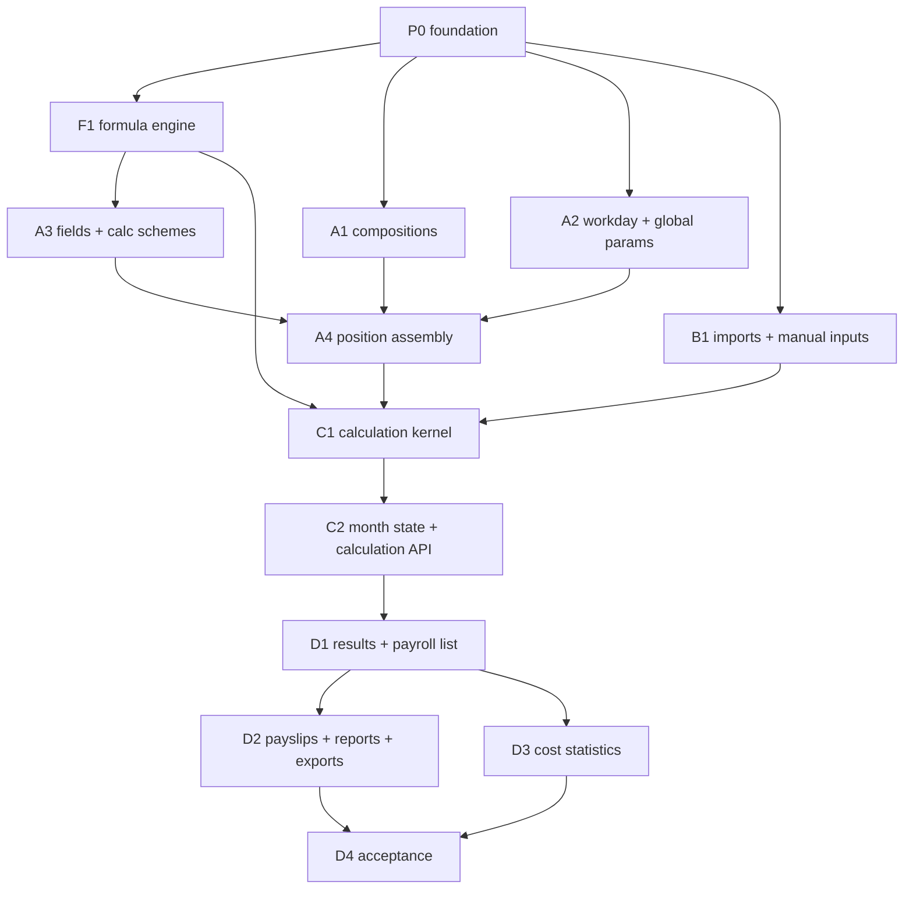

# Payroll Management Implementation Specification

- Status: Approved (2026-11-28)
- Date: 2026-11-28
- Scope: Compensation compositions, calculation schemes, workday parameters, position payroll assembly, global statutory parameters, salary field definitions, monthly input and attendance read contract, formula engine, payroll months, calculation and recalculation, results and payroll list, payslips, reports and export jobs, cost expenditure statistics and budget alerts, API contract, frontend IA, migrations, implementation order, tests, seed data, CI, acceptance, and risks
- Source decisions: [payroll domain model and configuration assembly (#46)](https://github.com/nasa-du/anysys-hr/issues/46), [formula engine and field/formula self-service (#47)](https://github.com/nasa-du/anysys-hr/issues/47), [monthly input and attendance read contract (#48)](https://github.com/nasa-du/anysys-hr/issues/48), [payroll month lifecycle and recalculation (#49)](https://github.com/nasa-du/anysys-hr/issues/49), [payslips and reports (#50)](https://github.com/nasa-du/anysys-hr/issues/50), [cost statistics and budget alerts (#51)](https://github.com/nasa-du/anysys-hr/issues/51), [frontend IA and prototype (#52)](https://github.com/nasa-du/anysys-hr/issues/52), [API contract and implementation architecture (#53)](https://github.com/nasa-du/anysys-hr/issues/53), [implementation order, tests, and acceptance (#54)](https://github.com/nasa-du/anysys-hr/issues/54), [formula engine research (#56)](https://github.com/nasa-du/anysys-hr/issues/56), [Chinese payslip PDF research (#57)](https://github.com/nasa-du/anysys-hr/issues/57), and [wayfinder map (#45)](https://github.com/nasa-du/anysys-hr/issues/45)
- Audience: implementers who should not need further product or architecture decisions before coding

---

## Table of Contents

1. [Background and Goals](#1-background-and-goals)
2. [Scope, Non-Goals, and Requirement Coverage](#2-scope-non-goals-and-requirement-coverage)
3. [Terminology and References](#3-terminology-and-references)
4. [Domain Model](#4-domain-model)
5. [Payroll Configuration](#5-payroll-configuration)
6. [Formula Engine and Self-Service Field Configuration](#6-formula-engine-and-self-service-field-configuration)
7. [Monthly Input and Attendance Read Contract](#7-monthly-input-and-attendance-read-contract)
8. [Payroll Month Lifecycle, Calculation, and Recalculation](#8-payroll-month-lifecycle-calculation-and-recalculation)
9. [Payroll Results, Payroll List, and Detail](#9-payroll-results-payroll-list-and-detail)
10. [Payslips, Reports, and Export Jobs](#10-payslips-reports-and-export-jobs)
11. [Cost Statistics and Budget Alerts](#11-cost-statistics-and-budget-alerts)
12. [API Contract](#12-api-contract)
13. [Frontend Information Architecture](#13-frontend-information-architecture)
14. [Interfaces with Basic Management and Attendance](#14-interfaces-with-basic-management-and-attendance)
15. [Implementation Architecture](#15-implementation-architecture)
16. [Migration Strategy](#16-migration-strategy)
17. [Implementation Order and Parallelism](#17-implementation-order-and-parallelism)
18. [Test Strategy](#18-test-strategy)
19. [Development Seed Data](#19-development-seed-data)
20. [CI Gates](#20-ci-gates)
21. [Acceptance Criteria and Demo Script](#21-acceptance-criteria-and-demo-script)
22. [Risks and Rollback](#22-risks-and-rollback)
23. [Future Extensions](#23-future-extensions)
24. [References](#24-references)

---

## 1. Background and Goals

Basic Management (companies, departments, positions, cost centers, employees) and Attendance Management (shifts, schedules, punches, OA applications, day results, month summaries, month closing, exports) are already implemented. Payroll is the second large module. It consumes the authoritative organization and employee records from Basic Management and the locked month summaries from Attendance, and it must never write either module's tables.

The requirement document (`docs/requirement/rx-hr-requirement.html`, modules M2–M11 and M14, plus sections 3.2–3.7, 3.9–3.10, 4, 5.2–5.3, and 6) defines a payroll model in which:

- Compensation compositions, calculation schemes, and workday/attendance parameters are independent reusable building blocks.
- A position assembles one composition, one calculation scheme, and one workday parameter set; an employee inherits payroll configuration through the current position.
- A single global field definition governs field names, categories, order, and visibility; each calculation scheme may override formulas only.
- Business users can define custom fields and edit formulas with a guided editor, live trial calculation, and save-time validation.
- Monthly input carries only payroll-owned values; attendance-owned values are read from locked attendance months.
- Payroll months move from draft to calculated to confirmed to paid; paid months are locked and their snapshot is the only value-level history.
- Payslips, department summaries, and cost expenditure statistics are read-only projections of results; cost statistics compare gross pay with cost-center budgets and show a three-state warning.
- An implementable specification must leave no product or architecture decision to the implementer.

This specification consolidates the resolutions of tickets #46–#54, the two research tickets #56/#57, the frontend prototype #52, the ten payroll-relevant ADRs (ADR-0001–0003 and ADR-0006–0012), and the golden cases into one document. It contains no production code. The deliverables of the effort are this specification, `docs/specs/payroll-golden-cases/`, and the disposable prototype `docs/prototypes/payroll-ia/`.

### 1.1 Design Principles

1. **Configuration is company-scoped and reusable.** Compositions, calculation schemes, and workday parameters belong to one company. Global statutory parameters and field definitions are system-wide. A position is the single assembly point.
2. **One global field definition.** Field keys, Chinese labels, categories, order, and visibility are shared by every company and every calculation scheme. A scheme decides formulas, never display.
3. **Attendance is authoritative.** Payroll reads locked attendance month summaries through an in-process read-only contract. There are no cross-module foreign keys and no cross-module writes.
4. **Current state plus batch audit for monthly input.** One current input value per employee, month, and field; import batches preserve how it was written.
5. **Explicit calculation.** Imports, manual edits, and configuration changes mark months as needing recalculation; they never calculate automatically.
6. **Paid is immutable.** A paid month's results, input, and presentation are frozen in a self-contained snapshot. Correction requires unlock with a reason, unconfirm, recalculate, confirm, and pay again.
7. **Overwritten results, value-level history only at payment.** Each employee has one current result row per month; failed runs never overwrite it. Only the paid snapshot preserves per-employee values over time.
8. **Server-side rendering for documents.** Payslips are rendered with WeasyPrint from a vendored static Chinese TrueType font; batch exports are asynchronous jobs with a dedicated worker and a shared volume.
9. **Single company context.** Every report is scoped to one company; no cross-company consolidation is provided.
10. **Simple permissions in V1.** Every logged-in user has full payroll access through the `payroll_access` dependency alias; RBAC replaces only that alias in a later effort.

### 1.2 Time, Number, and Language Conventions

- Business dates and month boundaries use `Asia/Shanghai`.
- Payroll months are stored as the first day of the month and serialized as `YYYY-MM`.
- Money is `NUMERIC(14,2)` in configuration and `NUMERIC(18,4)` in result values and inputs; API serialization always uses decimal strings.
- Money displays two decimals; days one decimal; hours two decimals.
- All formula arithmetic uses `Decimal`, never binary floating point.
- The UI is Simplified Chinese only (ADR-0002). Code identifiers, field keys, enum values, and API paths are ASCII.
- Primary keys are UUID v7 generated in Python (ADR-0001). Business codes follow ADR-0003.

---

## 2. Scope, Non-Goals, and Requirement Coverage

### 2.1 In Scope

| Area | Delivered capability |
|---|---|
| M2 Compensation compositions | Company-scoped identity + immutable amount versions; seven line items + `total_package`; activation/deactivation |
| M3 Calculation schemes | Company-scoped named formula overrides; no amounts or workday parameters |
| M4 Workday/attendance parameters | Company-scoped `avg_pay_days`, `work_hours`, three overtime multipliers, `min_wage` |
| M5 Position assembly | One-to-one `position_payroll_config` table; unconfigured-position blocking; employee expansion preview |
| M8 Formula engine | In-house stdlib-only tokenizer/parser/whitelisted AST/Decimal evaluator; dependencies, cycle detection, limits, trial calculation |
| M10 Fields and self-service | 32 system fields; custom `formula`/`import`/`fixed` fields; scheme formula overrides; visibility/order; revisions |
| M6 Monthly input | Company + month current-state input; CSV/TSV/XLSX/paste preview/commit batches; payroll-owned columns only |
| Attendance read | Nine values read from locked attendance month summaries; per-result attendance source snapshot; derived staleness |
| M9 Calculation and lifecycle | Draft → calculated → confirmed → paid; explicit calculation, overwrite-on-success, failed runs retained, paid snapshot, unlock with reason |
| M10 Payroll list | Dynamic columns, filters, sorting, totals, per-employee detail |
| M11 Payslips and reports | Official/preview payslips; single PDF, batch ZIP, merged PDF, payroll-detail Excel; department summary Excel; export audit |
| M14 Cost statistics | Single-month cost-center roll-up with frozen cost paths, unassigned row, three-state budget alerts, drill-down |
| API | 81 endpoints under `/api/v1/payroll`, 15 tags, `{data,count}` + `skip/limit`, error extensions |
| Frontend | Scheme A dual-area navigation, 12 leaf routes, payroll month context, generated client |
| Data | 21 tables in 4 DDL migrations, startup idempotent system defaults |
| Delivery | 13 implementation slices, tests, golden cases, C4 seed, CI gates, 18-step demo |

### 2.2 Out of Scope

The following are explicitly outside this effort. The authoritative list is the **Out of scope** section of [map #45](https://github.com/nasa-du/anysys-hr/issues/45); the most load-bearing items are:

- Accounts, roles, RBAC, department data scopes, and field-level permissions. V1 uses `payroll_access = get_current_user` and records operators for payroll audit.
- Employee self-service H5 and publish snapshots (M15).
- DingTalk/OA automatic collection; payroll only reads attendance results.
- Employee and organization Excel import (Basic Management).
- Approval flows (leave, overtime, payroll approval, budget approval).
- Historical payroll data migration and legacy Excel backfill.
- Salary payment, bank transfer files, bank payment sheets.
- Multi-currency and multi-region tax/social-insurance engines.
- Automatic overspend notifications; cost statistics only display the three-state warning.
- Payslip electronic seals, anti-forgery, watermarks, PDF/ZIP passwords, and PDF/A.
- Text/date/lookup formulas, `AND/OR/NOT`, `%`, `^`, `**`, string literals, cell references, progressive tax-bracket references, and automatic tax/social-insurance calculation.
- Attendance columns carried by the payroll file; V1 reads attendance only from locked attendance months.
- Import batch revoke/rollback; a wrong file is corrected by importing a new one.
- Per-edit manual-input history; only the last writer is retained.
- Original import file byte archive; only metadata and per-row `raw_row` are retained.
- Payroll calculation for unlocked attendance months.
- Automatic red reversal, supplemental payment, cross-month retroactive adjustment, or attendance-correction offset. V1 supports same-month unlock → unconfirm → recalculate → confirm → pay again.
- Historical archival and retention policies; V1 retains data permanently.
- Effective-dated configuration resolution; current vs historical month rules replace it.
- An explicit "use latest configuration" backdoor for historical months.
- Per-scheme display configuration; one global field definition governs all display.
- Browser print as a batch export path.
- Permanent PDF byte archive; official payslips are regenerated from the paid snapshot.
- Per-download audit for batch exports; only task-level audit and `last_downloaded_by`.
- Cost-statistics export (Excel/CSV), multi-month trends, per-capita cost, budget history/effective dates, cost allocation, and cross-company consolidation.
- Composite foreign keys or database-level same-company constraints; the service layer validates.
- Explicit display precision for custom reference fields.
- Asynchronous calculation jobs or queues; calculation is synchronous with a 60-second wall-clock limit.
- Internal HTTP between payroll and attendance.
- Per-field formula add/delete endpoints; scheme formulas are saved as an aggregate.
- Multi-instance workers, Redis, or Celery.
- System default data inside migrations; startup seed is used instead.
- `page`/`page_size` pagination; V1 uses `skip`/`limit`.

### 2.3 Requirement Coverage and Deliberate Deviations

**Coverage:**

| Requirement | Covered by | Notes |
|---|---|---|
| M2 Compensation composition | §4.2, §5.2 | Identity + immutable versions; seven line items + `total_package`; version row immutability |
| M3 Calculation scheme | §4.3, §5.3 | Formula overrides only; no amounts or parameters |
| M4 Workday/attendance parameters | §4.4, §5.4 | Company-scoped; `min_wage_note` informational |
| M5 Position assembly | §4.5, §5.5 | `position_payroll_config` 1:1; unconfigured positions block the month |
| M6 Monthly import | §7 | File carries nine payroll-owned columns + custom import fields; attendance pulled from locked months |
| M8 Formula engine | §6 | In-house Decimal engine; default formulas; trial; safety limits |
| M9 Calculation and lifecycle | §8 | Four-state month; explicit calculation; overwrite on success; paid snapshot |
| M10 Payroll list and self-service | §5.7, §6, §9 | Global fields; scheme overrides; custom fields; list and detail |
| M11 Payslips and reports | §10 | Official/preview payslips; department summary; Excel exports |
| M14 Cost architecture and spend statistics | §11 | Frozen cost paths; unassigned; budget three-state; drill-down |
| 3.2–3.7, 3.9–3.10, 4, 5.2–5.3, 6 | §4–§11, §2.3 | See deviations below |
| M12/M13/M15 | Out of scope (§2.2) | RBAC, accounts/roles, employee H5 |

**Deliberate deviations, all previously confirmed:**

| # | Requirement | V1 behavior | Decision |
|---|---|---|---|
| D1 | Monthly import "unknown employee → prompt to create a record" | Row error `unknown_employee`; payroll never creates employees | #48 |
| D2 | Import confirmation "triggers recalculation" | Commit only marks the month as needing recalculation; calculation is explicit | #48, #49 |
| D3 | Payslip "grouped by the employee's calculation scheme" | Grouped by global category; scheme determines formulas, not display | #47, #50 |
| D4 | Monthly file carries attendance columns | Attendance columns are recognized but ignored; nine values come from the locked attendance month | #48 |
| D5 | Attendance may be unlocked during payroll | Calculation requires a locked attendance month and complete summaries | #48 |
| D6 | Per-month configuration versions by effective date | No effective dating; current months use latest configuration, historical months reuse the last successful snapshot | #46, #49 |
| D7 | Per-employee history before payment | Only one current result per employee per month; paid snapshot is the only value-level history | #49 |
| D8 | "One-click recalculate" after any change | Only an explicit full-recalculation action, and only for draft/calculated months needing it | #49 |
| D9 | Result status stored on each result | Status lives only on the payroll month; results do not duplicate it | #49 |
| D10 | Bank payment sheet / transfer file | Not produced | #50 |
| D11 | PDF/Excel export of every report | Department summary is Excel-only; payroll detail is Excel-only; payslips are PDF | #50 |
| D12 | Employee H5 publish snapshot | Out of scope; "official" and "preview" are management-side payslip modes | #50 |
| D13 | RBAC and department data scope | All logged-in users have full payroll access; operator recorded; `payroll_access` alias reserved | #46, #53 |
| D14 | Cost statistics "auto notification" and trends | Three-state display and drill-down only | #51 |
| D15 | Budget as a monthly historical value | Current configuration applies to every month; page labels this | #51 |
| D16 | Parent and child budgets both consumed | Parent budget covers its subtree; child budget is reference only; never summed | #51 |
| D17 | Per-scheme field groups and visibility | One global field definition governs list, payslip, and export | #47, #50 |
| D18 | Import batch revoke | No revoke; superseding import with audit trail | #48 |
| D19 | Original uploaded file archived | Metadata and normalized rows only | #48 |
| D20 | Historical month can adopt latest configuration | No backdoor; historical months reuse their last successful snapshot | #49 |
| D21 | Automatic formula migration on default upgrade | `ON CONFLICT DO NOTHING`; existing rows are never updated automatically | #47, #53 |
| D22 | Progressive tax/social-insurance formulas | Tax and social insurance remain imported; example formulas only in help/golden cases | #47 |
| D23 | Page/page_size pagination | `skip`/`limit`; payroll list default 50, maximum 200 | #53 |
| D24 | Composite database constraints for same-company integrity | Service-layer validation with simple foreign keys | #53 |
| D25 | Async calculation | Synchronous calculation with a 60-second wall-clock deadline | #53 |
| D26 | Internal HTTP attendance read | Same-process read-only contract | #53 |
| D27 | Multi-instance export worker | One worker, database polling, no Redis/Celery | #50, #53 |
| D28 | System defaults in migrations | Startup idempotent seed; migrations insert no data | #53 |
| D29 | Field-level formula endpoints | Aggregate `PUT` for scheme formulas | #53 |
| D30 | Export PDF/ZIP encryption and PDF/A | Login-gated download, `no-store`, no passwords, no PDF/A | #50 |

---

## 3. Terminology and References

### 3.1 Canonical Terms

The canonical glossary is [`GLOSSARY.md`](../../GLOSSARY.md), section 薪资管理. The following terms are load-bearing in this specification:

| Term | Meaning |
|---|---|
| 薪资构成 (Compensation Composition) | Company-scoped reusable package of standard amounts: stable identity + immutable versions |
| 薪资构成版本 (Composition Version) | One frozen set of seven standard amounts; old versions remain traceable |
| 计算方案 (Calculation Scheme) | Company-scoped named container of field formula overrides; no amounts, no workday parameters |
| 工作日/考勤参数 (Workday Parameter) | Company-scoped `avg_pay_days`, `work_hours`, three overtime multipliers, `min_wage` |
| 岗位薪资装配 (Position Payroll Assignment) | One-to-one binding of a position to composition, scheme, and workday parameter |
| 未装配 (Unconfigured) | A position without an assembly; its employees block calculation |
| 薪资字段定义 (Salary Field Definition) | System-wide field metadata: key, Chinese label, category, calculation mode, source, order, visibility |
| 方案级公式覆盖 (Scheme Formula Override) | A scheme's replacement for a field's default formula |
| 全局法定参数 (Global Statutory Parameter) | System-wide numeric or JSON parameters such as tax threshold, tax rate, social rate, subsidy tiers |
| 配置修订 (Configuration Revision) | Append-only aggregate snapshot for non-composition configuration changes |
| 薪资月 (Payroll Month) | The company + month state carrier: draft, calculated, confirmed, paid |
| 当前薪资月 (Current Payroll Month) | Current or future calendar month that has never been paid; recalculates with latest configuration |
| 历史薪资月 (Historical Payroll Month) | A month before the current calendar month, or any month that has ever been paid; recalculates with the last successful snapshot |
| 薪资核算批次 (Payroll Calculation Run) | One calculation attempt with config snapshot, input snapshot, attendance source, summary, and status |
| 当前核算批次 (Current Calculation Run) | The most recent successful run; failed runs do not change current results |
| 薪资结果 (Payroll Result) | One row per employee per month with field values and attribution snapshots |
| 配置快照 (Configuration Snapshot) | Resolved configuration frozen at calculation start |
| 输入快照 (Input Snapshot) | Frozen monthly input values, sources, and source batch identifiers |
| 考勤来源快照 (Attendance Source Snapshot) | Nine attendance values plus attendance month/run/version identifiers |
| 考勤来源过期 (Attendance Source Stale) | The last successful run's attendance source no longer matches the current locked attendance month |
| 范围过期 (Scope Stale) | The current payroll scope differs from the last successful run's employee set |
| 薪资月度输入 (Payroll Month Input) | Current state of payroll-owned values per company, month, employee, field |
| 薪资自有列 (Payroll-owned Input Column) | A monthly-input column owned by payroll (allowances, bonuses, administrative deduction, social insurance, tax, advances), as opposed to attendance-owned values |
| 薪资导入批次 (Payroll Import Batch) | One preview/commit record of a company + month file import |
| 手工录入 (Manual Payroll Input) | Direct per-employee entry of an importable field; no import batch |
| 输入版本 (Input Version) | Integer incremented on every successful import commit or manual write |
| 历史归属快照 (Attribution Snapshot) | Frozen department, position, and cost-center ids/codes/names on a result |
| 冻结部门路径 (Frozen Department Path) | Root-to-leaf department path frozen at calculation |
| 冻结成本中心路径 (Frozen Cost Center Path) | Root-to-leaf cost-center path frozen at calculation |
| 薪资月快照 (Payroll Month Snapshot) | Self-contained paid snapshot appended on every payment |
| 默认公式 (Default Formula) | A field definition's global formula |
| 生效公式 (Effective Formula) | Scheme override if present, otherwise the default formula |
| 公式引擎版本 (Formula Engine Version) | Semantic version of the engine; semantic changes require a bump and golden-case update |
| 试算 (Trial Calculation) | Running formulas without writing results |
| 待重算 (Needs Recalculation) | Derived state after input, attendance, scope, or current-month configuration change |
| 全量重算 (Batch Recalculation) | Explicit company-level recalculation of all draft/calculated months needing it |
| 一致性校验 (Consistency Check) | Five category-anchored strong checks that fail the whole run on violation |
| 薪资字段类别 (Salary Field Category) | `earning`, `addon`, `deduction`, `total`, `reference` |
| 工资列表 (Payroll List) | Monthly table of result values with global field order and visibility |
| 工资条 (Payslip) | Read-only per-employee document; official from the latest paid snapshot, preview from the current successful run |
| 正式工资条 (Issued Payslip) | Payslip from the latest paid snapshot; immutable after issue |
| 预览工资条 (Preview Payslip) | Payslip from the current successful run of a calculated/confirmed month |
| 部门薪资汇总 (Department Payroll Summary) | Monthly report by frozen department path with inclusive roll-up |
| 成本支出统计 (Cost Expenditure Statistics) | Monthly report by frozen cost-center path with budgets and three-state alerts |
| 预算执行率 (Budget Utilization Rate) | Inclusive gross pay divided by the row's own budget; undefined when budget is zero |
| 成本预警三态 (Cost Budget Status) | Normal, near warning, over budget; zero budget is "not budgeted" |
| 工资明细导出 (Payroll Detail Export) | Flat one-row-per-employee Excel export |
| 导出任务 (Payroll Export Job) | Asynchronous batch export record with source, filter, progress, artifact, TTL |
| 导出审计 (Payroll Export Audit) | One row per export request/job with operator, scope, source, outcome; no amounts |

### 3.2 Architecture Decision Records

| ADR | Title | Relevance |
|---|---|---|
| [ADR-0001](../adr/0001-uuid-v7-primary-keys.md) | UUID v7 primary keys | All 21 payroll tables |
| [ADR-0002](../adr/0002-chinese-only-no-i18n.md) | Simplified Chinese only, no i18n | UI and messages |
| [ADR-0003](../adr/0003-uuid-v7-with-business-codes.md) | UUID v7 with business codes | Company-scoped codes |
| [ADR-0006](../adr/0006-payroll-config-snapshots-and-explicit-refresh.md) | Payroll configuration snapshots and explicit refresh | Config snapshot, composition versions, revisions; partially superseded by ADR-0009 |
| [ADR-0007](../adr/0007-payroll-formula-semantics.md) | Payroll formula semantics and rounding | Engine, rounding, consistency checks, engine version |
| [ADR-0008](../adr/0008-payroll-monthly-input-and-attendance-read-contract.md) | Payroll monthly input and attendance read contract | Current-state input, import batches, locked attendance |
| [ADR-0009](../adr/0009-payroll-month-lifecycle.md) | Payroll month lifecycle, overwritten results, and historical configuration | State machine, current/historical config, paid snapshot |
| [ADR-0010](../adr/0010-payroll-payslips-reports-and-export-jobs.md) | Payslips, department summaries, and export jobs | Official/preview, frozen paths, WeasyPrint, worker |
| [ADR-0011](../adr/0011-payroll-cost-statistics-and-budget-alerts.md) | Cost statistics and budget alerts | Cost path, inclusive budgets, three-state |
| [ADR-0012](../adr/0012-payroll-api-and-integration-architecture.md) | API and integration architecture | Routes, error model, migrations, worker, in-memory pivots |

ADR-0006's rule that recalculation defaults to the stored configuration snapshot is **partially superseded by ADR-0009**: current months resolve latest configuration; historical months reuse the last successful run's snapshot. The snapshot remains the audit and paid-reproduction record.

### 3.3 Requirement, Prototype, and Fixture References

- Requirement: [`docs/requirement/rx-hr-requirement.html`](../requirement/rx-hr-requirement.html), modules M2–M11 and M14; sections 3.2–3.7, 3.9–3.10, 4, 5.2–5.3, 6.
- Requirement prototype: [`docs/requirement/rx-hr-prototype.html`](../requirement/rx-hr-prototype.html) is reference only; the payroll IA does not copy its single-page stacking.
- Frontend prototype: [`docs/prototypes/payroll-ia/index.html`](../prototypes/payroll-ia/index.html) and [README](../prototypes/payroll-ia/README.md); merged via PR #59.
- Formula golden cases: [`docs/specs/payroll-golden-cases/`](payroll-golden-cases/README.md), JSON Schema `schema.json`, security corpus `security-corpus.json`, base data `base/`, 17 cases in `cases/`.
- Import template: [`docs/specs/payroll-import-template.csv`](payroll-import-template.csv).
- Formula engine research: [`docs/research/payroll-formula-engine.md`](../research/payroll-formula-engine.md).
- Chinese payslip PDF research: [`docs/research/payroll-pdf-export.md`](../research/payroll-pdf-export.md).
- Attendance specification: [`docs/specs/attendance-management.md`](attendance-management.md), especially 7.13 (export and payroll read contract) and 7.12 (locked snapshots).
- Basic Management specification: [`docs/specs/basic-management.md`](basic-management.md), especially 4.5 (cost center `budget`/`warn_pct`) and 4.6 (employee lifecycle).

### 3.4 Decision Provenance

| Ticket | Decision | Spec chapters |
|---|---|---|
| #46 | Payroll domain model and configuration assembly | §4, §5 |
| #56 | Formula engine technology research | §6.1 |
| #47 | Formula engine semantics and self-service fields | §6 |
| #48 | Monthly input and attendance read contract | §7 |
| #49 | Payroll month lifecycle and recalculation | §8, §9 |
| #57 | Chinese payslip PDF and batch export research | §10.6 |
| #50 | Payslips and reports | §10 |
| #51 | Cost statistics and budget alerts | §11 |
| #52 | Frontend IA and prototype | §13 |
| #53 | API contract and implementation architecture | §12, §15, §16 |
| #54 | Implementation order, tests, and acceptance | §17–§22 |

---

## 4. Domain Model

### 4.1 Entity Overview

Payroll adds 21 tables in four groups. All primary keys are UUID v7 generated in Python. Enum columns are `VARCHAR + CHECK`; no PostgreSQL native enums. Timestamps are `TIMESTAMPTZ` maintained by the service layer. Models are table-only SQLModel classes with no `Relationship`; services assemble queries explicitly.

```text
payroll_config
  salary_field_def 1─N calc_scheme_formula
  salary_field_def 1─N payroll_result_value
  salary_field_def 1─N payroll_input_value
  company 1─N compensation_composition 1─N compensation_composition_version
  company 1─N calc_scheme 1─N calc_scheme_formula
  company 1─N workday_param
  position 1─0..1 position_payroll_config N─1 compensation_composition / calc_scheme / workday_param
  payroll_global_param (system-wide)
  payroll_config_revision (polymorphic, no FK)

payroll_months
  company 1─N payroll_month 1─N payroll_calc_run 1─N payroll_result 1─N payroll_result_value
  payroll_month 1─N payroll_month_snapshot
  payroll_month 1─N payroll_month_event

payroll_inputs
  payroll_month 1─N payroll_month_input 1─N payroll_input_value
  company 1─N payroll_import_batch 1─N payroll_import_batch_row
  company 1─1 payroll_import_mapping_template

payroll_exports
  company 1─N payroll_export
```

Relationship notes:

- `payroll_result` references `calc_run`, `company`, `employee`, and `calc_scheme` with foreign keys; department, position, and cost-center identifiers are stored as UUID values **without** foreign keys, together with code/name/path snapshots.
- `payroll_calc_run` stores attendance month, snapshot, run, and version identifiers as values without cross-module foreign keys.
- `payroll_config_revision.entity_id` is polymorphic and has no foreign key.
- No payroll table has a foreign key to any attendance table, and no attendance table references payroll.

### 4.2 `compensation_composition`

| Column | Type | Constraints |
|---|---|---|
| `id` | UUID | PK |
| `company_id` | UUID | FK `company.id` RESTRICT, NOT NULL |
| `comp_code` | VARCHAR(32) | NOT NULL, immutable, `UNIQUE(company_id, comp_code)`, `^[A-Z0-9_-]{1,32}$` |
| `comp_name` | VARCHAR(100) | NOT NULL |
| `is_active` | BOOLEAN | NOT NULL, default true |
| `note` | VARCHAR(500) | NULL |
| `created_at` / `updated_at` | TIMESTAMPTZ | NOT NULL |

Rules:

- Positions reference the composition identity, never a version. The current version is `MAX(version_no)` at calculation time.
- `comp_name`, `is_active`, and `note` changes append a `payroll_config_revision` row with `entity_type = compensation_composition`; they do not create amount versions.
- A composition referenced by any `position_payroll_config` cannot be deactivated. Compositions are never hard-deleted.
- Creating a composition atomically creates version 1; a composition with zero versions must not exist.

### 4.3 `compensation_composition_version`

| Column | Type | Constraints |
|---|---|---|
| `id` | UUID | PK |
| `comp_id` | UUID | FK `compensation_composition.id` RESTRICT, NOT NULL |
| `version_no` | INTEGER | NOT NULL, ≥ 1, `UNIQUE(comp_id, version_no)` |
| `base_salary` | NUMERIC(14,2) | NOT NULL, ≥ 0, default 0 |
| `hightemp_subsidy` | NUMERIC(14,2) | NOT NULL, ≥ 0, default 0 |
| `performance_salary` | NUMERIC(14,2) | NOT NULL, ≥ 0, default 0 |
| `overtime_pay` | NUMERIC(14,2) | NOT NULL, ≥ 0, default 0 |
| `confidentiality_allowance` | NUMERIC(14,2) | NOT NULL, ≥ 0, default 0 |
| `social_subsidy` | NUMERIC(14,2) | NOT NULL, ≥ 0, default 0 |
| `noncompete_subsidy` | NUMERIC(14,2) | NOT NULL, ≥ 0, default 0 |
| `total_package` | NUMERIC(14,2) | NOT NULL, `CHECK (total_package = sum of the seven line items)` |
| `change_note` | VARCHAR(500) | NULL |
| `created_by` | UUID | NULL, FK `user.id` RESTRICT |
| `created_by_name` | VARCHAR(100) | NULL, operator name snapshot |
| `created_at` | TIMESTAMPTZ | NOT NULL |

Rules:

- Version rows are immutable. Changing any line item inserts `version_no + 1`; old versions are retained permanently.
- The server computes `total_package` from the seven line items. A client-supplied total is only a cross-check and is never trusted; the database `CHECK` is the backstop.
- The performance amount may be entered as "total minus the other six" in the UI, but the stored row must contain all seven line items and a consistent total.
- Confidentiality and high-temperature amounts come from the composition, not from the global tier JSON. Tiers are prefill/reference values only. `employee.confidentiality_level` is profile-only and does not change amounts.

### 4.4 `calc_scheme`

| Column | Type | Constraints |
|---|---|---|
| `id` | UUID | PK |
| `company_id` | UUID | FK `company.id` RESTRICT, NOT NULL |
| `calc_code` | VARCHAR(32) | NOT NULL, immutable, `UNIQUE(company_id, calc_code)` |
| `calc_name` | VARCHAR(100) | NOT NULL |
| `is_active` | BOOLEAN | NOT NULL, default true |
| `note` | VARCHAR(500) | NULL |
| `created_at` / `updated_at` | TIMESTAMPTZ | NOT NULL |

Rules:

- A scheme is a named container of formula overrides only. It contains no amounts and no workday parameters.
- A scheme referenced by any position assembly cannot be deactivated.
- Saving a scheme appends an aggregate revision containing the scheme and all formula overrides.

### 4.5 `calc_scheme_formula`

| Column | Type | Constraints |
|---|---|---|
| `id` | UUID | PK |
| `calc_scheme_id` | UUID | FK `calc_scheme.id` CASCADE, NOT NULL |
| `field_def_id` | UUID | FK `salary_field_def.id` RESTRICT, NOT NULL |
| `formula_expr` | TEXT | NOT NULL |
| `note` | VARCHAR(500) | NULL |
| `created_at` / `updated_at` | TIMESTAMPTZ | NOT NULL |

Rules:

- `UNIQUE(calc_scheme_id, field_def_id)`; a scheme has at most one override per field.
- Only `calc_mode = formula` fields may be overridden.
- Effective formula = override if present, otherwise `salary_field_def.default_formula`.

### 4.6 `workday_param`

| Column | Type | Constraints |
|---|---|---|
| `id` | UUID | PK |
| `company_id` | UUID | FK `company.id` RESTRICT, NOT NULL |
| `workday_code` | VARCHAR(32) | NOT NULL, immutable, `UNIQUE(company_id, workday_code)` |
| `workday_name` | VARCHAR(100) | NOT NULL |
| `avg_pay_days` | NUMERIC(5,2) | NOT NULL, > 0, default 21.75 |
| `work_hours` | NUMERIC(4,2) | NOT NULL, > 0 |
| `ot_mult_weekday` | NUMERIC(4,2) | NOT NULL, ≥ 1, default 1.5 |
| `ot_mult_weekend` | NUMERIC(4,2) | NOT NULL, ≥ 1, default 2.0 |
| `ot_mult_holiday` | NUMERIC(4,2) | NOT NULL, ≥ 1, default 3.0 |
| `min_wage` | NUMERIC(14,2) | NOT NULL, ≥ 0 |
| `min_wage_note` | VARCHAR(500) | NULL; region/effective-date note only |
| `is_active` | BOOLEAN | NOT NULL, default true |
| `note` | VARCHAR(500) | NULL |
| `created_at` / `updated_at` | TIMESTAMPTZ | NOT NULL |

Rules:

- Company-scoped and reusable; referenced by position assemblies. Referenced parameters cannot be deactivated.
- In-place edits append a revision. V1 does not resolve versions by effective date; `min_wage_note` is informational.
- Attendance rules own punch windows, grace periods, overtime thresholds, and deduction prices; attendance month summaries own days and hours. Payroll owns pricing only. The two modules share no table or foreign key.
- `employee.daily_hours` and `employee.monthly_rest` are profile-only and are not read by payroll; `work_hours` comes only from the assembled workday parameter.

### 4.7 `position_payroll_config`

| Column | Type | Constraints |
|---|---|---|
| `id` | UUID | PK |
| `position_id` | UUID | FK `position.id` CASCADE, NOT NULL, `UNIQUE(position_id)` |
| `comp_id` | UUID | FK `compensation_composition.id` RESTRICT, NOT NULL |
| `calc_scheme_id` | UUID | FK `calc_scheme.id` RESTRICT, NOT NULL |
| `workday_param_id` | UUID | FK `workday_param.id` RESTRICT, NOT NULL |
| `note` | VARCHAR(500) | NULL |
| `created_at` / `updated_at` | TIMESTAMPTZ | NOT NULL |

Rules:

- All three references are required; no row means the position is unconfigured.
- The three referenced configurations must belong to the same company as the position. The service layer validates; simple foreign keys are used (no composite keys).
- No effective dates. In-place edits append an aggregate revision recording the three references.
- Reassignment affects only later calculations. Existing results are unchanged; historical-month recalculation uses the last successful snapshot.
- Position deactivation follows Basic Management rules; the assembly is retained for resigned employees. Deleting a position cascades the assembly.
- Missing assembly or a reference to an inactive configuration blocks the whole month and lists affected employees; the calculation never silently skips them.
- `DELETE /position-configs/{position_id}` removes the assembly; history is unaffected.

### 4.8 `payroll_global_param`

| Column | Type | Constraints |
|---|---|---|
| `id` | UUID | PK |
| `key` | VARCHAR(64) | NOT NULL, `UNIQUE`, immutable |
| `label` | VARCHAR(100) | NOT NULL |
| `category` | VARCHAR(32) | NOT NULL, e.g. `tax`, `social`, `subsidy` |
| `value_type` | VARCHAR(16) | NOT NULL, `number` / `json` |
| `numeric_value` | NUMERIC(18,6) | NULL |
| `json_value` | JSONB | NULL |
| `display_order` | INTEGER | NOT NULL, default 0 |
| `is_active` | BOOLEAN | NOT NULL, default true |
| `note` | VARCHAR(500) | NULL |
| `created_at` / `updated_at` | TIMESTAMPTZ | NOT NULL |

Constraints:

- `CHECK`: when `value_type = number`, `numeric_value IS NOT NULL AND json_value IS NULL`; when `json`, the reverse.
- System-wide; no `company_id`. Multi-region tax/social engines are out of scope.
- Every key change appends a `payroll_config_revision`. Calculation freezes the parameters into `config_snapshot.global_params`.
- Only `number` parameters are exposed to formulas as `{param}`. JSON tiers and progressive tables are UI reference/default values; V1 formulas cannot reference them.

Initial keys:

| Key | Type | Initial value |
|---|---|---|
| `tax_threshold` | number | 5000 |
| `tax_rate` | number | 0.03 |
| `social_rate` | number | 0.23338 |
| `confidentiality_tier` | json | Five tiers: `[{level, label, amount}]` with amounts 5000/2000/1000/500/240 |
| `hightemp_tier` | json | Three tiers: `[{key:"outdoor", label, amount:300}, {key:"indoor", label, amount:150}, {key:"none", label, amount:0}]` |
| `tax_brackets` | json | Reserved reference value; not usable in formulas |

### 4.9 `salary_field_def`

| Column | Type | Constraints |
|---|---|---|
| `id` | UUID | PK |
| `field_key` | VARCHAR(64) | NOT NULL, `UNIQUE`, immutable, `^[a-z][a-z0-9_]{0,63}$` |
| `label` | VARCHAR(100) | NOT NULL, globally unique including inactive fields |
| `category` | VARCHAR(16) | NOT NULL, `earning` / `addon` / `deduction` / `total` / `reference` |
| `calc_mode` | VARCHAR(16) | NOT NULL, `plan` / `import` / `formula` / `fixed` |
| `source_key` | VARCHAR(64) | NULL; composition column for `plan`, input column key for `import`; partial unique when non-null |
| `fixed_value` | NUMERIC(18,4) | NULL; required for `fixed` |
| `default_formula` | TEXT | NULL; global default for `formula` |
| `display_order` | INTEGER | NOT NULL, default 0 |
| `visible` | BOOLEAN | NOT NULL, default true |
| `is_system` | BOOLEAN | NOT NULL, default false |
| `is_active` | BOOLEAN | NOT NULL, default true |
| `note` | VARCHAR(500) | NULL |
| `created_at` / `updated_at` | TIMESTAMPTZ | NOT NULL |

Rules:

- `calc_mode` and source constraints:
  - `plan`: `source_key` must be one of `base_salary`, `hightemp_subsidy`, `performance_salary`, `overtime_pay`, `confidentiality_allowance`, `social_subsidy`, `noncompete_subsidy`, `total_package`; only system fields may use `plan`.
  - `import`: `source_key` must be in one of two registries — the payroll monthly-input registry (`phone_allowance`, `car_allowance`, `other_addon`, `production_bonus`, `commission`, `admin_deduct`, `social_this`, `tax`, `paid_advance`, plus custom import keys) or the attendance summary registry (`weekday_full`, `weekend_full`, `weekday_attended`, `weekend_attended`, `paid_leave_days`, `ot_weekday_hours`, `ot_weekend_hours`, `ot_holiday_hours`, `attendance_deduct`). System attendance-owned fields use the attendance registry; all other system import fields use the payroll registry. A custom import field uses its own `field_key` as `source_key` (validated for uniqueness), and its Chinese label is the file column header.
  - `formula`: `default_formula` may be empty only if every scheme that uses the field provides an override; saving/calculation then fails with `formula_invalid`.
  - `fixed`: `fixed_value` is required.
- `input_source` is derived from `calc_mode + source_key`; no separate column.
- Custom fields (`is_system = false`) may only be `formula`, `import`, or `fixed`.
- Field definitions are system-wide shared: a custom field created in one company appears in the global payroll field list for every company. Company isolation applies only to compositions, calculation schemes, and workday parameters.
- `field_key` is immutable. `label`, `display_order`, `visible`, and `note` are editable and append a revision.
- System fields cannot be deactivated; they can only be hidden with `visible = false`. Custom fields can be soft-deactivated and reactivated.
- A field referenced by any enabled scheme's effective formula cannot be deactivated. Deactivation never deletes historical result values.
- A field with result values or formula references is never hard-deleted.
- `visible = false` affects list/payslip/report display only; it does not affect calculation, formula references, or import. `display_order` is the single global order; category only groups.

### 4.10 `payroll_month`

| Column | Type | Constraints |
|---|---|---|
| `id` | UUID | PK |
| `company_id` | UUID | FK `company.id` RESTRICT, NOT NULL |
| `month` | DATE | NOT NULL, first day of month, `CHECK (EXTRACT(DAY FROM month) = 1)`, `UNIQUE(company_id, month)` |
| `status` | VARCHAR(16) | NOT NULL, `draft` / `calculated` / `confirmed` / `paid`, default `draft` |
| `input_version` | INTEGER | NOT NULL, default 0, ≥ 0 |
| `config_stale` | BOOLEAN | NOT NULL, default false |
| `config_stale_detail` | JSONB | NULL; changed entity type/id and marked time |
| `calculated_at` | TIMESTAMPTZ | NULL |
| `confirmed_at` | TIMESTAMPTZ | NULL |
| `paid_at` | TIMESTAMPTZ | NULL |
| `unlock_reason` | VARCHAR(500) | NULL; latest unlock reason for list display |
| `created_at` / `updated_at` | TIMESTAMPTZ | NOT NULL |

Rules:

- The month is created lazily by the first committed import, manual input, or calculation attempt. A failed calculation on a non-existent month leaves a draft month plus a failed run.
- `config_stale` is stored and set only for current months that already have a successful run (calculated/confirmed); draft months without a successful run do not need it, historical months never get it, and paid months are never marked.
- All derived staleness (`input_stale`, attendance status, `scope_stale`, `needs_recalc`) is computed on read; none of it is stored except `config_stale`.

### 4.11 `payroll_calc_run`

| Column | Type | Constraints |
|---|---|---|
| `id` | UUID | PK |
| `payroll_month_id` | UUID | FK `payroll_month.id` CASCADE, NOT NULL |
| `trigger` | VARCHAR(24) | NOT NULL, `initial` / `manual` / `attendance_refresh` |
| `status` | VARCHAR(16) | NOT NULL, `running` / `succeeded` / `failed` |
| `config_snapshot_version` | INTEGER | NOT NULL |
| `config_snapshot` | JSONB | NOT NULL |
| `input_version` | INTEGER | NOT NULL; the month's input version at run start |
| `input_snapshot` | JSONB | NOT NULL; `{input_version, employee_ids, values: {employee_id: {field_key: {value, source, source_batch_id}}}}` |
| `attendance_month_id` | UUID | NULL, no FK |
| `attendance_snapshot_id` | UUID | NULL, no FK |
| `attendance_snapshot_version` | INTEGER | NULL |
| `attendance_calc_run_id` | UUID | NULL, no FK |
| `calc_version` | VARCHAR(32) | NULL |
| `rules_version` | VARCHAR(64) | NULL |
| `attendance_locked_at` | TIMESTAMPTZ | NULL |
| `summary` | JSONB | NULL |
| `error_code` | VARCHAR(50) | NULL |
| `error_message` | VARCHAR(500) | NULL |
| `triggered_by` | UUID | NULL, FK `user.id` RESTRICT |
| `triggered_by_name` | VARCHAR(100) | NULL |
| `started_at` | TIMESTAMPTZ | NOT NULL |
| `finished_at` | TIMESTAMPTZ | NULL |

Rules:

- Every attempt creates a row, including failures. Failed runs retain the resolved snapshots and error details but write no results.
- `config_snapshot` is frozen at calculation start and contains at least: `schema_version`, `engine_version`, `config_revision_vector`, `global_params`, `field_defs`, `schemes` (overrides and effective formulas plus `formula_hash`), and `positions` (assembly, composition identity/version/amounts, scheme, workday parameters). The `config_revision_vector` records the revision/version numbers actually resolved for every configuration entity (global params, field defs, schemes, assemblies, composition versions); it is used to detect configuration changes that race a calculation.
- Numeric values in snapshots are decimal strings to avoid floating-point loss.
- `summary` contains employee count, result count, totals for `normal_pay`, `addon_sum`, `gross`, `deduct_sum`, `net`, negative-net count, warning counts, and elapsed time. For failed runs it also persists the capped `violations` list (up to 100, with total count) and capped `formula_errors` (with total count), so the failed-run detail remains available after the HTTP error response.
- `GET /calc-runs/{calc_run_id}` returns the persisted `summary` including those `violations`/`formula_errors`; the UI does not depend on the transient `ErrorDetail` from the failed calculate request.
- `input_snapshot` preserves the input version, scope employee ids, and per-employee importable values with source and source batch id; missing values are treated as zero.
- The run-level attendance identifiers are one set for the whole month; each result additionally freezes its own nine values.

### 4.12 `payroll_result`

| Column | Type | Constraints |
|---|---|---|
| `id` | UUID | PK |
| `payroll_month_id` | UUID | FK `payroll_month.id` CASCADE, NOT NULL |
| `calc_run_id` | UUID | FK `payroll_calc_run.id` CASCADE, NOT NULL; the run that produced the current row |
| `company_id` | UUID | FK `company.id` RESTRICT, NOT NULL |
| `employee_id` | UUID | FK `employee.id` RESTRICT, NOT NULL |
| `position_id` | UUID | NOT NULL, no FK |
| `dept_id` | UUID | NOT NULL, no FK |
| `cost_org_id` | UUID | NULL, no FK; NULL = unassigned |
| `calc_scheme_id` | UUID | FK `calc_scheme.id` RESTRICT, NOT NULL |
| `position_code` / `position_name` | VARCHAR(32) / VARCHAR(100) | NOT NULL, snapshot |
| `dept_code` / `dept_name` | VARCHAR(32) / VARCHAR(100) | NOT NULL, snapshot |
| `cost_org_code` / `cost_org_name` | VARCHAR(32) / VARCHAR(100) | NULL, snapshot |
| `dept_path` | JSONB | NOT NULL; root-to-leaf `[{id, code, name}]` |
| `cost_org_path` | JSONB | NOT NULL; root-to-leaf `[{id, code, name}]`; empty array = unassigned |
| `attendance_source` | JSONB | NOT NULL; see 7.7 |
| `created_at` / `updated_at` | TIMESTAMPTZ | NOT NULL |

Rules:

- `UNIQUE(payroll_month_id, employee_id)`: exactly one current result per employee per month.
- Indexes: `(payroll_month_id, dept_id)`, `(payroll_month_id, position_id)`, `(payroll_month_id, cost_org_id)`, `(payroll_month_id, cost_org_code)`, `(company_id, dept_code)`, `(company_id, cost_org_code)`, GIN on `dept_path`, GIN on `cost_org_path`.
- A successful recalculation upserts in-scope employees, deletes results for employees no longer in scope, and updates `calc_run_id`. A failed run touches no rows.
- Department, position, and cost-center identifiers have no foreign keys. Their code/name/path snapshots preserve history; organization deletion never rewrites or blocks payroll history.
- Company and employee use foreign keys because they are never physically deleted while payroll data exists.
- Results do not store a status; status lives on `payroll_month`.

### 4.13 `payroll_result_value`

| Column | Type | Constraints |
|---|---|---|
| `id` | UUID | PK |
| `result_id` | UUID | FK `payroll_result.id` CASCADE, NOT NULL |
| `field_def_id` | UUID | FK `salary_field_def.id` RESTRICT, NOT NULL |
| `value` | NUMERIC(18,4) | NOT NULL |
| `source` | VARCHAR(16) | NOT NULL, `plan` / `import` / `formula` / `fixed` / `manual` |
| `produced_by_run_id` | UUID | FK `payroll_calc_run.id` RESTRICT, NOT NULL |
| `created_at` / `updated_at` | TIMESTAMPTZ | NOT NULL |

Rules:

- `UNIQUE(result_id, field_def_id)`.
- Active fields are written on every successful calculation and update `produced_by_run_id`. Values of deactivated fields are retained with their original producer.
- Salary-owned `import` fields record `import` or `manual` according to the input provenance; attendance-owned fields record `import`.
- Hidden fields still store values. Custom fields are ordinary rows; list/export ordering comes from the field definition.

### 4.14 `payroll_month_snapshot`

| Column | Type | Constraints |
|---|---|---|
| `id` | UUID | PK |
| `payroll_month_id` | UUID | FK `payroll_month.id` CASCADE, NOT NULL |
| `calc_run_id` | UUID | FK `payroll_calc_run.id` RESTRICT, NOT NULL |
| `version` | INTEGER | NOT NULL, ≥ 1, `UNIQUE(payroll_month_id, version)` |
| `paid_at` | TIMESTAMPTZ | NOT NULL |
| `paid_by` | UUID | NOT NULL, FK `user.id` RESTRICT |
| `paid_by_name` | VARCHAR(100) | NOT NULL |
| `payload` | JSONB | NOT NULL, self-contained |

Rules:

- Every payment appends a version; unlocking does not delete it; paying again appends a new version.
- `payload` contains at least: `schema_version`, a copy of `config_snapshot`, a copy of `input_snapshot`, the month-level attendance source identifiers, and for each employee: `result_id` (so the paid-month payroll list can populate its row id), `employee_id`, `employee_no`, employee name snapshot, company name snapshot, attribution snapshot (including `dept_path` and `cost_org_path`), the nine attendance values, per-field `{label, category, display_order, visible, value, source, produced_by_run_id}`, the five totals (`normal_pay`, `addon_sum`, `gross`, `deduct_sum`, `net`), headcount, and total amounts.
- Employee name in the paid snapshot is document data, not a copied employee profile.
- The newest snapshot is the official payslip source; list/payslip presentation for a paid month uses it.

### 4.15 `payroll_month_event`

Append-only audit of month state actions:

| Column | Type | Constraints |
|---|---|---|
| `id` | UUID | PK |
| `payroll_month_id` | UUID | FK `payroll_month.id` CASCADE, NOT NULL |
| `event` | VARCHAR(16) | NOT NULL, `confirmed` / `unconfirmed` / `paid` / `unlocked` |
| `from_status` | VARCHAR(16) | NOT NULL, previous status |
| `to_status` | VARCHAR(16) | NOT NULL, new status |
| `calc_run_id` | UUID | NULL, FK `payroll_calc_run.id` SET NULL |
| `snapshot_id` | UUID | NULL, FK `payroll_month_snapshot.id` SET NULL |
| `reason` | VARCHAR(500) | NULL; required for unlock |
| `operator_id` | UUID | NULL, FK `user.id` RESTRICT |
| `operator_name` | VARCHAR(100) | NULL |
| `created_at` | TIMESTAMPTZ | NOT NULL |

Calculation events are not duplicated here; `payroll_calc_run` already records them. The month's latest `unlock_reason` is kept for list display.

### 4.16 `payroll_month_input`

| Column | Type | Constraints |
|---|---|---|
| `id` | UUID | PK |
| `payroll_month_id` | UUID | FK `payroll_month.id` CASCADE, NOT NULL |
| `employee_id` | UUID | FK `employee.id` RESTRICT, NOT NULL |
| `created_at` / `updated_at` | TIMESTAMPTZ | NOT NULL |

`UNIQUE(payroll_month_id, employee_id)`. This is the current-state header for one employee in one month.

### 4.17 `payroll_input_value`

| Column | Type | Constraints |
|---|---|---|
| `id` | UUID | PK |
| `input_id` | UUID | FK `payroll_month_input.id` CASCADE, NOT NULL |
| `field_def_id` | UUID | FK `salary_field_def.id` RESTRICT, NOT NULL |
| `value` | NUMERIC(18,4) | NOT NULL, default 0 |
| `source` | VARCHAR(16) | NOT NULL, `import` / `manual` |
| `source_batch_id` | UUID | NULL, FK `payroll_import_batch.id` SET NULL |
| `updated_by` | UUID | NULL, FK `user.id` RESTRICT |
| `updated_by_name` | VARCHAR(100) | NULL |
| `updated_at` | TIMESTAMPTZ | NOT NULL |

`UNIQUE(input_id, field_def_id)`. Only importable fields are allowed: `calc_mode = import` and not attendance-owned.

### 4.18 `payroll_import_batch`

| Column | Type | Constraints |
|---|---|---|
| `id` | UUID | PK |
| `company_id` | UUID | FK `company.id` RESTRICT, NOT NULL |
| `month` | DATE | NOT NULL, first day of month |
| `status` | VARCHAR(16) | NOT NULL, `preview` / `committed` / `superseded` / `discarded` |
| `source` | VARCHAR(16) | NOT NULL, `upload` / `paste` |
| `file_name` | VARCHAR(255) | NULL for paste |
| `file_size` | INTEGER | NULL |
| `file_sha256` | VARCHAR(64) | NULL |
| `sheet_name` | VARCHAR(100) | NULL |
| `header_row_number` | INTEGER | NULL |
| `header_columns` | JSONB | NULL |
| `column_mapping` | JSONB | NULL |
| `parser_version` | VARCHAR(32) | NOT NULL |
| `source_rows` | INTEGER | NOT NULL, default 0, ≥ 0 |
| `valid_records` | INTEGER | NOT NULL, default 0, ≥ 0 |
| `error_records` | INTEGER | NOT NULL, default 0, ≥ 0 |
| `warning_records` | INTEGER | NOT NULL, default 0, ≥ 0 |
| `warning_counts` | JSONB | NULL |
| `operator_id` | UUID | NULL, FK `user.id` RESTRICT |
| `operator_name` | VARCHAR(100) | NULL |
| `created_at` | TIMESTAMPTZ | NOT NULL |
| `committed_at` / `superseded_at` / `discarded_at` | TIMESTAMPTZ | NULL |
| `expires_at` | TIMESTAMPTZ | NULL; preview TTL, 24 h |
| `superseded_by_batch_id` | UUID | NULL, FK `payroll_import_batch.id` SET NULL |
| `discard_reason` | VARCHAR(500) | NULL |
| `payroll_month_id` | UUID | NULL, FK `payroll_month.id` SET NULL; backfilled on commit |

Rules:

- Partial unique index `(company_id, month) WHERE status = 'committed'`: at most one effective committed batch per company + month.
- Status machine: `preview → committed → superseded`; `preview → discarded` by user or expiry. There is no `revoked` state.
- Preview: 24-hour TTL; discarding/expiring deletes rows and raw rows immediately; metadata is hard-deleted after 90 days.
- Committed: immutable, may be superseded by a new commit; metadata and normalized rows are permanent; `raw_row` is retained permanently.
- Superseded: terminal; metadata and normalized rows are retained permanently; superseded `raw_row` and error details are cleared after 90 days.
- Discarded: a discarded batch is always a preview that never became effective; its rows and raw rows are deleted immediately and its metadata is hard-deleted after 90 days (the preview rule). There is no permanent retention of a discarded preview.
- Index `(company_id, month, status, created_at DESC)`.

### 4.19 `payroll_import_batch_row`

| Column | Type | Constraints |
|---|---|---|
| `id` | UUID | PK |
| `batch_id` | UUID | FK `payroll_import_batch.id` CASCADE, NOT NULL |
| `source_row_number` | INTEGER | NOT NULL, ≥ 1 |
| `employee_id` | UUID | NULL, FK `employee.id` SET NULL |
| `employee_no_raw` | VARCHAR(64) | NULL |
| `values` | JSONB | NULL; normalized values by field key |
| `status` | VARCHAR(16) | NOT NULL, `valid` / `error` / `skipped` |
| `error_code` | VARCHAR(50) | NULL |
| `error_message` | VARCHAR(500) | NULL |
| `warnings` | JSONB | NULL |
| `raw_row` | JSONB | NULL |

Indexes `(batch_id, status)` and `(batch_id, source_row_number)`.

### 4.20 `payroll_import_mapping_template`

| Column | Type | Constraints |
|---|---|---|
| `id` | UUID | PK |
| `company_id` | UUID | FK `company.id` CASCADE, NOT NULL, `UNIQUE(company_id)` |
| `column_mapping` | JSONB | NOT NULL |
| `created_at` / `updated_at` | TIMESTAMPTZ | NOT NULL |

The mapping template is updated only after a successful commit and pre-fills the next import. It reuses the attendance mapping mechanism.

### 4.21 `payroll_export`

| Column | Type | Constraints |
|---|---|---|
| `id` | UUID | PK |
| `company_id` | UUID | FK `company.id` RESTRICT, NOT NULL |
| `month` | DATE | First day of month, NOT NULL |
| `export_type` | VARCHAR(32) | NOT NULL, `payslip_single` / `payslip_zip` / `payslip_merged` / `payroll_detail_xlsx` / `department_summary_xlsx` |
| `format` | VARCHAR(8) | NOT NULL, `pdf` / `zip` / `xlsx` |
| `mode` | VARCHAR(16) | `official` / `preview`; NULL for Excel exports |
| `snapshot_id` | UUID | NULL, FK `payroll_month_snapshot.id` SET NULL |
| `snapshot_version` | INTEGER | NULL |
| `calc_run_id` | UUID | NULL, FK `payroll_calc_run.id` SET NULL |
| `month_status_at_creation` | VARCHAR(16) | NULL |
| `filter` | JSONB | NULL |
| `filter_hash` | VARCHAR(64) | NULL |
| `employee_count` | INTEGER | NOT NULL, default 0, ≥ 0 |
| `status` | VARCHAR(16) | NOT NULL, `queued` / `running` / `succeeded` / `failed` / `expired` |
| `progress_done` / `progress_total` | INTEGER | NOT NULL, default 0 |
| `error_code` / `error_message` | VARCHAR(50) / VARCHAR(500) | NULL |
| `created_at` / `started_at` / `finished_at` | TIMESTAMPTZ | `created_at` NOT NULL |
| `artifact_path` | VARCHAR(500) | NULL, relative to `/app/exports` |
| `artifact_size` | BIGINT | NULL |
| `expires_at` | TIMESTAMPTZ | NULL |
| `artifact_deleted_at` | TIMESTAMPTZ | NULL |
| `operator_id` | UUID | NULL, FK `user.id` RESTRICT |
| `operator_name` | VARCHAR(100) | NULL |
| `template_version` | VARCHAR(32) | NULL |
| `download_count` | INTEGER | NOT NULL, default 0 |
| `last_downloaded_by` | UUID | NULL, FK `user.id` RESTRICT |
| `last_downloaded_by_name` | VARCHAR(100) | NULL |
| `last_downloaded_at` | TIMESTAMPTZ | NULL |

Indexes `(company_id, month, created_at DESC)`, `(status, created_at)`, `(expires_at)`. Synchronous exports write a row and immediately succeed; batch jobs start queued. Metadata is permanent; artifacts expire.

### 4.22 `payroll_config_revision`

| Column | Type | Constraints |
|---|---|---|
| `id` | UUID | PK |
| `entity_type` | VARCHAR(32) | NOT NULL, `compensation_composition` / `calc_scheme` / `workday_param` / `salary_field_def` / `payroll_global_param` / `position_payroll_config` |
| `entity_id` | UUID | NOT NULL, no FK (polymorphic) |
| `version_no` | INTEGER | NOT NULL, ≥ 1, `UNIQUE(entity_type, entity_id, version_no)` |
| `snapshot` | JSONB | NOT NULL; complete aggregate snapshot |
| `change_note` | VARCHAR(500) | NULL |
| `changed_by` | UUID | NULL, FK `user.id` RESTRICT |
| `changed_by_name` | VARCHAR(100) | NULL |
| `changed_at` | TIMESTAMPTZ | NOT NULL |

Rules:

- Aggregate snapshots: a calculation scheme includes all formula overrides; a position assembly includes all three references; a field definition includes all attributes; a global parameter includes key/value.
- Composition amount changes use version rows; composition identity metadata uses this table.
- No polymorphic foreign key; the service validates `entity_id`. For `entity_type = position_payroll_config`, `entity_id` is the **`position_id`**, matching the revision API key and remaining resolvable after the assembly row is deleted. Index `(entity_type, entity_id, changed_at DESC)`.
- Adjacent revisions are the before/after comparison; there is no separate formula history table.

### 4.23 Relationships and Delete Behavior

| Parent | Child / reference | Behavior |
|---|---|---|
| `company` | `compensation_composition`, `calc_scheme`, `workday_param`, `payroll_month`, `payroll_import_batch`, `payroll_export`, `payroll_result` | RESTRICT; Basic Management already blocks deleting a company with organization data |
| `position` | `position_payroll_config` | ON DELETE CASCADE; results keep position snapshots |
| `compensation_composition` | `position_payroll_config` | RESTRICT; referenced composition cannot be deleted or deactivated |
| `calc_scheme` | `position_payroll_config`, `payroll_result` | RESTRICT |
| `workday_param` | `position_payroll_config` | RESTRICT |
| `salary_field_def` | `calc_scheme_formula`, `payroll_result_value`, `payroll_input_value` | RESTRICT; no hard delete |
| `payroll_month` | `payroll_calc_run`, `payroll_result`, `payroll_month_input`, `payroll_month_snapshot`, `payroll_month_event` | CASCADE; only an empty draft may be deleted |
| `payroll_calc_run` | `payroll_result.calc_run_id`, `payroll_result_value.produced_by_run_id`, `payroll_month_snapshot.calc_run_id` | CASCADE for `payroll_result.calc_run_id`; RESTRICT for the other two |
| `payroll_import_batch` | `payroll_import_batch_row`, `payroll_input_value.source_batch_id`, `payroll_import_batch.superseded_by_batch_id` | Rows CASCADE; source batch SET NULL; superseding batch SET NULL |
| `payroll_month_snapshot` | `payroll_month_event.snapshot_id`, `payroll_export.snapshot_id` | SET NULL |
| `employee` | `payroll_result`, `payroll_month_input`, `payroll_import_batch_row` | RESTRICT / RESTRICT / SET NULL |
| `user` | operator/actor columns | RESTRICT; users are not deleted while referenced |

Organization deletion never rewrites payroll history: `dept_id`, `position_id`, and `cost_org_id` on results have no foreign keys, and the code/name/path snapshots are authoritative for history.

### 4.24 Enums

| Enum | Values |
|---|---|
| Payroll month status | `draft`, `calculated`, `confirmed`, `paid` |
| Calculation run trigger | `initial`, `manual`, `attendance_refresh` |
| Calculation run status | `running`, `succeeded`, `failed` |
| Import batch status | `preview`, `committed`, `superseded`, `discarded` |
| Import batch source | `upload`, `paste` |
| Import row status | `valid`, `error`, `skipped` |
| Input value source | `import`, `manual` |
| Result value source | `plan`, `import`, `formula`, `fixed`, `manual` |
| Field category | `earning`, `addon`, `deduction`, `total`, `reference` |
| Field calculation mode | `plan`, `import`, `formula`, `fixed` |
| Global parameter type | `number`, `json` |
| Export type | `payslip_single`, `payslip_zip`, `payslip_merged`, `payroll_detail_xlsx`, `department_summary_xlsx` |
| Export status | `queued`, `running`, `succeeded`, `failed`, `expired` |
| Month event | `confirmed`, `unconfirmed`, `paid`, `unlocked` |
| Revision entity type | `compensation_composition`, `calc_scheme`, `workday_param`, `salary_field_def`, `payroll_global_param`, `position_payroll_config` |

### 4.25 Database Constraints and Indexes

- All business codes are uppercase `^[A-Z0-9_-]{1,32}$`, immutable, unique within company.
- Unique constraints: `UNIQUE(company_id, comp_code)`, `UNIQUE(comp_id, version_no)`, `UNIQUE(company_id, calc_code)`, `UNIQUE(company_id, workday_code)`, `UNIQUE(position_id)`, `UNIQUE(calc_scheme_id, field_def_id)`, `UNIQUE(field_key)`, `label`, partial `source_key`, `UNIQUE(company_id, month)` on payroll month, `UNIQUE(payroll_month_id, employee_id)` on result and input, `UNIQUE(result_id, field_def_id)`, `UNIQUE(input_id, field_def_id)`, `UNIQUE(payroll_month_id, version)` on snapshot, `UNIQUE(entity_type, entity_id, version_no)` on revision, `UNIQUE(company_id)` on mapping template.
- Partial unique index `(company_id, month) WHERE status = 'committed'` on import batches.
- Checks: month first day; composition amounts ≥ 0 and `total_package` sum; workday parameter positivity and multipliers ≥ 1; result value/source enums; global parameter number/json exclusivity; import row number ≥ 1; export progress ≥ 0; non-negative counters.
- Indexes: `salary_field_def (category, display_order)`, `compensation_composition (company_id, is_active)`, `position_payroll_config` on each of the three references, `calc_scheme_formula (field_def_id)`, `payroll_calc_run (payroll_month_id, started_at DESC)`, `payroll_calc_run (status)`, `payroll_result` indexes listed in 4.12, `payroll_result_value (field_def_id)`, `payroll_result_value (produced_by_run_id)`, `payroll_month_input (employee_id)`, `payroll_input_value (field_def_id)`, `payroll_input_value (source_batch_id)`, `payroll_import_batch (company_id, month, status, created_at DESC)`, `payroll_import_batch_row (batch_id, status)`, `(batch_id, source_row_number)`, `payroll_month_event (payroll_month_id, created_at DESC)`, `payroll_config_revision (entity_type, entity_id, changed_at DESC)`, export indexes above.

---

## 5. Payroll Configuration

### 5.1 Scopes and Versioning

| Configuration | Scope | Versioning |
|---|---|---|
| Compensation composition | Company | Identity + immutable version rows |
| Calculation scheme | Company | In-place edit + append-only aggregate revision |
| Workday parameter | Company | In-place edit + revision |
| Position assembly | Company (via position) | In-place edit + revision |
| Global statutory parameter | System | In-place edit + revision |
| Salary field definition | System | In-place edit + revision |

- Configuration entities are soft-deactivated with `is_active`; no hard deletion. The exception is `position_payroll_config`, which has no `is_active` and is removed by `DELETE /position-configs/{position_id}` or by the position cascade; its revisions remain.
- No effective-date resolution in V1. Current months resolve the latest configuration; historical months reuse the last successful calculation run's snapshot.
- Every value-affecting configuration save marks eligible months as `config_stale` via the reverse-dependency closure (5.8). Display-only saves (`label`, `display_order`, `visible`, `note`) write a revision but do not mark months.

### 5.2 Compensation Composition Lifecycle

1. Create identity and version 1 atomically. The server computes `total_package` from the seven line items; the request may include a total only for cross-checking.
2. Editing any amount appends version `MAX(version_no) + 1`. Old versions remain permanently; the current version is the highest.
3. Editing name, note, or active state appends a revision, not a version.
4. Deactivation is blocked while any position assembly references the identity. There is no hard delete.
5. Positions reference the identity, so a new version automatically becomes current for future calculations while snapshots preserve the amounts actually used.
6. The UI pre-fills confidentiality and high-temperature amounts from global tiers, but the stored composition amounts are authoritative.

### 5.3 Calculation Schemes and Formula Overrides

- A scheme is created with code, name, note, and active state; code is immutable.
- Formula overrides are saved as one aggregate `PUT`: the full list replaces the previous set; omitting a field deletes its override. There are no per-field create/delete endpoints.
- Only `calc_mode = formula` fields may be overridden.
- Saving validates every effective formula (override when present, default otherwise) for syntax, references, arity, reserved keys, cycles, and limits; any blocking error rejects the save with 409 `formula_invalid` and `formula_errors[]`.
- The effective formula set is returned with dependencies and a deterministic topological order.
- A scheme referenced by a position assembly cannot be deactivated.
- Saving a scheme writes an aggregate revision with all overrides, normalized formula text, `formula_hash`, and `engine_version`.

### 5.4 Workday Parameters

- Fields: `avg_pay_days`, `work_hours`, `ot_mult_weekday`, `ot_mult_weekend`, `ot_mult_holiday`, `min_wage`, `min_wage_note`.
- Company-scoped and reusable; any number of positions may reference one parameter set.
- In-place edit + revision. `min_wage_note` records region/effective-date information but is not used for automatic resolution; `min_wage` itself is usable in formulas as `{min_wage}`.
- Attendance continues to own punch windows, grace periods, overtime thresholds, and deduction prices. Payroll owns pricing parameters only.

### 5.5 Position Assembly and Unconfigured Positions

- `GET /position-configs/` returns all positions of a company left-joined with their assembly, including employee count, a summary of the three references, and `configured`.
- `GET /position-configs/{position_id}` returns `configured = false` rather than 404 when unconfigured.
- `PUT /position-configs/{position_id}` upserts the three references; `base_revision_no = 0` means create. All three must be active and belong to the same company.
- `DELETE /position-configs/{position_id}` removes the assembly; historical results are unchanged.
- Employee expansion reuses `GET /employees/?company_id&position_id`; no new endpoint.
- The UI shows the number of affected employees for an unconfigured position. Calculation blocks the whole month and lists unconfigured positions/employees.
- Position deactivation/removal does not delete or rewrite historical results. The assembly cascades when the position is deleted.

### 5.6 Global Parameters

- Six seeded keys (4.8): `tax_threshold`, `tax_rate`, `social_rate`, `confidentiality_tier`, `hightemp_tier`, `tax_brackets`.
- New parameters may be created from the UI; `key` is immutable, labels are Chinese, and value type is `number` or `json`.
- Only `number` parameters are available as `{param}` in formulas. JSON values are displayed as reference tiers; they cannot be referenced by formulas.
- Every edit appends a revision and is included in the calculation snapshot.
- Global parameters are system-wide and have no company selector.

### 5.7 Field Definitions and Custom Fields

- The 32 system fields are seeded at startup (6.4); they are not company data.
- Custom fields support only `formula`, `import`, and `fixed`. A custom `formula` field must supply a non-empty default formula at creation, so it cannot break schemes that do not override it. A scheme-specific field can default to `0` and be overridden in the target scheme.
- `field_key`, `category`, `calc_mode`, and `source_key` are immutable after creation.
- Editable: `label`, `default_formula` (formula only), `fixed_value` (fixed only), `display_order`, `visible`, `note`, `is_active`.
- Labels are globally unique, including inactive fields. Chinese labels are editor aliases; stored formulas contain ASCII field keys only.
- System fields cannot be deactivated; they can be hidden. Custom fields can be deactivated/reactivated.
- A field referenced by any enabled scheme's effective formula cannot be deactivated. Historical result values remain.
- `visible = false` affects list/payslip/report display only; formulas and imports still use the field. `display_order` is the single global order.
- Field definitions are shared system-wide; custom fields created by one company appear in all companies' field lists and payroll lists.
- API field metadata adds a derived `format`: `money`, `days`, `hours`, or `number`. The definition table is not extended with a format column.

### 5.8 Configuration Revisions and Staleness

- Every configuration save appends a `payroll_config_revision` aggregate snapshot with `version_no`, actor id/name, timestamp, and optional `change_note`.
- Saving a calculation scheme writes all overrides, normalized formula text, `formula_hash = sha256(sorted effective formulas JSON + engine_version)`, and `engine_version`.
- Saving a field definition writes the complete field snapshot. Saving a global parameter writes key/value.
- Adjacent revisions are the before/after comparison. There is no separate formula-history table.
- Value-affecting changes (default formula, scheme override, `fixed_value`, active-state toggle, composition/parameter change, assembly change) mark affected calculated/confirmed **current** months as `config_stale`; a draft month without a successful run needs no flag (its first calculation uses the latest configuration); paid months are never marked; historical months are never marked.
- Display-only changes write a revision but do not mark months.
- Current-month successful recalculation with the latest configuration clears `config_stale`, but only after a recheck under the month row lock: compare the current configuration revision vector with the run's `config_revision_vector`; clear only if they match. If a configuration save committed during the run, set/keep `config_stale` (including on the first successful calculation of a current month, which otherwise had no flag). A configuration save's `payroll_month` staleness update blocks on the calculation's month row lock, so it is ordered after the run's clear; the final state is stale. Historical-month recalculation uses the snapshot and does not change `config_stale`. A stale flag that survives a month crossing the boundary is ignored by `needs_recalc`.
- `config_stale` is advisory: it never blocks confirmation or payment.

### 5.9 Deactivation, Deletion, and Reference Rules

- Referenced compositions, schemes, and workday parameters cannot be deactivated; none of them can be hard-deleted.
- Position assemblies are deleted only through the position cascade or explicit `DELETE /position-configs/{position_id}`.
- Fields referenced by any enabled scheme's effective formula cannot be deactivated. Fields with results or input values are never hard-deleted.
- Global parameters cannot be deleted; they can be deactivated. A deactivated numeric parameter is not available to new formula saves; an existing formula that references it fails on the next save or calculation with `formula_unknown_parameter` until re-pointed.
- Import column registration: an enabled custom `import` field adds a file column by its label; a deactivated custom field is ignored by new imports but its historical input values remain.

---

## 6. Formula Engine and Self-Service Field Configuration

### 6.1 Engine Architecture and Security

The engine is **in-house and stdlib-only**: tokenizer → Pratt/recursive-descent parser → whitelisted tuple AST → `Decimal` evaluator, with its own dependency graph, cycle detection, and deterministic topological order.

- No `eval`, `exec`, `compile`, or `ast.parse` on user formulas.
- No third-party formula library (simpleeval, asteval, formulas, pycel were evaluated and rejected; see `docs/research/payroll-formula-engine.md`).
- The engine module is a pure-function boundary: it must not import SQLAlchemy or FastAPI; it does not touch the database or raise HTTP errors.
- Only whitelisted node types and functions are executable; attribute access, subscripting, imports, string literals, and system calls are impossible by construction.
- Errors are stable domain codes with Chinese messages, field keys, character positions, and no Python traceback.

Structural limits:

| Limit | Value |
|---|---|
| Expression length | 2,000 characters |
| Tokens | 500 |
| Nested depth | 100 |
| Numeric literal digits | 30 |
| Evaluation steps | 20,000 |
| `ROUND` digits | -10..10 |
| Calculation batch wall clock | 60 seconds (initial; enforced by the service layer) |

The "single-expression timeout" in requirement 4.4 is implemented as the evaluation-step budget, plus the batch wall-clock deadline at the calculation service boundary. No `signal`-based timeout is used in async workers.

Domain error codes:

Formula detail codes, which appear only inside `formula_errors[]`:

`formula_syntax_error`, `formula_unknown_field`, `formula_unknown_parameter`, `formula_unknown_function`, `formula_arity_error`, `formula_reserved_key`, `formula_cycle`, `formula_limit_exceeded`, `formula_missing_value`, `formula_division_by_zero`, `formula_type_error`, `formula_value_scale`, `formula_value_range`, `formula_inactive_field`.

The top-level calculation error `formula_consistency_failed` is not a `formula_errors[]` detail code; it carries the capped `violations` list (6.7, 12.5).

### 6.2 Syntax

- Formulas are stored **without** a leading `=`; the editor and import accept one optional leading `=` and strip it.
- Field keys and parameter names are case-sensitive; function names are case-insensitive.
- Comparisons: `=`, `<>`, `<`, `<=`, `>`, `>=`. `==` and `!=` are accepted as aliases and normalized to `=` and `<>` on save.
- Chained comparisons (`a < b < c`) are rejected; use nested `IF` or parentheses.
- V1 supports only `+`, `-`, `*`, `/`, parentheses, comparisons, and `IF(cond, a, b)`. It does not support `AND/OR/NOT`, `%`, `^`/`**`, string literals, cell/sheet references, `$`, or `&`.
- `IF` is lazy, exactly three arguments. A comparison yields `1` or `0`; `0` is false and any non-zero value is true.
- `SUM`, `MIN`, `MAX` take at least one argument. `ABS` takes exactly one. `ROUND(x, n)` requires `n` to be an integer literal in [-10, 10].
- `if`, `round`, `sum`, `min`, `max`, `abs` are reserved (case-insensitive); field keys must not equal them or any composition input/parameter key.
- Chinese labels are UI aliases only. The editor inserts the Chinese label, but the saved formula contains the ASCII field key; renaming a label never breaks history.
- `{param}` resolves only:
  - numeric workday parameters: `{avg_pay_days}`, `{work_hours}`, `{ot_mult_weekday}`, `{ot_mult_weekend}`, `{ot_mult_holiday}`, `{min_wage}`;
  - numeric global parameters: `{tax_threshold}`, `{tax_rate}`, `{social_rate}`.
  - JSON parameters (`confidentiality_tier`, `hightemp_tier`, `tax_brackets`) cannot be referenced in V1.
- Composition inputs are usable in formulas but are not field definitions: `base_salary`, `hightemp_subsidy`, `performance_salary`, `overtime_pay`, `confidentiality_allowance`, `social_subsidy`, `noncompete_subsidy`, `total_package`.

### 6.3 Decimal Semantics and Rounding

- All arithmetic uses `Decimal` with precision 28, `Emax = Emin = 100`; non-finite or out-of-range values are rejected.
- `ROUND` uses `Decimal.quantize(..., ROUND_HALF_UP)`: ties away from zero, matching Excel. `ROUND(1.005, 2) = 1.01`.
- The engine performs **no implicit rounding**. Every monetary field's effective formula must produce a value exactly representable at two decimals (`value == value.quantize(Decimal("0.01"))`); otherwise the run fails with `formula_value_scale`. `fixed` monetary fields are validated at save time with the same rule.
- Non-monetary fields may have up to four decimals; the result table stores `NUMERIC(18,4)`.
- Default formulas explicitly round every monetary result, including `base_pay` and `overtime_pay_actual`. Downstream formulas read the rounded values. The five consistency checks compare exactly.
- Negative values are allowed. Deduction signs are guaranteed by the input layer; the engine does not auto-negate or apply `ABS`.

### 6.4 System Field Catalog

The 32 system fields are seeded at startup (`ensure_payroll_defaults`). All start with `visible = true`, `is_system = true`, `is_active = true`, and `display_order` 10..320 in steps of 10. Full metadata is in [`payroll-golden-cases/base/field-defs.json`](payroll-golden-cases/base/field-defs.json).

| # | `field_key` | 中文名 | Category | Mode | Source key |
|---|---|---|---|---|---|
| 10 | `base_pay` | 基本工资(实) | earning | formula | — |
| 20 | `hightemp` | 高温补贴(实) | earning | plan | `hightemp_subsidy` |
| 30 | `performance` | 绩效(实) | earning | formula | — |
| 40 | `overtime_pay_actual` | 加班费(实) | earning | formula | — |
| 50 | `confidential` | 保密津贴(实) | earning | plan | `confidentiality_allowance` |
| 60 | `social_sub` | 社保补贴(实) | earning | plan | `social_subsidy` |
| 70 | `noncompete_sub` | 竞业补贴(实) | earning | plan | `noncompete_subsidy` |
| 80 | `normal_pay` | 正常出勤工资 | total | formula | — |
| 90 | `paid_leave_pay` | 带薪假工资 | addon | formula | — |
| 100 | `ot_subsidy` | 加班补贴 | addon | formula | — |
| 110 | `phone_allowance` | 话费 | addon | import | `phone_allowance` |
| 120 | `car_allowance` | 车补 | addon | import | `car_allowance` |
| 130 | `other_addon` | 其他 | addon | import | `other_addon` |
| 140 | `production_bonus` | 生产奖 | addon | import | `production_bonus` |
| 150 | `commission` | 提成 | addon | import | `commission` |
| 160 | `attendance_deduct` | 考勤扣款 | addon | import | `attendance_deduct` |
| 170 | `admin_deduct` | 行政扣减 | addon | import | `admin_deduct` |
| 180 | `addon_sum` | 加减项小计 | total | formula | — |
| 190 | `gross` | 应发工资 | total | formula | — |
| 200 | `social_this` | 本期社保 | deduction | import | `social_this` |
| 210 | `tax` | 本期个税 | deduction | import | `tax` |
| 220 | `paid_advance` | 已发 | deduction | import | `paid_advance` |
| 230 | `deduct_sum` | 扣减项小计 | total | formula | — |
| 240 | `net` | 实发工资 | total | formula | — |
| 250 | `weekday_full` | 工作日满勤 | reference | import | `weekday_full` |
| 260 | `weekend_full` | 周末满勤 | reference | import | `weekend_full` |
| 270 | `weekday_attended` | 工作日出勤 | reference | import | `weekday_attended` |
| 280 | `weekend_attended` | 周末出勤 | reference | import | `weekend_attended` |
| 290 | `paid_leave_days` | 带薪假天数 | reference | import | `paid_leave_days` |
| 300 | `ot_weekday_hours` | 工作日加班(小时) | reference | import | `ot_weekday_hours` |
| 310 | `ot_weekend_hours` | 周末加班(小时) | reference | import | `ot_weekend_hours` |
| 320 | `ot_holiday_hours` | 节假日加班(小时) | reference | import | `ot_holiday_hours` |

Notes:

- `hightemp`, `confidential`, `social_sub`, and `noncompete_sub` are `plan` fields that read composition columns. They have no formula and cannot be overridden per scheme; changing the amount requires a new composition version.
- Salary-owned `import` fields are `phone_allowance`, `car_allowance`, `other_addon`, `production_bonus`, `commission`, `admin_deduct`, `social_this`, `tax`, `paid_advance`. Attendance-owned `import` fields are `attendance_deduct` plus the eight reference fields (`weekday_full`, `weekend_full`, `weekday_attended`, `weekend_attended`, `paid_leave_days`, `ot_weekday_hours`, `ot_weekend_hours`, `ot_holiday_hours`).
- `attendance_deduct` and `admin_deduct` are negative `addon` fields, not `deduction` fields.

### 6.5 Default Formulas

Stored without a leading `=`:

```text
base_pay = ROUND(base_salary / weekday_full * weekday_attended, 2)
performance = ROUND(performance_salary - total_package / (weekday_full + weekend_full) * ((weekday_full + weekend_full) - weekday_attended - weekend_attended) + (base_salary - base_pay) + (overtime_pay - overtime_pay_actual), 2)
overtime_pay_actual = ROUND(overtime_pay / weekend_full * weekend_attended, 2)
normal_pay = ROUND(base_pay + hightemp + performance + overtime_pay_actual + confidential + social_sub + noncompete_sub, 2)
paid_leave_pay = ROUND(base_salary / {avg_pay_days} * paid_leave_days, 2)
ot_subsidy = ROUND(base_salary / {avg_pay_days} / {work_hours} * {ot_mult_weekday} * ot_weekday_hours + base_salary / {avg_pay_days} / {work_hours} * {ot_mult_weekend} * ot_weekend_hours + base_salary / {avg_pay_days} / {work_hours} * {ot_mult_holiday} * ot_holiday_hours, 2)
addon_sum = ROUND(SUM(paid_leave_pay, ot_subsidy, phone_allowance, car_allowance, other_addon, production_bonus, commission, attendance_deduct, admin_deduct), 2)
gross = ROUND(normal_pay + addon_sum, 2)
deduct_sum = ROUND(SUM(social_this, tax, paid_advance), 2)
net = ROUND(gross + deduct_sum, 2)
```

`social_this`, `tax`, and the attendance fields have no default formula; tax and social insurance remain imported. `{tax_threshold}`, `{tax_rate}`, and `{social_rate}` are available to user-created formula fields but are not used as defaults, because the rate values are not sufficient to implement progressive tax or a correct social-insurance base.

### 6.6 Evaluation, Dependencies, and Cycles

1. Load the field catalog, effective formulas, input values, composition inputs, and parameters for each employee's configuration.
2. Parse each effective formula into the whitelisted AST.
3. Extract field references and build a dependency graph; `{param}` references are leaves.
4. Detect cycles with DFS and report the path (e.g. `a -> b -> c -> a`) as `formula_cycle`.
5. Topologically sort with a deterministic Kahn order (stable by `display_order`, then `field_key`).
6. Evaluate each field once, in order, with `Decimal`; comparison values are `1`/`0`.
7. Run the five category-anchored consistency checks.

Missing values in the evaluation contract (for example a composition input such as `base_salary` that is absent, as in golden case-06d), division by zero, type errors, scale violations, out-of-range values, and inactive-field references fail the employee's evaluation and therefore the whole run (except that consistency failures collect up to 100 violations). Monthly payroll import/manual values are materialized as 0 in `input_snapshot` before evaluation (4.11, 7.1), so an absent monthly input is never `formula_missing_value`. Trial calculation reports the same errors without writing results.

### 6.7 Consistency Checks

| Check | Relationship |
|---|---|
| `normal_pay` | `normal_pay = ROUND(Σ earning, 2)` |
| `addon_sum` | `addon_sum = ROUND(Σ addon, 2)` |
| `gross` | `gross = ROUND(normal_pay + addon_sum, 2)` |
| `deduct_sum` | `deduct_sum = ROUND(Σ deduction, 2)` |
| `net` | `net = ROUND(gross + deduct_sum, 2)` |

- All five are strong. Any violation by any employee fails the whole `calc_run`; no results are written.
- Up to 100 violations are collected (employee, field, check, expected, actual); the rest are counted. The top-level error code is `formula_consistency_failed`.
- `attendance_deduct` and `admin_deduct` belong to `addon`; `deduct_sum` contains only `social_this`, `tax`, and `paid_advance`.
- Save-time category coverage checks are warnings only (listing active `earning`/`addon`/`deduction` fields not included in the corresponding subtotal); the calculation-time checks are the hard gate.

### 6.8 Save-Time and Calculation-Time Validation

Save-time (scheme formula save, field definition save, custom field creation):

- Syntax, unknown field/parameter/function, arity, reserved keys, dependency cycles with path, and structural limits.
- Field default formulas are checked against every enabled scheme that does not override them; if any scheme breaks, the save is rejected and blocking items are listed.
- `fixed` monetary fields must be exactly representable at two decimals.
- Category coverage warnings are returned but do not block.

Calculation/trial time:

- Missing value, division by zero, monetary scale, non-finite/out-of-range, inactive-field reference, and the five consistency checks.
- Trial reports errors and field values without writing anything.

### 6.9 Trial Calculation

- Default input: an employee + payroll month, resolving the employee's position assembly and that month's attendance/input values.
- When trialing a field's default formula, a calculation scheme must also be selected.
- If no employee/month is available, the engine falls back to a labeled **synthetic sample**: composition 5000/1000/500, `total_package = 6500`, full attendance 21/9, attended 21/9, all other values 0.
- Trial never writes to result or input tables.
- The response includes `mode = employee | synthetic`, per-field value/source/formula, `formula_errors`, warnings, and the attendance source when applicable.

### 6.10 Formula Revisions and Engine Version

- Scheme saves write an aggregate revision: all overrides, normalized text, `formula_hash`, `engine_version`, actor, time, and optional note.
- Field saves write the full field snapshot; global parameter saves write key/value.
- `engine_version` is a semantic version. A semantic change requires a version bump and synchronized golden cases. Recalculation always uses the current engine; existing results change only through explicit recalculation.
- `formula_hash = sha256(canonical JSON of effective formulas sorted by field_key + engine_version)`. Compilation cache key: `(field_key, normalized_expr, engine_version)`.
- Default formula upgrades are not automatically migrated. Schemes without overrides follow the new default; schemes with overrides keep them and the scheme page warns that the default changed. Following #49, only affected **current** months that already have a successful run (calculated/confirmed) are marked `config_stale`; draft months without a successful run are not marked (their first calculation uses the latest configuration), historical months are never marked and keep their last successful snapshot, and paid months are never marked. Historical results are unchanged.

### 6.11 Golden Cases

Directory: [`docs/specs/payroll-golden-cases/`](payroll-golden-cases/README.md).

- `schema.json` (JSON Schema draft 2020-12) supports `kind = formula` and `kind = scheme`; all values are decimal strings; every case carries `engine_version`.
- `security-schema.json` + `security-corpus.json`: 15 attack/unknown-function strings and 3 limit cases (over-long expression, 150-level nesting, 40-digit literal).
- `base/`: `field-defs.json` (32 fields), `compositions.json`, `workday-params.json`, `global-params.json`, `schemes.json`.
- `cases/`: 17 cases — default formulas, rounding, custom fields, three-node cycle, lazy `IF` and comparisons, chained comparison rejection, unknown function, arity, unknown field, unknown parameter, explicit division by zero, missing value, zero denominator, scale violation, five consistency failures, negative adjustments, and `plan`/`import`/`fixed` sources.
- Execution reuses the production tokenizer/parser/evaluator/graph. CI validates the schema, runs all cases and the security corpus, and requires `engine_version = 1.0.0` until a deliberate bump.
- Three API smoke cases (`case-01`, `case-03`, `case-08`) run through DB factories → `POST /months/{month}/calculate` to verify adaptation and persistence.

---

## 7. Monthly Input and Attendance Read Contract

### 7.1 Input Model

Payroll-owned monthly values are stored as **current state**:

- `payroll_month_input`: one row per payroll month + employee.
- `payroll_input_value`: one row per input + field, with `value`, `source` (`import` or `manual`), `source_batch_id`, `updated_by`, `updated_at`.
- Only importable fields are allowed: `calc_mode = import` and not attendance-owned.
- `payroll_month.input_version` increments on every successful import commit or manual write; calculation runs snapshot it.
- Import batches and their rows are audit records; they are not the source of current values.
- There is no separate attendance value table in payroll. The nine attendance-owned fields are stored as `payroll_result_value` rows with `source = import`, and the same nine values are also copied into the result-level `attendance_source` snapshot (7.7).

### 7.2 Import Batch Lifecycle

```text
preview ──commit──▶ committed ──new commit──▶ superseded
   │                     │
   ├─discard/expire──▶ discarded
```

- `preview`: 24-hour TTL; discarding or expiry deletes rows and raw rows immediately; metadata is hard-deleted after 90 days.
- `committed`: the single effective batch; immutable; can be superseded by a new commit.
- `superseded`: terminal; metadata and normalized rows are retained permanently; `raw_row`/error details are cleared after 90 days.
- `discarded`: terminal; always a preview that never became effective. Rows and raw rows are deleted immediately; metadata is hard-deleted after 90 days. It is not retained permanently.
- Commits are allowed only for `draft`/`calculated` months; `confirmed`/`paid` return `month_confirmed`/`month_paid`. Preview is always allowed with `can_commit = false`.
- Commit transaction: verify batch is preview and unexpired → verify month status → mark the old committed batch superseded → write current-state values → `input_version + 1` → backfill `payroll_month_id` and `committed_at`.
- Repeated commit of an already committed batch returns 200 without writing again. Concurrent commits use the partial unique index and `SELECT ... FOR UPDATE` on `payroll_month`; a conflict returns 409 `import_commit_conflict`.
- **Commit does not calculate.** It only marks the month as needing recalculation.
- A wrong file is corrected by importing the correct one; there is no revoke.

### 7.3 File Contract and Parsing

The payroll import reuses the attendance import pipeline's low-level parser (`app/services/importing/parsing.py`, extracted in Phase 0).

- Formats: `.csv`, `.tsv`, `.xlsx`; no `.xls`.
- Encoding: `utf-8-sig`, then `gb18030`.
- Limits: 10 MB / 100,000 data rows.
- Header detected within the first 10 non-empty rows; no position fallback.
- XLSX: default first non-empty worksheet; multiple non-empty sheets require `sheet_name`.
- Paste fallback: tab, comma, or pipe separated.
- Cleaning: whole-row/whole-column cleanup, whitespace trim, full-width/half-width header normalization.
- Server-side parsing; original file bytes are never retained; keep file name, size, SHA-256, and source only.
- Preview/commit/discard, impact comparison, and mapping template follow attendance 6.1/6.2/6.7.

### 7.4 Column Registry and Coverage

The file carries:

- The nine system payroll-owned fields:
  `phone_allowance`, `car_allowance`, `other_addon`, `production_bonus`, `commission`, `admin_deduct`, `social_this`, `tax`, `paid_advance`.
- Any enabled custom `import` fields (appended by label).

| Field key | Chinese label | Aliases | Category / sign |
|---|---|---|---|
| `phone_allowance` | 话费 | 电话补贴、phone | addon, signed |
| `car_allowance` | 车补 | 交通补贴、car | addon, signed |
| `other_addon` | 其他 | 其它、other | addon, signed |
| `production_bonus` | 生产奖 | 生产奖金、production | addon, signed |
| `commission` | 提成 | commission | addon, signed |
| `admin_deduct` | 行政扣减 | 行政扣款 | addon, negative = deduction, positive = add-back |
| `social_this` | 本期社保 | 社保 | deduction, positive normalized to negative |
| `tax` | 本期个税 | 个税、`tax_this` | deduction, positive normalized to negative |
| `paid_advance` | 已发 | 已发提成/奖金/工资、已发工资 | deduction, positive normalized to negative |

Attendance-owned columns (recognized but ignored in the file): `weekday_full`, `weekend_full`, `weekday_attended`, `weekend_attended`, `paid_leave_days`, `ot_weekday_hours`, `ot_weekend_hours`, `ot_holiday_hours`, `attendance_deduct`.

Rules:

- `employee_no` is the required, unique matching key; `employee_name` is an optional reference column.
- At least one importable column and at least one valid row are required to commit.
- A repeated `employee_no` makes **all rows for that employee** error with `duplicate_employee_no`; later rows never overwrite earlier ones.
- Attendance columns produce warning `attendance_column_ignored`.
- `plan`/`formula`/`fixed` field columns produce warning `non_importable_column_ignored`.
- Unknown columns are ignored and listed. The legacy 5.3 template can be uploaded, but attendance columns have no effect; a file with only attendance columns fails fatally because there are no importable columns.
- Fatal errors: duplicate column mapping, missing `employee_no` column, multi-sheet ambiguity, or exceeding limits → 4xx, no batch created.
- Blank cell = 0; fully empty rows are dropped; employee numbers are treated as text and preserve leading zeros.
- The new template header is exactly:
  `工号,姓名,话费,车补,其他,生产奖,提成,行政扣减,本期社保,本期个税,已发`
  Custom import fields append their labels.

### 7.5 Overwrite Semantics

The unit of overwrite is **a column present in the file**, applied to the **entire payroll scope**:

- Employees present in the file receive the file value.
- In-scope employees missing from the file have that column set to 0.
- Columns absent from the file are untouched (importing only phone allowance does not clear social insurance or tax).
- Manual values in an overwritten column are replaced; the preview lists each as `manual_overwrite` (employee, field, old manual value, new imported value).
- The preview impact block lists added/changed/zeroed/missing employees and overwritten manual values.
- The employee scope is re-validated at commit; if the profile changed after preview and rows became invalid, commit returns 409 `scope_changed` and requires a new preview.

### 7.6 Employee Scope

- In scope: `hire_date <= month end` and (`resign_date` is null or `resign_date >= month start`). Active, probation, and resigned employees are included; a resigned employee appears only in the resignation month and earlier. Company is derived from the department; cross-company employees are excluded.
- File rows outside scope: row errors `unknown_employee` / `out_of_employment`; payroll never creates employee profiles.
- In-scope employees missing from the file: warning `missing_employee`; every column present in the file is written as 0 for that employee, while columns absent from the file stay untouched (7.5).
- The preview shows attendance alignment: missing employees in the locked month summary and extra employees outside scope (warned and ignored at calculation).
- At calculation, an in-scope employee without an attendance summary blocks the whole run and lists employee numbers (up to 100 plus a count).
- Transfers: the current department/position at calculation time is snapshotted into the attribution; history is not rewritten.

### 7.7 Attendance Read Contract

- Payroll reads **only locked attendance months**, through an in-process read-only function against `attendance_month_summary` and the locked snapshot. It does not parse the 14-column CSV; the CSV is for human reconciliation.
- Nine values: `weekday_full`, `weekend_full`, `weekday_attended`, `weekend_attended`, `paid_leave_days`, `ot_weekday_hours`, `ot_weekend_hours`, `ot_holiday_hours`, `attendance_deduct`.
- Days one decimal, hours and amounts two decimals, all decimal strings; amounts are negative.
- If the summary row's `calc_run_id` disagrees with the locked snapshot's `calc_run_id`, the run fails with `attendance_source_inconsistent`.
- The nine result values have `source = import` and match `attendance_source.values`.

Per-result `attendance_source` schema:

```json
{
  "schema_version": 1,
  "attendance_month_id": "...",
  "attendance_snapshot_id": "...",
  "attendance_snapshot_version": 3,
  "attendance_calc_run_id": "...",
  "calc_version": "attendance-calc-v1",
  "rules_version": "...",
  "locked_at": "2026-10-05T10:00:00+08:00",
  "values": {
    "weekday_full": "21.0",
    "weekend_full": "9.0",
    "weekday_attended": "21.0",
    "weekend_attended": "0.0",
    "paid_leave_days": "0.0",
    "ot_weekday_hours": "0.00",
    "ot_weekend_hours": "0.00",
    "ot_holiday_hours": "0.00",
    "attendance_deduct": "0.00"
  }
}
```

### 7.8 Derived Staleness and Needs Recalculation

Attendance source status (derived, not stored):

| Status | Meaning |
|---|---|
| `not_calculated` | No successful calculation run yet |
| `missing` | No attendance month |
| `unlocked` | Attendance month exists but is not `locked` |
| `changed` | Locked, but the last successful run's snapshot/run identifiers differ from the current locked snapshot |
| `fresh` | Locked and identical |

- `input_stale = current payroll_month.input_version != last successful run snapshot input_version`.
- `scope_stale`: current payroll scope employee set differs from the last successful run's `input_snapshot` scope.
- `needs_recalc` (derived) = status is `calculated`/`confirmed` and any of: `input_stale`, attendance status != `fresh`, `scope_stale`, or (current month and `config_stale`). Draft with no successful run shows "待核算"; paid is never marked.
- `config_stale` only warns; it does not block confirmation or payment. Confirmation/payment are blocked only by input, attendance, and scope.
- Attendance unlocking after payroll confirmation/payment never rewrites results; paid months show a stale warning and remain paid.

### 7.9 Manual Entry

- Allowed only for in-scope employees and importable fields.
- Validation is identical to import.
- Writable in `draft`/`calculated`; blocked in `confirmed`/`paid`.
- Every successful write increments `input_version`; no prior import batch is required.
- Clearing a value writes 0.
- Only the last writer and time are retained; there is no per-edit log.
- A later import of that column overwrites the manual value (with `manual_overwrite` preview).
- Columns absent from an import retain their manual values.
- Existing input rows for employees who leave scope are not automatically deleted; calculation ignores them.

### 7.10 Numeric and Sign Semantics

- Decimal parsing accepts `¥`/`￥`, thousands separators, and full-width digits; any other character yields `invalid_number`.
- Amounts must be exactly representable at two decimals; more than two decimals yields `import_value_scale` (no silent rounding).
- `deduction` fields (including custom deduction fields): a positive value is normalized to negative with warning `sign_normalized`; a negative value is kept (refund/offset); 0 stays 0.
- `admin_deduct` and `earning`/`addon` fields keep their sign. `attendance_deduct` is supplied negative by attendance.
- Values must fit `NUMERIC(18,4)` and satisfy `|v| < 10^12`; non-finite values yield `invalid_range`.

### 7.11 Errors, Preview, and Audit

**Fatal (4xx, no batch):** format/encoding/header/`missing_required_column`/`duplicate_column_mapping`/`no_importable_columns`/`sheet_required`/limit exceeded.

**Row errors:** `unknown_employee`, `out_of_employment`, `duplicate_employee_no`, `missing_required`, `invalid_number`, `import_value_scale`, `invalid_range`.

**Warnings:** `name_mismatch`, `attendance_column_ignored`, `non_importable_column_ignored`, `unknown_column_ignored`, `missing_employee`, `manual_overwrite`, `sign_normalized`.

**Commit blockers:** `month_confirmed`, `month_paid`, `no_valid_records`, `scope_changed`, `import_commit_conflict`.

**Calculation blockers:** `attendance_month_missing`, `attendance_month_not_locked`, `attendance_summary_missing`, `attendance_source_inconsistent`, `no_employees_in_scope`.

Preview returns: batch, counts, first 100 errors/warnings, first 20 normalized samples, impact comparison, attendance coverage, `can_commit`, and `commit_blocked_reason`. Audit: batch metadata + operator id/name + commit time + file metadata + mapping snapshot; original bytes are not retained. Retention follows 7.2.

### 7.12 Requirement 5.3 Mapping

| Requirement column | V1 contract |
|---|---|
| 工号* | File `employee_no`, required and unique; missing → row error; never auto-creates a profile |
| 姓名 | Optional `employee_name`; only `name_mismatch` warning |
| 岗位 | Not in file; current position snapshotted at calculation |
| 在职状态 | Not in file; scope derives from hire/resign dates |
| 日工作时长/月休天数 | Not in file; profile-only; hours come from `{work_hours}` |
| 工作日/周末满勤、出勤、带薪天数、三类加班小时 | Not in file; read from the locked attendance month |
| 话费/车补/其他/生产奖/提成 | File columns → five addon fields |
| 考勤扣款 | Not in file; read from attendance as `attendance_deduct` (negative) |
| 行政扣减 | File `admin_deduct`; negative = deduction |
| 本期社保 / 本期个税 / 已发 | File `social_this` / `tax` / `paid_advance`; positive normalized to negative |

The template lives at [`docs/specs/payroll-import-template.csv`](payroll-import-template.csv).

---

## 8. Payroll Month Lifecycle, Calculation, and Recalculation

### 8.1 State Machine

| From | Action | To | Conditions |
|---|---|---|---|
| draft | Calculation succeeds | calculated | Attendance locked; every in-scope employee has a month summary; position assemblies and referenced configuration valid; five consistency checks pass; no blocking exception |
| calculated | Recalculation succeeds | calculated | Same; the new run becomes current |
| draft / calculated | Calculation fails | unchanged | Failed run recorded; no results written; old results retained |
| calculated | Confirm | confirmed | Latest run is successful; `input_stale = false`; attendance `fresh`; `scope_stale = false` |
| confirmed | Unconfirm | calculated | No reason required; operator/time recorded |
| confirmed | Mark paid | paid | Same gates as confirm; `config_stale` warning only; append a paid snapshot |
| paid | Unlock | confirmed | Reason required; paid snapshots retained; results and input unchanged |
| confirmed | Recalculate | blocked | 409 `month_confirmed`; unconfirm first |
| paid | Recalculate / input write | blocked | 409 `month_paid`; unlock first |
| paid | Attendance unlock | unchanged | Warning only; never rolls back paid |

Rules:

- There is no separate "unlocked" state; unlock returns paid to confirmed.
- Recalculation is allowed only in draft/calculated.
- Every logged-in user has full payroll permission; calculation, confirm, unconfirm, pay, and unlock record the operator. The API keeps the `payroll_access` dependency alias.
- A month row is created lazily by the first committed import, manual input, or calculation attempt.
- The requirement's result states map to month states: 草稿 = draft, 已核算 = calculated, 已发 = paid. `confirmed` is a V1 approval gate. Results do not duplicate status.

### 8.2 Confirmation and Payment Gates

Inside the month-level serial lock, re-check:

- The month's **most recent run is successful**. If the most recent run failed, confirmation/payment is blocked even if an earlier run succeeded; recalculate successfully first.
- `input_stale = false`.
- Attendance source status = `fresh`.
- `scope_stale = false`.
- `config_stale` warns only.
- Negative net pay warns only.

### 8.3 Calculation Trigger and Concurrency

- Only explicit calculation; no automatic calculation.
- Trigger selection: `initial` when the month has no successful run at run start; `manual` otherwise; `attendance_refresh` when the caller explicitly chooses "刷新考勤并重算" (`refresh_attendance = true`), which re-reads the current locked attendance snapshot into a new run. There is no separate attendance-pull endpoint; the refresh flag is the only way to produce `attendance_refresh`.
- Every request creates a new run, even with unchanged input, for audit. Result overwriting is idempotent and produces no duplicate rows.
- Calculation, import commit, manual input, confirm, unconfirm, pay, unlock, and delete share the month-level serial lock. The lock key is deterministic across processes (`hashtextextended('payroll-calc:' || company_id || ':' || month, 0)` or an equivalent SHA-256-derived signed 64-bit value; never Python's salted `hash()`), and the lock lifetime covers the whole operation. Because calculation creates the `running` run in a short transaction before the evaluation/result transaction, the month lock is a session-level advisory lock (`pg_try_advisory_lock` + explicit `pg_advisory_unlock` in `finally`), not a transaction-scoped `pg_try_advisory_xact_lock`; the result transaction still uses `SELECT ... FOR UPDATE`. A concurrent calculation returns 409 `calc_in_progress`.
- At calculation start, attendance is read once and recorded in the run; later attendance changes only affect derived staleness.
- Batch wall-clock deadline: 60 seconds (initial). Timeout fails the whole run and writes no results (`calc_timeout`).
- Requirement 4.4's "one-click full recalculation" is a company-level explicit action: recalculate every draft/calculated month needing recalculation in order; skip confirmed with a hint to unconfirm; skip paid. Each month is an independent transaction; one failure does not roll back other months. These months already have a successful run, so their run trigger is `manual`; a first-ever calculation (no prior successful run) is `initial`.

### 8.4 Current vs Historical Month Configuration Resolution

At the run's `started_at`, using `Asia/Shanghai`:

- **Historical payroll month** = month first day is before the current calendar month's first day, **or** the month has ever had a paid snapshot.
- **Current payroll month** = everything else (current/future calendar month, never paid).

Recalculation configuration:

- Current month: resolve the **latest configuration** (current composition version, effective scheme formulas, workday parameters, global parameters, field definitions, position assembly) and generate a new `config_snapshot`.
- Historical month: copy the **last successful run's** `config_snapshot`. If there is no successful run (first calculation), fall back to the latest configuration resolved at run start — the known boundary of having no effective dating. The snapshot records the resolved `config_revision_vector`, but no `config_stale` flag is kept because there is no prior result to be stale against.
- The snapshot remains the audit and paid-reproduction record, no longer the default recalculation source.
- Historical months have no "use latest configuration" backdoor. Correcting a configuration error in a settled month is a cross-month correction/red-reversal effort, out of scope.
- No effective-date auto-resolution and no date-based version selection.

### 8.5 Overwritten Results and Run Semantics

- On successful recalculation, in one transaction: upsert results and values for in-scope employees; delete results for employees no longer in scope; update `calc_run_id` and producer ids. On failure, write nothing and leave state/results unchanged.
- Confirmed months must be unconfirmed before recalculation; paid months never recalculate. Unlock paid → confirmed, then unconfirm → calculated, then recalculate.
- Current-month recalculation: latest configuration + current input + current attendance snapshot.
- Historical-month recalculation: last successful snapshot configuration + current input + current attendance snapshot (fix data, not configuration).
- Because results are overwritten, per-employee amounts before recalculation are not retained. The paid snapshot is the only value-level history. Run snapshots and summaries preserve audit/reproduction clues.
- Re-running identical input creates a new run with identical amounts; no deduplication.
- Paid correction flow: unlock (reason) → confirmed → unconfirm → recalculate (historical snapshot configuration) → confirm → pay again (new snapshot version). No automatic red reversal, supplemental payment, or cross-month retroactive adjustment.

### 8.6 Paid Snapshot and Events

- Each payment appends a `payroll_month_snapshot` version with a self-contained payload (4.14): config snapshot, input snapshot, month attendance identifiers, per-employee values and attribution, frozen presentation metadata, totals, headcount.
- Unlock does not delete the snapshot. Re-payment appends a new version, which becomes the official payslip source.
- `payroll_month_event` is append-only for confirmation, unconfirmation, payment, and unlock; calculation is recorded by `payroll_calc_run`.
- The month keeps the latest `unlock_reason` for list display.

### 8.7 Exceptions and Warnings

| Category | Handling |
|---|---|
| Attendance missing/unlocked/missing summary/source inconsistent | Whole run fails; no results |
| Position unconfigured or references inactive configuration | Whole run fails; lists employees |
| Formula missing value, division by zero, monetary scale, range, inactive field | Whole run fails |
| Five category-anchored checks fail | Whole run fails; up to 100 violations collected |
| No employees in scope | Whole run fails |
| Batch timeout/limit exceeded | Whole run fails |
| Negative net (including any negative total) | Succeeds with warning; lists employees; does not block confirm/pay |
| Out-of-scope input ignored | Succeeds with warning |
| `config_stale` | Succeeds with warning; never blocks |
| Attendance unlock after payment | Paid unchanged; stale warning |

- Missing monthly input = 0, not an error: the input snapshot materializes every importable field for every in-scope employee, with absent values as 0. `formula_missing_value` applies only to a referenced value absent from the evaluation contract itself (for example a missing composition input, as in golden case-06d).
- A failed run changes neither the month status nor current results; `needs_recalc` remains derived from data state.
- Warnings never block confirmation/payment; the confirmation screen lists them.

### 8.8 Empty Draft Deletion and Retention

- Calculated/confirmed/paid months, runs, results, and paid snapshots are retained permanently; no archival.
- Only an **empty draft** may be deleted: status `draft`, no successful run, no paid snapshot, no committed import batch. Inputs and failed runs cascade. UI requires confirmation.
- A month with a committed batch is not deletable; correct it by re-import.
- Cross-year queries use ordinary month queries.

### 8.9 Full Recalculation

- Company-level explicit action `POST /months/recalculate-all` with `{company_id}`.
- For each draft/calculated month whose `needs_recalc` is true, run calculation sequentially; return per-month outcome (`recalculated`, `skipped`, `failed`), run id, and error code.
- Confirmed months are skipped with a "cancel confirmation first" hint; paid months are skipped.
- Each month is an independent transaction; partial failure does not roll back other months.
- The trigger is `manual`; a first successful run is `initial`.

---

## 9. Payroll Results, Payroll List, and Detail

### 9.1 Result Model

- One `payroll_result` row per employee per payroll month, unique on `(payroll_month_id, employee_id)`.
- `calc_run_id` points to the run that produced the current row; `payroll_result_value.produced_by_run_id` records the producer per value.
- Results store attribution snapshots: position, department, cost center (ids without foreign keys, plus codes/names and root-to-leaf paths).
- Results store the per-result `attendance_source` snapshot with nine values and identifiers.
- Results do not store a status.
- A successful recalculation upserts in-scope employees and removes employees who left scope. A failed run never writes.
- Values of deactivated fields remain with their original producer.

### 9.2 Payroll List

- Required: company + month. Optional filters: department (including descendants), position, cost center (including descendants) or unassigned, and employee keyword (employee number or name). Historical months filter by the frozen attribution, not current assignments.
- Default data source: the current successful run. No successful run → empty list plus month status and needs-recalculation reasons. There is no per-historical-run employee value view.
- Pagination: `skip`/`limit`; default 50, maximum 200.
- Default sorting: employee number ascending. Sortable by employee number, department code, position code, cost center code, or any visible field key; employee number is the tiebreaker.
- Totals: sum every visible numeric field over the **entire filtered set**, plus headcount; not just the current page.
- Unpaid months use current field definitions; paid months read the latest paid snapshot's frozen presentation.
- Custom fields appear automatically.
- The cost-center filter uses the same data source's frozen attribution; it never filters by the employee's current `cost_org_id`.
- Query strategy (mandated by ADR-0012): filter the result headers in SQL; load the values for the **entire filtered set** in one query; pivot, sort, total, and paginate in Python. Paid months read the paid snapshot payload directly. Do not build dynamic SQL crosstabs. The same strategy drives department summaries and cost statistics.

### 9.3 Result Detail

- Data source: unpaid months read the current result + producing run snapshot; paid months read the latest paid snapshot.
- Response includes: employee, month status, run metadata; attribution snapshot; the nine attendance values and source identifiers; per-field label, category, source, value, effective formula from the run's `config_snapshot`; for formula fields, direct dependency values and parameter values (one level, no full trace); for `plan` fields, the composition version and source column; for `fixed` fields, `fixed_value`.
- Historical runs expose metadata only (trigger/status/summary/snapshot id/error), not per-employee values.

### 9.4 Fields, Totals, and Dynamic Columns

- `fields` metadata is returned with every list: `field_key`, label, category, calc_mode, source_key, display_order, visible, and derived `format`.
- `format` is derived server-side: money for monetary fields, days for day fields, hours for hour fields, number otherwise. It is not stored on the field definition.
- Only `visible = true` fields appear in list columns and exports; hidden fields still exist and can be referenced by formulas.
- `totals` covers all visible numeric fields and headcount.
- Paid months freeze labels, categories, order, visibility, and values in the paid snapshot.

### 9.5 Paid Month Freezing

- A paid month's list and detail read the latest paid snapshot, not current results or configuration.
- Unlocking a paid month returns it to confirmed; while it remains confirmed, the list reads current results and the month indicates that a paid snapshot version exists. Official payslips still read the latest paid snapshot.
- Re-paying appends a new snapshot and becomes the new official version.

---

## 10. Payslips, Reports, and Export Jobs

### 10.1 Payslip Modes and Data Sources

A payslip is a read-only projection of payroll results. Two modes never mix in one batch:

| Mode | Available months | Data source | Header |
|---|---|---|---|
| **Official payslip** | Months with a paid snapshot (`paid`; also unlocked/recalculated months as long as a snapshot exists) | Latest `payroll_month_snapshot` version | “已发放” + payment date |
| **Preview payslip** | `calculated` / `confirmed` | The current successful calculation run pinned at creation | “未发放 · 预览” + month status + “待重算” if derived + “最近核算失败” if the latest run failed |

- A draft with no successful run, or any month with no successful run, cannot produce a payslip.
- A paid month produces only official payslips; preview is available only for calculated/confirmed. An unlocked paid month (now confirmed) has both the prior official version and a preview of current results.
- Official payslips are frozen once issued; unlock, recalculation, and re-confirmation do not change the issued version. Re-payment appends a new snapshot version, which becomes the new official version.
- Official payslips show no staleness warnings; attendance/configuration staleness appears only in the payroll list and month status. Preview “待重算” and “最近核算失败” do not block export; `config_stale` blocks neither mode.
- Preview jobs pin `calc_run_id` and month status at creation; before rendering the worker verifies the current successful run is still that run and the status is still calculated/confirmed. Otherwise the job fails with `source_changed` and the user must regenerate; it never silently switches runs. Official jobs pin `snapshot_id`; snapshots are never deleted, so rendering only verifies existence.
- A job records exactly one data source (`snapshot_id` + version, or `calc_run_id`).
- An employee not in the source → 4xx (`employee_not_in_scope`).

### 10.2 Layout, Grouping, and Totals

- Group by **global field definition**: category groups (计薪项 / 加减项 / 代扣项 / 参考项), ordered by `display_order`, only `visible = true`.
- Do not group by calculation scheme. The scheme determines effective formulas, not display.
- Custom fields appear automatically in their category and order.
- Unpaid months use current field definitions; paid months use the label/category/order/visibility frozen in the latest paid snapshot. A field deactivated after payment still appears in the official payslip.
- Reference fields are visible by default (all 32 system fields start visible). Hiding them affects the payroll list as well; there is no payslip-only visibility switch.
- Total fields are not repeated as ordinary rows:
  - `normal_pay` is the earning subtotal;
  - `addon_sum` is the addon subtotal;
  - `deduct_sum` is the deduction subtotal.
- The bottom four-cell summary is fixed: **应发工资 (`gross`) / 本期社保 (`social_this`) / 本期个税 (`tax`) / 实发工资 (`net`)**.
- `paid_advance` stays inside the deduction group and is not a fifth cell; when non-zero, the deduction subtotal explains the gap between gross and net.
- Deductions display negative; money right-aligned with thousands separators and two decimals; days one decimal; hours two decimals.
- Header: company name, “工资条”, payroll period `YYYY-MM`, employee name, employee number, department, position; official adds payment date, preview adds a status bar. Department/position come from the attribution snapshot. Cost center is not printed.
- Footer: generation time and page number; the template version is recorded in export audit, not printed.
- A4 portrait; one page per employee by default. Overflow continues to another page with a repeated table header; content is never truncated. A fixed fixture asserts the normal one-page case.

### 10.3 Batch Payslips and Formats

- **Single PDF** (synchronous).
- **Batch ZIP** (asynchronous): one PDF per employee, employee-number ascending; ZIP member names `工资条-YYYY-MM-{工号}-{姓名}.pdf`, sanitizing `/`, `\`, `..`, and control characters; outer filename ASCII fallback (`payroll-slips-2026-10.zip`), Chinese name via RFC 5987 `filename*=UTF-8''...`.
- **Merged PDF** (asynchronous): one file, one page per employee, employee-number ascending; rendered from one HTML template so the font is embedded once; filename `payroll-slips-YYYY-MM.pdf`. No `pypdf` dependency for merging.
- **Payroll detail Excel**: the flat table in 10.5; the batch-payslip Excel format is that same flat table, not a workbook per employee.
- Batch selection = the payroll list filter (department including descendants via the month's frozen department paths, position, keyword) or an explicit checked subset.
- Zero matches → 4xx `no_matching_employees`; no empty ZIP.
- Hard ceiling 1000 employees → 4xx `batch_too_large`; ask the user to narrow or split.
- Batch supports official and preview modes; the user chooses explicitly. When a paid snapshot exists, official is the default; an unpaid month allows preview only. One job uses exactly one source.
- Every preview page in a batch carries the “未发放 · 预览” status bar; official batches do not.

### 10.4 Department Payroll Summary

- Each result freezes the full department path: the department and every ancestor, `dept_id`, `dept_code`, `dept_name`, root-to-leaf. The path is saved with the result and copied into the paid snapshot's per-employee attribution. No organization foreign key.
- The summary builds its tree from the month's frozen paths, never from the current department tree. Department moves, renames, deactivations, and deletions never rewrite history; no node that did not exist at the time appears.
- The paid snapshot also stores a company-name snapshot for a self-contained official document; preview uses the current company name.
- Aggregation: a parent row includes all descendants (inclusive roll-up); the company row is the total; the tree table indents by level.
- Columns: department (level + code + name), headcount, gross, social insurance, tax, advances, net. `gross + social_this + tax + paid_advance = net`; no separate addon/deduction subtotals.
- Headcount = distinct employees with a result in the month, including zero and negative values; no FTE conversion; employees without results are not counted.
- Data source: `paid` reads the latest paid snapshot; other months read the current result if a successful run exists; no successful run returns an empty table plus month status. The header shows month status, data source (snapshot version or current run id), and generation time. A draft month with old results summarizes them and marks “待重算”.
- Scope: whole company + month; no department-root filter, because each row already includes its subtree. Employee drill-down belongs to the payroll list's department filter.
- Export: **Excel only** (`xlsx`); the requirement's PDF delivery is covered by payslips. The workbook has an explanation sheet with company, month, status, data source, generation time, and template version.

### 10.5 Payroll Detail Excel

- One `工资明细` worksheet, one row per employee; fixed columns: employee number, name, department, position; then every `visible = true` field in global `display_order`, including totals. Hidden fields are not exported; custom fields appear automatically.
- Paid months take labels/order/visibility from the latest paid snapshot; unpaid months use current definitions.
- Money written as numeric cells with `#,##0.00`; days `0.0`; hours `0.00`; frozen header row; autofilter; no per-employee worksheet; no total row at the bottom (so the user can keep sorting/summing).
- A `说明` sheet records company, month, status, data source, generation time, and template version.
- Data source matches the payroll list. A month with no successful run returns 409 `no_successful_run` (12.5); it must never silently emit a header-only file.
- Department payroll summary is a separate Excel; it does not reuse the cost-statistics aggregation basis.
- No bank payment sheet; no payroll-detail CSV (V1 xlsx only). Excel exports are synchronous with a hard limit of 10,000 rows (`batch_too_large`).

### 10.6 Rendering and Fonts

- Server-side **WeasyPrint 70 + Jinja2 HTML/CSS**. No frontend batch printing; no Chromium/Playwright in production; ReportLab is not the default.
- Vendor **static Noto Sans SC Regular + Bold TrueType TTF + `OFL.txt`** in the repository (about 20 MB): fixed version, offline builds, stable PDF bytes. WeasyPrint embeds only used glyph subsets; never `full_fonts=True`; never Microsoft YaHei, SimSun, or STSong-Light.
- The backend Docker image adds Pango/HarfBuzz/fontconfig system libraries; fonts and OFL travel with the image/repository. Following #54 Q10, CI runs one Chinese PDF smoke test asserting rendered HTML content, the `%PDF` signature, content type, page count, and the export audit row; no PDF text-extraction dependency is added.
- Excel uses the existing openpyxl 3.1.5 with `Workbook(write_only=True)` for large tables; no xlsxwriter.

### 10.7 Asynchronous Export Jobs and Worker

- **Synchronous**: single payslip PDF, payroll detail Excel, department summary Excel.
- **Asynchronous**: batch ZIP and merged PDF. Creation returns 202 + job id; the frontend polls status and downloads when done.
- `payroll_export` is the unified export record and audit (4.21).
- Worker: a separate `worker` service using the same image with command `python -m app.worker.main`; polls the database with `FOR UPDATE SKIP LOCKED`; single instance, one job at a time, four internal render processes; no Redis/Celery.
- Jobs have a 10-minute hard timeout. On restart, the worker marks timed-out `running` jobs `failed` (`worker_lost`) and does not retry automatically; the user recreates the job.
- Progress updates by rendered employee count. If a `queued`/`running` job already exists for the same `company + month + export_type + mode + data source + filter_hash`, a duplicate POST returns the existing job.
- Named volume `payroll-exports` mounted read-write at `/app/exports` in the worker and read-only at the same path in the backend. Artifacts are `{job_id}.zip` / `{job_id}.pdf`; write `.{job_id}.tmp`, then `os.replace`; directory 0700, files 0600; never exposed as a static directory; downloads only through authenticated endpoints; the volume is excluded from backups.
- The worker checks free disk before startup and each job (below 2 GB → `insufficient_disk`). Single-artifact limit 200 MB; over-limit or write failure → `artifact_write_failed`, job fails, no retry.
- Housekeeping every 5 minutes: delete artifacts with `expires_at < now`, set `artifact_deleted_at`, mark `expired`; remove files without a job and `.tmp` leftovers older than one hour.
- `expires_at = finished_at + 24h` (from render completion, not queue time). Expired downloads return 410 `export_expired`; the frontend asks to regenerate (new job; old audit retained). Failed jobs have no artifact.
- Official payslips are regenerated from the paid snapshot on each request; PDF bytes are not permanently archived. The template version is recorded in export audit; layout changes may change the reprint appearance, never the amounts or field values.

### 10.8 Export Audit and Access

- One `payroll_export` row per export request/job; synchronous exports write a row and immediately succeed.
- Record: operator id + name snapshot, time, company, month, export type, format, mode, data source, filter snapshot, employee count, template version, success/failure and error code. **Amounts are never recorded.**
- Batch job: one row per task; repeated downloads update `download_count`, `last_downloaded_by`, `last_downloaded_at`; no per-download rows. Single payslip: one row per download. Synchronous Excel: one row. Failures also leave a row.
- Metadata is permanent; V1 has no query UI (operators query the table).
- All logged-in users can view/create/poll/download any export; `payroll_access` is the only gate. No PDF/ZIP passwords, no PDF/A.
- Responses use `Cache-Control: no-store` + `Content-Disposition: attachment`; Chinese filenames use RFC 5987 with an ASCII fallback.

### 10.9 Performance Budgets

- Single PDF p95 < 1 s.
- 1000-employee ZIP p95 ≤ 60 s; 1000-page merged PDF p95 ≤ 120 s; end-to-end job ready ≤ 3 minutes; progress polling 2 s.
- Batch payslip ceiling 1000 employees; synchronous Excel ceiling 10,000 rows; job timeout 10 minutes.
- The research measured 500 employees; 1000 is a linear extrapolation and remains the product target. Following #54 Q5, the CI gate renders 500-employee ZIP/merged PDFs (≤ 60 s / ≤ 120 s); a 1000-employee export is a benchmark only. If the 1000-employee target is missed in staging, tune render-process count, not the contract.

---

## 11. Cost Statistics and Budget Alerts

### 11.1 Scope and Metrics

- Read-only, single-company, single-month report. Company context isolation; no cross-company consolidation.
- Fixed system fields:
  - `gross` (应发工资): budget consumption and execution-rate basis;
  - `social_this` (本期社保): display only;
  - `tax` (本期个税): display only;
  - `net` (实发工资): display only;
  - `paid_advance` (已发): display only, never budgeted.
- Do not read custom fields, reference fields, or scheme-level display configuration.
- Amounts are summed with `Decimal` and displayed two decimals; execution rate displayed one decimal.

### 11.2 Frozen Cost Center Path

- `payroll_result.cost_org_path` JSONB stores root-to-leaf `{id, code, name}`; no foreign key; an empty array means unassigned.
- The paid snapshot's per-employee attribution carries the same path.
- The existing leaf `cost_org_id`, `cost_org_code`, and `cost_org_name` remain for filtering and display.
- Historical roll-ups read only frozen paths; moving, renaming, deactivating, or deleting a cost center never rewrites history.

### 11.3 Data Sources and Freshness

| Month status | Data source | Header |
|---|---|---|
| `paid` | Latest `payroll_month_snapshot` | “已发放” + payment date + snapshot version |
| `calculated` / `confirmed` | Current successful run: `payroll_result` + `payroll_result_value` | Month status + needs-recalc/latest-failure badge if any |
| `draft` with old results | Current results | “草稿” + “待重算” |
| No successful run | Empty table | “待核算” / “未核算” |
| Unlocked `paid` (now `confirmed`) | Current results | “存在已发快照 vN” |

- One view uses one source; no official/preview mode switch.
- No successful run returns an empty table plus status; never a zero-spend tree.
- Unconfirmed months compute the three-state normally but the header marks “未确认月为预览口径”.
- Freshness badges are non-blocking: `needs_recalc`, latest-run failure (“最近核算失败，显示上次成功结果”), and `config_stale`. Paid snapshots show no recalc badges; unlocked paid shows current results + “存在已发快照 vN”. Badges never block viewing or drill-down.

### 11.4 Budgets and Three-State Alerts

- `cost_center.budget` (`NUMERIC(14,2)`, ≥ 0; 0 = no budget) and `warn_pct` (1–100, default 85) are current Basic Management configuration.
- Budgets apply to every selected month; no monthly snapshot, no effective dates. Editing a budget changes historical execution rates; the page states “预算为当前配置”. Paid snapshots freeze amounts and attribution, not budgets.
- Parent budget covers its entire subtree; a child budget is a breakdown reference; parent and child budgets are never summed. Every row uses its own inclusive `gross` against its own budget.
- Company budget = sum of root budgets (`parent_id IS NULL`). If a root budget is 0 while its subtree has spend, mark “预算未覆盖该根”.
- The table header says “月度预算（含下级）”; help text explains that parent and child are not summed.
- Inactive centers use their current budget/warn_pct; deleted centers have no current configuration → “未设预算” and no alert.
- Three-state order:
  1. `budget <= 0` → **未设预算** (no rate, no state);
  2. rate ≥ 100% → **超预算**;
  3. rate ≥ `warn_pct` → **接近预警**;
  4. otherwise → **正常**.
- Exactly 100% is over budget; `warn_pct = 100` never produces near-warning. Compare unrounded `Decimal`; display one decimal.
- Unconfirmed months compute the states but the header marks preview.

### 11.5 Company KPIs

- **Company gross total** = sum of every root's inclusive `gross` + unassigned `gross` (each result exactly once).
- **Company budget total** = sum of root budgets only; mark roots not covered.
- **Company execution rate** = root gross / root budget, **excluding unassigned**; if the root budget total is 0, do not show a rate.
- **Alert-center KPI** = count of rows with `budget > 0` in near-warning/over-budget; parents and children may both appear (no amount roll-up). Also show separate over-budget and near-warning counts.
- **Headcount KPI** = distinct employees with a result, including unassigned; parent rows include descendants.
- No company-level three-state; company level shows totals, consolidated execution rate, alert-row counts, and unassigned amount.

### 11.6 Row Set and Display

- With a successful run, the row set = current active cost centers + nodes appearing in this month's frozen paths + unassigned. If no result has an empty `cost_org_path`, omit the unassigned row; otherwise show it last.
- Cost centers with results are placed and named by their frozen path; they do not appear again at their current position. Parent rows include descendants.
- Current active centers without results appear at their current position with 0 and current budget: `budget > 0` shows 0% / normal; `budget = 0` shows not budgeted.
- Inactive or deleted centers appear only when included in the month's frozen paths, marked “停用” / “已删除”; deleted centers have no budget.
- Inactive centers with no results are hidden.
- A newly created cost center appears as a zero row in older months; the header states “成本中心树与预算为当前配置，金额归属为核算时冻结”.
- No successful run: empty table + status, no tree.
- Sorting: roots and children by `order_no`; unassigned last; ghost rows at their frozen-path position. Visual layout belongs to §13.

### 11.7 Drill-Down and Payroll List Integration

- Clicking a row lists employees in that center and its descendants, using the same data source and month.
- Columns: employee number, name, administrative department, position, cost attribution, gross, social insurance, tax, net; employee-number ascending.
- Attribution always comes from the frozen path. Paid snapshots take employee number/name from the snapshot; current results join the employee record.
- The payroll list gains a “成本中心（含下级）” filter plus an “未分配” option, based on the same data source's frozen attribution, never the employee's current `cost_org_id`.
- A row links to the payroll list with company + month + cost center preselected; filter state is restorable.
- Drill-down and list are employee-deduplicated; an employee is never counted twice across levels.

### 11.8 Performance and Indexes

- On-the-fly aggregation, no summary table; do not write totals into paid snapshots.
- Paid: aggregate the snapshot JSONB. Current: join `payroll_result` with the four result values and pivot.
- Index `(payroll_month_id, cost_org_code)` plus the existing result indexes; compute inclusive roll-up in memory to avoid N+1.
- Target 1000 employees/month p95 < 2 s; performance gate in §18.

---

## 12. API Contract

### 12.1 Conventions

- Prefix `/api/v1/payroll`; collection routes have a trailing slash, item/action routes do not. Static routes precede dynamic routes (`/months/recalculate-all`, `/results/export.xlsx`, `/imports/mapping-template`).
- Company-scoped collections and month endpoints take explicit `company_id`. Configuration item endpoints resolve the company from the resource. System resources (`field-defs`, `global-params`) have no `company_id`.
- Cross-company **reference** → 409 `cross_company`; cross-company **access by id** → 404 `not_found`; missing company → 404 `not_found`.
- Lists: `skip=0` default; payroll list `limit` default 50, max 200; other payroll lists default 100, max 500. `count` is the total before pagination.
- Payroll list supports `sort=<key>` / `sort=-<key>` for `employee_no`, `dept_code`, `position_code`, `cost_org_code`, or any visible field key; default `employee_no` ascending. Other lists have fixed sorting.
- Write schemas use `extra="forbid"`; immutable fields are absent from Update schemas; Decimals serialize as strings; months are `YYYY-MM`; enums are lowercase snake_case.
- Create → 201; action → 200; async job creation → 202; delete → `Message`; business errors → 409/404/410/413/415; Pydantic shape errors → 422.
- OpenAPI operation id = first tag + route function name. `frontend/openapi-ts.config.ts` strips the multi-segment `payroll-` prefix; no config change is needed.
- All routes depend on `CurrentUser` through `payroll_access = get_current_user`.

### 12.2 Tags and Generated Services

| Tag | Generated service |
|---|---|
| `payroll-compositions` | `PayrollCompositionsService` |
| `payroll-calc-schemes` | `PayrollCalcSchemesService` |
| `payroll-workday-params` | `PayrollWorkdayParamsService` |
| `payroll-position-configs` | `PayrollPositionConfigsService` |
| `payroll-field-defs` | `PayrollFieldDefsService` |
| `payroll-global-params` | `PayrollGlobalParamsService` |
| `payroll-formulas` | `PayrollFormulasService` |
| `payroll-imports` | `PayrollImportsService` |
| `payroll-inputs` | `PayrollInputsService` |
| `payroll-months` | `PayrollMonthsService` |
| `payroll-results` | `PayrollResultsService` |
| `payroll-payslips` | `PayrollPayslipsService` |
| `payroll-reports` | `PayrollReportsService` |
| `payroll-cost-stats` | `PayrollCostStatsService` |
| `payroll-exports` | `PayrollExportsService` |

### 12.3 Endpoint Inventory (81 endpoints)

#### 12.3.1 `payroll-compositions` (9)

| Method + path | Request / query | Success response |
|---|---|---|
| `GET /compositions/` | `company_id*`, `keyword`, `is_active`, `skip`, `limit` | `CompositionsPublic` |
| `POST /compositions/` | `CompositionCreate` (identity + version 1, atomic) | `CompositionPublic`, 201 |
| `GET /compositions/{comp_id}` | — | `CompositionPublic` (current version, revision no, position count) |
| `PATCH /compositions/{comp_id}` | `CompositionUpdate` (name/note/active + `base_revision_no`) | `CompositionPublic` |
| `POST /compositions/{comp_id}/versions` | `CompositionVersionCreate` (seven items + `base_version_no` + `change_note`) | `CompositionVersionPublic`, 201 |
| `GET /compositions/{comp_id}/versions/` | `skip`, `limit` | `CompositionVersionsPublic` |
| `GET /compositions/{comp_id}/versions/{version_id}` | — | `CompositionVersionPublic` |
| `GET /compositions/{comp_id}/revisions/` | `skip`, `limit` | `ConfigRevisionsPublic` |
| `GET /compositions/{comp_id}/revisions/{revision_id}` | — | `ConfigRevisionPublic` |

#### 12.3.2 `payroll-calc-schemes` (8)

| Method + path | Request / query | Success response |
|---|---|---|
| `GET /calc-schemes/` | `company_id*`, `keyword`, `is_active`, `skip`, `limit` | `CalcSchemesPublic` |
| `POST /calc-schemes/` | `CalcSchemeCreate` | `CalcSchemePublic`, 201 |
| `GET /calc-schemes/{scheme_id}` | — | `CalcSchemePublic` (revision no, override count, position count) |
| `PATCH /calc-schemes/{scheme_id}` | `CalcSchemeUpdate` + `base_revision_no` | `CalcSchemePublic` |
| `GET /calc-schemes/{scheme_id}/formulas/` | — | `CalcSchemeFormulasPublic` (overrides + effective formulas + dependencies + warnings) |
| `PUT /calc-schemes/{scheme_id}/formulas/` | `CalcSchemeFormulasUpdate` (full override list + `base_revision_no` + `change_note`) | `CalcSchemeFormulasPublic` |
| `GET /calc-schemes/{scheme_id}/revisions/` | `skip`, `limit` | `ConfigRevisionsPublic` |
| `GET /calc-schemes/{scheme_id}/revisions/{revision_id}` | — | `ConfigRevisionPublic` |

Only `calc_mode = formula` fields may be overridden; PUT is an aggregate save (omitted = delete override); no per-field create/delete.

#### 12.3.3 `payroll-workday-params` (6)

| Method + path | Request / query | Success response |
|---|---|---|
| `GET /workday-params/` | `company_id*`, `keyword`, `is_active`, `skip`, `limit` | `WorkdayParamsPublic` |
| `POST /workday-params/` | `WorkdayParamCreate` | `WorkdayParamPublic`, 201 |
| `GET /workday-params/{param_id}` | — | `WorkdayParamPublic` |
| `PATCH /workday-params/{param_id}` | `WorkdayParamUpdate` + `base_revision_no` | `WorkdayParamPublic` |
| `GET /workday-params/{param_id}/revisions/` | `skip`, `limit` | `ConfigRevisionsPublic` |
| `GET /workday-params/{param_id}/revisions/{revision_id}` | — | `ConfigRevisionPublic` |

#### 12.3.4 `payroll-position-configs` (6)

| Method + path | Request / query | Success response |
|---|---|---|
| `GET /position-configs/` | `company_id*`, `keyword`, `configured`, `position_is_active`, `skip`, `limit` | `PositionConfigsPublic` (all positions left-joined to assembly; employee count, three references, `configured`) |
| `GET /position-configs/{position_id}` | — | `PositionConfigPublic` (`configured = false` when unconfigured) |
| `PUT /position-configs/{position_id}` | `PositionConfigUpsert` (three FKs + note + `base_revision_no`; 0 = create) | `PositionConfigPublic` |
| `DELETE /position-configs/{position_id}` | — | `Message` (remove assembly; history unchanged) |
| `GET /position-configs/{position_id}/revisions/` | `skip`, `limit` | `ConfigRevisionsPublic` |
| `GET /position-configs/{position_id}/revisions/{revision_id}` | — | `ConfigRevisionPublic` |

Employee expansion reuses `GET /employees/?company_id&position_id`.

#### 12.3.5 `payroll-field-defs` (6)

| Method + path | Request / query | Success response |
|---|---|---|
| `GET /field-defs/` | `category`, `calc_mode`, `is_active`, `visible`, `keyword`, `skip`, `limit` | `FieldDefsPublic` |
| `POST /field-defs/` | `FieldDefCreate` (custom fields only) | `FieldDefPublic`, 201 |
| `GET /field-defs/{field_def_id}` | — | `FieldDefPublic` |
| `PATCH /field-defs/{field_def_id}` | `FieldDefUpdate` + `base_revision_no` | `FieldDefPublic` |
| `GET /field-defs/{field_def_id}/revisions/` | `skip`, `limit` | `ConfigRevisionsPublic` |
| `GET /field-defs/{field_def_id}/revisions/{revision_id}` | — | `ConfigRevisionPublic` |

#### 12.3.6 `payroll-global-params` (6)

| Method + path | Request / query | Success response |
|---|---|---|
| `GET /global-params/` | `category`, `value_type`, `is_active`, `keyword`, `skip`, `limit` | `GlobalParamsPublic` |
| `POST /global-params/` | `GlobalParamCreate` | `GlobalParamPublic`, 201 |
| `GET /global-params/{param_id}` | — | `GlobalParamPublic` |
| `PATCH /global-params/{param_id}` | `GlobalParamUpdate` + `base_revision_no` (key immutable) | `GlobalParamPublic` |
| `GET /global-params/{param_id}/revisions/` | `skip`, `limit` | `ConfigRevisionsPublic` |
| `GET /global-params/{param_id}/revisions/{revision_id}` | — | `ConfigRevisionPublic` |

#### 12.3.7 `payroll-formulas` (3)

| Method + path | Request / query | Success response |
|---|---|---|
| `GET /formulas/catalog` | `company_id*` | `FormulaCatalogPublic`: engine version, function whitelist, numeric parameter keys, field metadata |
| `POST /formulas/validate` | `FormulaValidateRequest`: `field_key`, `formula`, `calc_scheme_id?` | 200 `FormulaValidationPublic`: valid, normalized formula, dependencies, topological order, `formula_errors`, warnings |
| `POST /formulas/trial` | `FormulaTrialRequest`: `company_id`, `month`, `employee_id?`, `calc_scheme_id?`, `field_key?`, `formula?`, `sample?` | 200 `FormulaTrialPublic`: mode, per-field values/sources/formulas, `formula_errors`, warnings, `attendance_source?` |

`validate` writes nothing; `trial` writes no result tables. Save-time blocking errors return 409 `formula_invalid` + `formula_errors[]`.

#### 12.3.8 `payroll-imports` (7)

| Method + path | Request / query | Success response |
|---|---|---|
| `POST /imports/preview` | multipart: `company_id*`, `month*`, `file` or `text`, `sheet_name?`, `column_mapping?` | `ImportPreviewPublic` |
| `GET /imports/mapping-template` | `company_id*` | `ImportMappingTemplatePublic`; 404 if none |
| `GET /imports/` | `company_id*`, `month`, `status`, `skip`, `limit` | `ImportBatchesPublic` |
| `GET /imports/{batch_id}` | — | `ImportBatchPublic` (counts, mapping, first 20 samples, impact, `can_commit`) |
| `GET /imports/{batch_id}/rows` | `status`, `severity`, `skip`, `limit` | `ImportBatchRowsPublic` |
| `POST /imports/{batch_id}/commit` | — | `ImportCommitPublic` (batch, superseded batch, month, input version, needs-recalc) |
| `POST /imports/{batch_id}/discard` | — | `ImportBatchPublic` |

No revoke and no DELETE; commit does not calculate.

#### 12.3.9 `payroll-inputs` (3; nested under month)

| Method + path | Request / query | Success response |
|---|---|---|
| `GET /months/{month}/inputs/` | `company_id*`, `dept_id`, `position_id`, `keyword`, `skip`, `limit` | `PayrollInputsPublic` |
| `GET /months/{month}/inputs/{employee_id}` | `company_id*` | `PayrollInputPublic` |
| `PUT /months/{month}/inputs/{employee_id}` | `PayrollInputUpdate`: `values[{field_key, value}]` | `PayrollInputPublic` (new `input_version`) |

#### 12.3.10 `payroll-months` (15; includes run, snapshot, and event queries)

| Method + path | Request / query | Success response |
|---|---|---|
| `GET /months/` | `company_id*`, `year?` | `PayrollMonthsPublic` (existing months only) |
| `GET /months/{month}` | `company_id*` | `PayrollMonthPublic` (no row → `exists = false` synthetic draft, no write) |
| `GET /months/{month}/checklist` | `company_id*` | `PayrollChecklistPublic` (`can_calculate`/`can_confirm`/`can_pay` + `checks[]` + `warnings[]`) |
| `POST /months/{month}/calculate` | `company_id*`, `refresh_attendance=false` (optional; true → `trigger = attendance_refresh`, otherwise `initial`/`manual` per 8.3) | `CalcRunPublic`; failure 409 `calc_run_failed` + `calc_run_id` |
| `POST /months/{month}/confirm` | `company_id*` | `PayrollMonthPublic` |
| `POST /months/{month}/unconfirm` | `company_id*` | `PayrollMonthPublic` |
| `POST /months/{month}/pay` | `company_id*` | `PayrollMonthPublic` (with new snapshot summary) |
| `POST /months/{month}/unlock` | `company_id*` + `{reason}` | `PayrollMonthPublic` |
| `DELETE /months/{month}` | `company_id*` | `Message` (empty draft only) |
| `POST /months/recalculate-all` | `{company_id}` | `RecalcAllPublic` (per-month outcome/run id/error code) |
| `GET /months/{month}/calc-runs/` | `company_id*`, `skip`, `limit` | `CalcRunsPublic` |
| `GET /calc-runs/{calc_run_id}` | `company_id*`, `include_snapshot=false` | `CalcRunPublic` |
| `GET /months/{month}/snapshots/` | `company_id*`, `skip`, `limit` | `MonthSnapshotsPublic` |
| `GET /snapshots/{snapshot_id}` | `company_id*`, `include_payload=false` | `MonthSnapshotPublic` |
| `GET /months/{month}/events/` | `company_id*`, `skip`, `limit` | `MonthEventsPublic` |

#### 12.3.11 `payroll-results` (3)

| Method + path | Request / query | Success response |
|---|---|---|
| `GET /results/` | `company_id*`, `month*`, `dept_id` (descendants), `position_id`, `cost_org_id` + `include_descendants=true`, `unassigned`, `keyword`, `sort`, `skip`, `limit` | `PayrollResultsPublic`: `data`/`count`/`fields`/`totals` |
| `GET /results/{employee_id}` | `company_id*`, `month*` | `PayrollResultDetailPublic` |
| `GET /results/export.xlsx` | Same filters/sort as list | xlsx; writes `payroll_detail_xlsx` audit |

`fields` freezing: paid months use the latest paid snapshot; other months use current field definitions. `totals` covers the entire filtered set.

#### 12.3.12 `payroll-payslips` (1)

| Method + path | Request / query | Success response |
|---|---|---|
| `GET /payslips/{employee_id}` | `company_id*`, `month*`, `mode=official/preview` | PDF; writes `payslip_single` audit; `no_paid_snapshot` / `no_successful_run` / `month_not_previewable` / `employee_not_in_scope` → 409; employee/company mismatch → 404 |

#### 12.3.13 `payroll-reports` (2)

| Method + path | Request / query | Success response |
|---|---|---|
| `GET /reports/department-summary/` | `company_id*`, `month*` | `DepartmentSummaryPublic` (frozen department path tree, headcount and five amounts, data source, generation time) |
| `GET /reports/department-summary/export.xlsx` | `company_id*`, `month*` | xlsx; writes `department_summary_xlsx` audit |

#### 12.3.14 `payroll-cost-stats` (2)

| Method + path | Request / query | Success response |
|---|---|---|
| `GET /cost-stats/` | `company_id*`, `month*` | `CostStatsPublic` (company KPIs + frozen cost-path tree + unassigned row + three-state) |
| `GET /cost-stats/employees/` | `company_id*`, `month*`, `cost_org_id?`, `include_descendants=true`, `unassigned`, `skip`, `limit` | `CostStatEmployeesPublic` (drill-down with frozen attribution) |

#### 12.3.15 `payroll-exports` (4)

| Method + path | Request / query | Success response |
|---|---|---|
| `POST /exports/` | `ExportJobCreate`: `company_id`, `month`, `export_type` (`payslip_zip`/`payslip_merged`), `mode`, `filter?`, `employee_ids?` | `ExportJobPublic`, 202; duplicate returns existing job, 200 |
| `GET /exports/` | `company_id*`, `month?`, `export_type?`, `status?`, `skip`, `limit` | `ExportJobsPublic` (task/audit list) |
| `GET /exports/{job_id}` | — | `ExportJobPublic` |
| `GET /exports/{job_id}/download` | — | File; `export_not_ready`/`export_failed` 409, `export_expired` 410, missing 404 |

### 12.4 Schema Highlights

- `PayrollResultsPublic { data: PayrollResultRow[], count: int, fields: PayrollFieldMeta[], totals: {employee_count, values: {field_key: str}} }`; each row has `result_id`, employee display, attribution snapshot (including `dept_path`/`cost_org_path`), and `values: {field_key: str}`.
- `PayrollFieldMeta {field_key, label, category, calc_mode, source_key?, display_order, visible, format}`; `format = money|days|hours|number` derived by the server.
- `PayrollResultDetailPublic` gives each field's `calc_mode`, effective formula, direct dependency values and parameter values, composition source column, `source`, and consistency check result; it also includes `attendance_source`, the producing run metadata, `month_status`, and warnings.
- `PayrollMonthPublic` includes `exists`, status, `input_version`, `config_stale`/detail, `latest_calc_run`, `latest_success_run`, `latest_snapshot`, `active_batch`, counts, and derived `input_stale`/`attendance_status`/`scope_stale`/`needs_recalc`/`latest_run_failed`/`has_paid_snapshot`.
- `CalcRunPublic` includes id, trigger, status, timestamps, summary, error code/message, and the persisted failed-run `summary.violations`/`summary.formula_errors` with totals; `include_snapshot=true` additionally returns the config/input/attendance snapshots.
- `PayrollChecklistPublic.checks[]` uses stable codes (`attendance_locked`, `attendance_summary_complete`, `position_configured`, `config_active`, `latest_run_succeeded`, `input_fresh`, `attendance_fresh`, `scope_fresh`, `config_stale`, `negative_net`, etc.), `status = pass|warn|block`, with `count`, `blockers`, and `blocker_count`.
- `FormulaErrorPublic {code, message, field_key?, position?, params?}`; `FormulaValidationPublic` also returns `normalized_formula`, `dependencies`, and `topological_order`; `FormulaTrialPublic` returns `mode = employee|synthetic` and per-field values.
- `ExportJobPublic` includes `source` (snapshot id+version or calc run id+creation status), `filter`/`filter_hash`, `employee_count`, progress, artifact expiry, operator, template version, and download audit fields.
- `ImportBatchPublic` includes the preview's 24-hour `expires_at`, the committed unique marker, `superseded_by_batch_id`, `payroll_month_id`, `can_commit`, and `commit_blocked_reason`; row-level errors/warnings are only in the rows endpoint.
- Configuration public schemas include `revision_no`; composition versions include `version_no`; revision lists include `snapshot` for frontend diffing.

### 12.5 Error Model

`ErrorDetail` gains optional `formula_errors: FormulaErrorPublic[]` and `violations: ConsistencyViolationPublic[]`; `domain_error_handler` emits them only when non-empty. `BlockerType` gains `compensation_composition`, `calc_scheme`, `workday_param`, `salary_field_def`, `payroll_global_param`, `payroll_month`, `payroll_import_batch`; `collect_blockers` gains `max_entries`, with payroll using 100 (default remains 20). `DOMAIN_STATUS_CODES` gains `export_expired: 410` and `export_job_not_found: 404`.

| Domain | Top-level codes (409 unless marked) |
|---|---|
| Common | `not_found` (404), `cross_company`, `invalid_reference`, `inactive_reference`, `referenced`, `deactivate_blocked`, `duplicate_code` |
| Configuration | `config_revision_conflict`, `composition_version_conflict`, `invalid_field_def`, `invalid_global_param`, `invalid_workday_param`, `formula_invalid` |
| Import | `import_parse_failed`, `missing_required_column`, `duplicate_column_mapping`, `sheet_required`, `no_importable_columns`, `preview_expired`, `import_commit_conflict`, `no_valid_records`, `scope_changed`, `file_too_large` (413), `unsupported_file_type` (415) |
| Manual input | `employee_out_of_scope`, `field_not_importable`, `invalid_number`, `import_value_scale`, `invalid_range` |
| Calculation/gates | `attendance_month_missing`, `attendance_month_not_locked`, `attendance_summary_missing`, `attendance_source_inconsistent`, `no_employees_in_scope`, `position_unconfigured`, `calc_in_progress`, `calc_run_failed`, `calc_timeout`, `formula_consistency_failed`, `latest_run_failed`, `input_stale`, `attendance_source_stale`, `scope_stale`, `month_confirmed`, `month_paid`, `month_not_calculated`, `invalid_month_transition`, `month_not_empty` |
| Export/payslip | `no_successful_run`, `no_paid_snapshot`, `month_not_previewable`, `employee_not_in_scope`, `no_matching_employees`, `batch_too_large`, `source_changed`, `export_expired` (410), `export_not_ready`, `export_failed`, `insufficient_disk`, `artifact_write_failed`, `worker_lost`, `export_job_not_found` (404) |

Formula detail codes appear only inside `formula_errors[]`: `formula_syntax_error`, `formula_unknown_field`, `formula_unknown_parameter`, `formula_unknown_function`, `formula_arity_error`, `formula_reserved_key`, `formula_cycle`, `formula_limit_exceeded`, `formula_missing_value`, `formula_division_by_zero`, `formula_type_error`, `formula_value_scale`, `formula_value_range`, `formula_inactive_field`. Import row-level errors/warnings appear only in the rows endpoint. 422 is only for Pydantic shape errors, single-field ranges, and immutable fields.

### 12.6 Validation Layering

- Route/schema: type, shape, `extra="forbid"`, enum membership, string length, `YYYY-MM`, non-negative ranges.
- Service: company isolation, reference existence/active state, state-machine gates, optimistic revision checks, formula compilation, scope, attendance lock, uniqueness, permission via `payroll_access`.
- Database: unique constraints, checks, and foreign keys as backstops; database error text is never exposed.

### 12.7 Transactions and Concurrency

- **Month lock**: `services/payroll/month_state.py` provides `lock_month_for_calculation`. It derives a deterministic signed 64-bit key with `hashtextextended('payroll-calc:' || company_id || ':' || month, 0)` (never Python's salted `hash()`), acquires a **session-level** `pg_try_advisory_lock` for the whole operation (failure → 409 `calc_in_progress`), and releases it in `finally`. A transaction-scoped `pg_try_advisory_xact_lock` cannot span the short run-creation transaction and the later result transaction; it is therefore not used for calculation. Within the result transaction, `SELECT ... FOR UPDATE` on the month row plus lazy month creation provides the row-level guarantee; all other month operations use the same session lock helper. `get_or_create_month`, `existing_month`, and `ensure_month_editable` live in the same module. Calculation, import commit, manual input, confirm, unconfirm, pay, unlock, and delete share this lock.
- **Calculation transaction**: create a `running` run in a short independent transaction (so failures still have a run id) → resolve configuration/input/attendance → evaluate formulas → five consistency checks → in the result transaction delete the month's results, batch-insert results/values, update month state → commit. On any failure, roll back the result transaction and, in a new transaction, mark the run failed with code/message/finished time; month state and old results are unchanged. The session-level month lock is held across both transactions and released only after the failure/success bookkeeping. 60-second wall-clock deadline; timeout `calc_timeout`.
- **Configuration editing**: entity row `SELECT ... FOR UPDATE` + revision increment; `base_revision_no` mismatch → 409 `config_revision_conflict`; composition version `base_version_no` mismatch → 409 `composition_version_conflict`. Saving marks eligible current months `config_stale` via the reverse-dependency closure; historical and paid months are never marked.
- **Import commit**: re-read the current committed batch under the month lock, compare, mark it superseded → overwrite present columns → `input_version + 1` → backfill month id. Re-committing an already committed batch returns 200; concurrency conflict 409 `import_commit_conflict`.
- **Manual input**: month row lock + state check + `input_version + 1`; last-write-wins; no per-field history.
- **Confirm/pay**: re-check inside the month lock that the latest run succeeded, input is fresh, attendance is fresh, and scope is fresh; `config_stale` warns only; pay creates a new snapshot version + event.
- **Delete**: only an empty draft (draft, no successful run, no snapshot, no committed batch); cascades inputs and failed runs.
- **Full recalculation**: company-level explicit action; draft/calculated months needing recalculation in order; confirmed skipped with a hint; paid skipped; each month independent.
- **Export jobs**: worker claims with `FOR UPDATE SKIP LOCKED`; single instance, 4 render processes, 10-minute hard timeout; restart marks stuck running jobs failed.
- **Attendance read**: `services/attendance/read_contract.py` reads `attendance_month`, `attendance_month_summary`, and the locked snapshot in the same `Session` and returns frozen contracts. Payroll maps missing/unlocked/missing-summary/inconsistent to its own blockers with employee details. Attendance never writes payroll; payroll never writes attendance.

### 12.8 Security and Files

- All payroll routes require login through `payroll_access`; no endpoint is public.
- No internal HTTP between modules; no attendance import in payroll.
- Uploads are parsed server-side with the shared parser; original bytes are not retained; `.xls`, macros, zip bombs, DTD/external entities, and oversized uploads are rejected by the shared parser.
- Download paths are constructed from job ids, never from user input; path traversal is rejected.
- Responses with payroll data use `Cache-Control: no-store`.
- Company isolation is enforced on every query; cross-company references 409 and cross-company access 404.

### 12.9 Frontend Client Contract

- Generated services and operation ids follow the tag table in 12.2.
- Query keys: `["payroll", <resource>, ...companyId/month/filters]`; configuration revisions use `["payroll", "config-revisions", entityType, entityId]`.
- Invalidation: configuration save → that configuration + `months` + `results` + `checklist`; import/manual input → `imports`/`inputs` + `months` + `results` + `checklist`; calculation → `months` + `results` + `calc-runs` + `checklist` + `reports` + `cost-stats`; confirm/pay/unlock → `months` + `events` + `snapshots` + `results` + `payslips`; export polling → `exports`.
- Never hand-edit `frontend/src/client`; regenerate with `bash scripts/generate-client.sh` and commit `frontend/openapi.json` + `frontend/src/client`.

---

## 13. Frontend Information Architecture

### 13.1 Navigation and Company/Month Context

The approved IA is **Scheme A · dual-area module independence** (ticket #52; prototype reviewed 2026-11-28). B and C remain in the prototype for history only and do not enter the implementation.

- Sidebar group **薪资月度** (5 entries): 工资列表, 月度导入, 核算与确认, 工资条, 成本统计.
- Sidebar group **薪资配置** (6 entries): 薪资构成, 计算方案, 工作日参数, 岗位装配, 字段与公式, 全局参数.
- Configuration pages have no month context. Monthly pages each carry a month bar with: month, status, input version, latest successful run, attendance lock state, badges (待重算 / 考勤过期 / 范围变化 / 配置已更新 / 最近批次失败), and actions (导入 / 重算 / 确认 / 发工资条 / 解锁).
- The company switcher is reused from the existing shell; switching company resets month/filter state for the new company.
- URL retains the selected month for deep links.

### 13.2 Page Inventory and Key Interactions

| Page | Route | Key interactions |
|---|---|---|
| 工资列表 | `/payroll/results` | Month bar; dynamic columns/column settings; department (descendants), position, cost-center (descendants), unassigned, keyword filters; totals; detail drawer (fields, sources, formulas, attendance, run snapshot, consistency); manual-input drawer; payroll-detail Excel export; deep link to/from cost statistics |
| 月度导入 | `/payroll/imports` | Read-only attendance source card; active batch; batch history; upload/paste → column mapping (attendance columns marked “忽略”) → preview (source coloring: attendance/file/manual/zeroed/error) → keep valid rows → commit; warnings for missing employees, manual overwrite, out-of-scope rows |
| 核算与确认 | `/payroll/calc` | Checklist (attendance lock, summary completeness, assembly, latest run, input version, attendance freshness, scope, config); run history including failed runs; calculate / 刷新考勤并重算 / confirm / unconfirm / pay / unlock with reason; month events; consistency violations |
| 工资条 | `/payroll/payslips` | Official/preview switch; header status bar; category groups and four-cell totals; single PDF; batch ZIP/merged PDF/Excel; async job progress and 24-hour expiry; export audit |
| 成本统计 | `/payroll/cost-stats` | Company KPIs; frozen cost-path tree with inclusive roll-up; unassigned row; current budget and three-state; drill-down to employees; link to payroll list with filters preselected |
| 薪资构成 | `/payroll/config/compositions` | Identity + immutable versions; live total; create composition/version; usage positions; version history; `total_package` strong check |
| 计算方案 | `/payroll/config/calc-schemes` | Scheme list; effective formulas (default vs override); create scheme; scheme revisions; trial sample |
| 工作日参数 | `/payroll/config/workday-params` | Parameter list/detail; values and referenced positions; create/edit |
| 岗位装配 | `/payroll/config/positions` | Position: composition/scheme/workday = 1:1; unconfigured positions and affected headcount; assembly drawer; employee expansion preview |
| 字段与公式 | `/payroll/config/fields` | Global 32 fields and five categories; scheme overrides; default formulas; visibility/active state; dependency order; five consistency checks; custom field creation; formula editor (Chinese labels in the editor, ASCII keys on save; fields/functions/parameters insertion; live trial; syntax/unknown/arity/zero-division/cycle/scale errors; restore default; revision note) |
| 全局参数 | `/payroll/config/globals` | Tax/social/tier parameters; system-wide; create/edit; numeric parameters automatically appear in the formula parameter panel; revisions; built-in function help |

### 13.3 Component Map

- Shared: `PayrollMonthContext`, month bar, status badge, stale badge, state views (loading/empty/error), `CompanyContext`, `api-error.ts`, `download.ts`.
- Configuration: composition table/version form, scheme list/formula aggregate editor, workday form, position assembly drawer/employee preview, field table/formula editor/parameter panel, global parameter form.
- Monthly: import wizard (mapping/preview/error rows/impact), results table with dynamic columns, detail drawer, manual-input drawer, month checklist, run/event lists, payslip page, batch export dialog, cost tree/drill-down.
- Reuse shadcn/ui components (Form, Sheet, Dialog, Select, Switch, Button, LoadingButton, DataTable) and existing dark/narrow styles.

### 13.4 States, Themes, and Accessibility

- Loading, empty, and error are explicit page states; stale/locked/expired states are banners, not silent changes.
- All monetary fields right-aligned; negative values visible; Chinese labels everywhere.
- Dark theme follows existing variables; narrow screens stack layouts and make drawers full-width.
- Keyboard: Escape closes overlays; focus moves into dialogs; the prototype's keyboard shortcuts are not required in production.
- Toast + inline error mapping for 404/409/410/413/415/422; no raw server text.

### 13.5 Prototype and Differences from the Requirement Prototype

- Prototype: [`docs/prototypes/payroll-ia/index.html`](../prototypes/payroll-ia/index.html); notes and screenshots: [README](../prototypes/payroll-ia/README.md); merged via PR #59.
- The requirement prototype stacks payroll panels in one long page with top tabs and mixes attendance, payroll, permissions, and employee H5. The payroll IA separates configuration (low-frequency, company-level, versioned) from monthly work (high-frequency, month-contextual, stateful).
- Key differences: independent module navigation; configuration six pages; month state machine with calculation runs; import wizard with source coloring and audit; formula editor with insertion/trial/errors; dynamic payroll list with detail drawer; official/preview payslips with async exports; frozen-path cost statistics; login-only permissions (no RBAC implied).
- Prototype limitations (explicitly not contracts): simplified JS evaluator, simulated export jobs, no historical snapshot replay, no deleted cost-center ghost rows; golden cases and this spec are authoritative.

---

## 14. Interfaces with Basic Management and Attendance

### 14.1 Basic Management Source of Truth

- Basic Management owns companies, departments, positions, cost centers, and employees. Payroll reads these entities and never copies employee profile fields.
- Payroll adds only `position_payroll_config` and its own 20 tables; it does not alter existing Basic Management columns or semantics.
- `employee.daily_hours`, `employee.monthly_rest`, and `employee.confidentiality_level` are profile-only and do not participate in payroll.
- `cost_center.budget` and `cost_center.warn_pct` already exist; no DDL change is required.

### 14.2 Employee Lifecycle and Scope

- Payroll scope for a month: `hire_date <= month end` and (`resign_date` is null or `>= month start`), company derived from the employee's department.
- Active, probation, and resigned employees are included; a resigned employee appears in the resignation month and earlier.
- Employees outside scope are ignored at calculation; file rows for them are errors.
- Payroll never creates or edits employee records.
- Transfers use the current department/position at calculation time and snapshot them; past months are never rewritten.

### 14.3 Department, Position, and Cost Center Boundaries

- Department, position, and cost center ids on results have no foreign keys; code/name/path snapshots are authoritative for history.
- Deleting or renaming an organization entity never rewrites payroll history and never blocks payroll reads.
- A position delete cascades only its assembly; historical results are unaffected.
- A cost center delete leaves its frozen path in history; cost statistics show it as a deleted ghost row only when it appears in the month's frozen paths.

### 14.4 Attendance Read-Only Contract

- Payroll reads only locked attendance months, in-process, through `app/services/attendance/read_contract.py`.
- Fields: the nine values listed in 7.7, plus attendance month/snapshot/run/version/locked-at identifiers.
- Missing month, unlocked month, missing summary, or inconsistent source maps to payroll blockers.
- Attendance's authoritative export remains the 14-column payroll CSV (`attendance_month, company_name, employee_no, employee_name, department_name, weekday_full, weekend_full, weekday_attended, weekend_attended, paid_leave_days, ot_weekday_hours, ot_weekend_hours, ot_holiday_hours, attendance_deduct`), used for reconciliation; payroll does not parse it for calculation.
- Payroll stores its own attendance source snapshot; attendance may re-export at any time. No shared tables or foreign keys.

### 14.5 No Cross-Module Writes or Foreign Keys

- Payroll never writes attendance tables; attendance never writes payroll tables.
- There are no foreign keys between payroll and attendance.
- Attendance unlock/recalculation after payroll confirmation/payment only makes payroll stale; it never rewrites payroll results, and paid months remain paid.

### 14.6 Seed Compatibility

- Existing C1–C3 data remains untouched by payroll seed.
- C4 is a new development-only company for payroll (19).
- Payroll seed uses real service paths for imports and calculation; no hand-written result values.

---

## 15. Implementation Architecture

### 15.1 Backend File Map

```text
backend/app/
├── enums.py                      # Payroll enums appended
├── models.py                     # 21 table-only SQLModel classes appended
├── schemas_payroll/
│   ├── common.py                 # Shared types, DecimalString, MonthString, display DTOs
│   ├── config.py                 # Composition/version/scheme/workday/assembly/field/global/revision
│   ├── formulas.py               # Catalog/validate/trial
│   ├── imports.py                # Preview/batch/row/mapping
│   ├── inputs.py                 # Monthly input
│   ├── months.py                 # Month/checklist/run/snapshot/event/recalc-all
│   ├── results.py                # List/detail/fields/totals
│   ├── reports.py                # Department summary
│   ├── cost_stats.py             # Cost statistics
│   └── exports.py                # Payslips/export jobs/audit
├── core/errors.py                # BlockerType, ErrorDetail, 410 mapping extensions
├── services/importing/parsing.py # Shared low-level file parser extracted from attendance
├── services/attendance/read_contract.py  # Read-only attendance contract
├── services/payroll/
│   ├── errors.py                 # PayrollErrorCode + Chinese messages
│   ├── defaults.py               # 32 system fields + 6 global params; ensure_payroll_defaults
│   ├── common.py                 # Company reference checks, revision numbers, snapshot helpers
│   ├── compositions.py / calc_schemes.py / workday_params.py
│   ├── position_configs.py / field_defs.py / global_params.py
│   ├── revisions.py
│   ├── formulas.py               # Catalog/validate/trial orchestration
│   ├── imports.py / import_mapping.py
│   ├── inputs.py
│   ├── months.py                 # State machine/gates/confirm/pay/unlock/delete/recalc-all
│   ├── month_state.py            # Lazy month creation, advisory lock, row lock, editability
│   ├── config_staleness.py       # Reverse-dependency marking
│   ├── attendance_source.py      # Calls attendance read contract and maps errors
│   ├── results.py / payslips.py / reports.py / cost_stats.py
│   ├── snapshot.py               # Paid snapshot payload build/read
│   ├── exports.py / export_render.py / export_worker.py
│   ├── calc/
│   │   ├── contracts.py          # Frozen dataclasses (config/input/attendance/output)
│   │   ├── context.py            # Current-month latest config vs historical snapshot
│   │   ├── consistency.py        # Five category-anchored checks
│   │   ├── runner.py             # Load → evaluate → check → persist
│   │   └── persistence.py        # Batch delete/insert results and values
│   └── formula/                  # Pure engine, no SQLAlchemy/FastAPI imports
│       ├── tokenizer.py / parser.py / ast.py / evaluator.py
│       ├── dependencies.py / catalog.py / validation.py / version.py
├── worker/main.py                # `python -m app.worker.main` polling loop
└── api/routes/payroll/
    ├── compositions.py / calc_schemes.py / workday_params.py
    ├── position_configs.py / field_defs.py / global_params.py
    ├── formulas.py / imports.py / inputs.py
    ├── months.py                 # Month + calc run + snapshot + event routes
    ├── results.py / payslips.py / reports.py / cost_stats.py / exports.py
```

Tests and scripts:

```text
backend/tests/
├── payroll/
│   ├── test_golden_cases_schema.py
│   ├── test_golden_cases.py
│   ├── test_formula_security.py
│   ├── test_formula_api.py
│   ├── test_config_*.py
│   ├── test_imports_*.py
│   ├── test_inputs_*.py
│   ├── test_calc_*.py
│   ├── test_months_*.py
│   ├── test_results_*.py
│   ├── test_payslips_*.py
│   ├── test_reports_*.py
│   ├── test_cost_stats_*.py
│   └── test_exports_*.py
├── utils/payroll_tables.py       # PAYROLL_TABLES registry (21)
├── utils/payroll_factories.py
├── test_payroll_schema.py
├── test_migrations.py
└── scripts/test_seed_dev.py
backend/scripts/
└── bench_payroll.py              # 1000-employee benchmark, not a routine gate
```

### 15.2 Backend Conventions

- Table-only SQLModel classes; no `Relationship`; UUID v7 generated in Python; `VARCHAR + CHECK` enums; `TIMESTAMPTZ` maintained by services; no database triggers.
- `extra="forbid"` on writes; decimals serialize as strings; immutable fields absent from Update schemas; `from_attributes` on responses where needed.
- Services own validation, Chinese messages, transactions, locks, and `updated_at`. Display names are batch-loaded to avoid N+1.
- Payroll list and report queries use the ADR-0012 in-memory pivot: SQL filters select the result headers, one query loads all values for the filtered set, and Python pivots/sorts/totals/pages; paid months aggregate the snapshot payload. No dynamic SQL crosstabs and no summary tables.
- Formula engine and calc contracts are pure functions over frozen dataclasses; the DB adapter converts rows to contracts and persists outputs. The runner runs without a database in unit tests.
- Routes are thin: bind `SessionDep`, `CurrentUser`, path/query/body, call the service, return the response model. Register `ErrorResponse` for 404/409/410.
- Raise `DomainError`; `not_found` → 404, other domain codes → 409 (with the listed exceptions); extend `translate_validation_error` with `extra_forbidden`.
- Shared pagination helper returns `(items, count)`; `count` uses the same filters before offset/limit.
- Generated client is never hand-edited.

### 15.3 Frontend File Map

```text
frontend/src/
├── routes/_layout/payroll.tsx
├── routes/_layout/payroll/
│   ├── results.tsx
│   ├── imports.tsx
│   ├── calc.tsx
│   ├── payslips.tsx
│   ├── cost-stats.tsx
│   ├── config/
│   │   ├── compositions.tsx
│   │   ├── calc-schemes.tsx
│   │   ├── workday-params.tsx
│   │   ├── positions.tsx
│   │   ├── fields.tsx
│   │   └── globals.tsx
│   └── payslips/$employeeId.tsx
├── components/Payroll/
│   ├── shared/                  # MonthBar, StatusBadge, StaleBadge, StateViews, export utilities
│   ├── compositions/            # CompositionTable, VersionForm, VersionHistory, UsagePositions
│   ├── calc-schemes/            # SchemeList, FormulaAggregateEditor, RevisionList, TrialPanel
│   ├── workday-params/          # WorkdayTable/Form, UsagePositions
│   ├── position-configs/        # PositionTable, AssemblyDrawer, EmployeePreview
│   ├── fields/                  # FieldTable, FieldForm, FormulaEditor, ParameterPanel, DependencyView
│   ├── global-params/           # GlobalParamTable/Form, TierEditor
│   ├── imports/                 # ImportWizard, MappingStep, PreviewStep, ErrorRows, BatchHistory
│   ├── months/                  # Checklist, RunList, EventList, MonthActions, UnlockDialog
│   ├── results/                 # ResultFilters, DynamicTable, DetailDrawer, ManualInputDrawer, Totals
│   ├── payslips/                # ModeSwitch, PayslipPreview, BatchExportDialog, JobList
│   ├── cost-stats/              # CompanyKpis, CostTree, UnassignedRow, BudgetState, DrillDown
│   └── exports/                 # ExportJobsPanel (payslip/detail/summary entries)
├── contexts/
│   ├── CompanyContext.tsx       # Reused
│   └── PayrollMonthContext.tsx  # Monthly pages only; configuration pages do not mount it
├── lib/
│   ├── payroll-enums.ts         # Chinese labels and option arrays
│   ├── api-error.ts             # Reused
│   └── download.ts              # Reused
└── routes/_layout.tsx           # Sidebar groups + providers
```

Tests:

```text
frontend/tests/
├── payroll-navigation.spec.ts
├── payroll-compositions.spec.ts
├── payroll-schemes-fields.spec.ts
├── payroll-workday-assembly.spec.ts
├── payroll-imports.spec.ts
├── payroll-calc.spec.ts
├── payroll-results.spec.ts
├── payroll-payslips.spec.ts
├── payroll-cost-stats.spec.ts
├── payroll-states.spec.ts
└── payroll-isolation.spec.ts
```

### 15.4 Frontend Conventions

- TanStack Query with the query keys and invalidation rules in 12.9.
- react-hook-form + zod; existing shadcn components; no new design system.
- Configuration pages are form/table driven; monthly pages share `PayrollMonthContext` and the month bar.
- Dynamic columns use the `fields` metadata from the API; column settings are client-side and persisted per user only if the existing shell already supports it.
- Documents download through authenticated endpoints; no client-side PDF generation or browser print for batches.
- State components cover loading/empty/error; stale/locked/expired are explicit banners.
- Dark theme and narrow layout follow the existing shell; drawers become full-width on narrow screens.

### 15.5 Generated Client Workflow

- Each slice regenerates the client with `bash scripts/generate-client.sh` and commits `frontend/openapi.json` + `frontend/src/client`.
- CI runs generation and `git diff --exit-code` on those paths.
- TypeScript types are never hand-written for API payloads.

---

## 16. Migration Strategy

### 16.1 Migration Chain

Current Alembic head before payroll: `d0a4f6b8c234`. Add four payroll migrations after it, in dependency order:

| Order | Migration | Tables | Dependencies |
|---|---|---|---|
| 1 | `payroll_config` | `salary_field_def`, `compensation_composition`, `compensation_composition_version`, `workday_param`, `calc_scheme`, `calc_scheme_formula`, `position_payroll_config`, `payroll_global_param`, `payroll_config_revision` (9) | `company`, `position`, `user` |
| 2 | `payroll_months` | `payroll_month`, `payroll_calc_run`, `payroll_result`, `payroll_result_value`, `payroll_month_snapshot`, `payroll_month_event` (6) | `company`, `employee`, `user`, `calc_scheme` |
| 3 | `payroll_inputs` | `payroll_month_input`, `payroll_input_value`, `payroll_import_batch`, `payroll_import_batch_row`, `payroll_import_mapping_template` (5) | `company`, `payroll_month`, `employee`, `salary_field_def`, `user` |
| 4 | `payroll_exports` | `payroll_export` (1) | `company`, `payroll_month_snapshot`, `payroll_calc_run`, `user` |

- Total: 21 tables.
- Migration files follow `<revision>_<slug>.py`; each supports an independent `upgrade → downgrade → upgrade` round trip.
- Downgrade drops tables in reverse dependency order: exports → inputs → months → config.
- Migrations insert zero data rows; system defaults are seeded at startup (16.4).
- Enum columns are `VARCHAR + CHECK`; no native PostgreSQL enums.
- UUIDs are generated by Python `uuid.uuid7`; timestamps are `TIMESTAMPTZ` maintained by services.
- Existing `tests/test_attendance_schema.py`'s “no payroll tables” assertion and `tests/test_migrations.py`'s migration list/`TRUNCATE company CASCADE` scope are updated in Phase 0; add a `PAYROLL_TABLES` registry and explicit cleanup for system-level tables.

### 16.2 Table Groups and Creation Order

1. **Config**: `salary_field_def` first (referenced by scheme formulas and later input/result values); `compensation_composition` before versions; `calc_scheme` before formulas; `position_payroll_config` after all three config entities; `payroll_global_param` and `payroll_config_revision` last.
2. **Months**: `payroll_month` first; `payroll_calc_run` before `payroll_result`; `payroll_result` before `payroll_result_value`; `payroll_month_snapshot` after `payroll_calc_run`; `payroll_month_event` last.
3. **Inputs**: `payroll_import_batch` before rows and input values; `payroll_month_input` before input values; `payroll_import_mapping_template` independent.
4. **Exports**: `payroll_export` after snapshots and runs.

### 16.3 Constraints, Indexes, and Checks

- Apply every unique/partial-unique constraint, index, and foreign-key behavior in §4.22–4.25 exactly.
- Check constraints include: month first day; composition amounts non-negative and total sum; workday positivity/multipliers; global parameter number/json exclusivity; import row number ≥ 1 and counters ≥ 0; export progress ≥ 0.
- Unique constraints and checks are backstops; services still return Chinese 409/422 messages and never expose database text.
- Indexes: the list in 4.25, including GIN on both frozen paths and `(payroll_month_id, cost_org_code)` for cost statistics.

### 16.4 Startup Default Data

- `app/services/payroll/defaults.py` stores the 32 system field definitions and 6 global parameters as constants, aligned with `docs/specs/payroll-golden-cases/base/`.
- `ensure_payroll_defaults(session)` inserts missing rows with `ON CONFLICT DO NOTHING`; it never updates existing rows (default formula upgrades are not automatic).
- Hook into `app/initial_data.py` (prestart) and the test conftest.
- Do not create default compositions, schemes, workday parameters, or position assemblies; companies maintain those.

### 16.5 Rollback

- Each migration's downgrade drops only its own tables in reverse order.
- Full rollback: `alembic downgrade` through exports → inputs → months → config; verify no payroll tables remain.
- CI runs each migration's round trip and the full `upgrade → downgrade base → upgrade`.
- Shared environments: `pg_dump` before applying/rolling back; development may use `docker compose down -v`.
- If a Phase-0 definition is wrong after merge, fix it with a new migration in the owning slice; never rewrite a merged migration.

---

## 17. Implementation Order and Parallelism

### 17.1 Phase 0: Foundation

Phase 0 lands once, before any slice:

1. **Enums and models**: append payroll enums to `backend/app/enums.py` using the existing `StrEnum` + non-native `SAEnum` pattern; append 21 table-only models to `backend/app/models.py`; no `Relationship`.
2. **Migrations**: add the four migrations in §16; `alembic upgrade head` repeatable; zero data rows.
3. **Schemas**: create `backend/app/schemas_payroll/` with `common.py`, `config.py`, `formulas.py`, `imports.py`, `inputs.py`, `months.py`, `results.py`, `reports.py`, `cost_stats.py`, `exports.py`; writes `extra="forbid"`; decimals use `DecimalString`, months use `MonthString`.
4. **Error model**: extend `BlockerType`; add `formula_errors[]`/`violations[]` to `ErrorDetail`; add `export_expired: 410` and `export_job_not_found: 404`; `collect_blockers(max_entries=100)`.
5. **Shared parser**: extract `app/services/importing/parsing.py` from attendance; attendance fixture regression stays green.
6. **Attendance read contract**: add `app/services/attendance/read_contract.py` returning frozen dataclasses; direction payroll → attendance; attendance never imports payroll.
7. **Default data**: `app/services/payroll/defaults.py` with 32 fields + 6 global parameters; `ensure_payroll_defaults`; hook prestart and conftest.
8. **Test isolation**: add `backend/tests/utils/payroll_tables.py` with 21 tables; conftest truncates company data, then explicitly clears `salary_field_def`, `payroll_global_param`, and `payroll_config_revision`, then re-runs `ensure_payroll_defaults`; update `test_attendance_schema.py` and `test_migrations.py`; add `test_payroll_schema.py`.
9. **Frontend shell**: `routes/_layout/payroll.tsx` + 12 leaf routes; dual sidebar groups; `PayrollMonthContext`; `lib/payroll-enums.ts`; shared state components; generated client.
10. **Worker skeleton**: `app/worker/main.py` polling loop; compose `worker` service; named volume `payroll-exports`; Docker adds Pango/HarfBuzz/fontconfig + Noto Sans SC static TTF; WeasyPrint 70/Jinja2; single worker + DB polling, no Redis/Celery.
11. **CI/seed skeleton**: create `.github/workflows/test-payroll.yml` with three jobs; `test-backend` timeout 15 → 25 minutes; Playwright shards 4 → 6, timeout 20 → 30 minutes; `test-docker-compose` adds worker startup check; `seed_dev.py` adds C4 company/department/position/cost-center/employee skeleton without payroll results.

**Phase 0 gate:**

- [ ] Empty database `alembic upgrade head` succeeds; each of the four migrations round-trips; 21 tables exist.
- [ ] Existing Basic Management and Attendance tests stay green; updated schema/migration assertions pass.
- [ ] `ruff`, `mypy`, `ty`, `biome`, `bun run build` pass.
- [ ] 17 golden cases pass JSON Schema validation (evaluation not yet wired).
- [ ] 12 leaf routes resolve; dual sidebar visible; generated client has no uncommitted diff.
- [ ] `ensure_payroll_defaults` is idempotent twice: 32 fields / 6 global parameters; seed guard works; C1–C3 contain no payroll data.
- [ ] Worker container starts and mounts `payroll-exports`; it does not consume jobs yet.

### 17.2 Dependency Graph



### 17.3 Slice Table (13 PRs)

PR numbers are the suggested merge order, not strict dependency order.

| PR | Slice | Endpoints | Pages | Main tests | Depends on |
|---|---|---|---|---|---|
| PR1 | **P0 foundation** | 0 | 12 route shells, dual sidebar, month context | schema/migrations/defaults/seed skeleton/navigation | — |
| PR2 | **F1 formula engine** | 3: `formulas/catalog`, `validate`, `trial` | — | tokenizer/parser/evaluator/dependencies, 17 golden, 18 security corpus, formulas API | P0 |
| PR3 | **A1 compositions** | 9: `compositions` | 薪资构成 | versions/revisions/conflicts/assembly references, Playwright | P0 |
| PR4 | **A2 workday + global params** | 12: `workday-params` 6 + `global-params` 6 | two pages | CRUD/revisions/conflicts, Playwright | P0 |
| PR5 | **A3 fields + calc schemes** | 14: `field-defs` 6 + `calc-schemes` 8 | 字段与公式, 计算方案 | custom fields, default formulas, aggregate overrides, save validation, Playwright | F1 |
| PR6 | **A4 position assembly** | 6: `position-configs` | 岗位装配 | 1:1 assembly, unconfigured blocking, employee expansion, Playwright | A1/A2/A3 |
| PR7 | **B1 imports + manual inputs** | 10: `imports` 7 + `inputs` 3 | 月度导入 + manual drawer | shared parser regression, preview/commit/discard, `input_version`, Playwright | P0 |
| PR8 | **C1 calculation kernel** | 0 | — | pure kernel/consistency/context/attendance source, fake + real DB, golden API smoke | F1/A4/B1 |
| PR9 | **C2 month state + calculation API** | 15: `months` | 核算与确认 | state machine, checklist, concurrency, snapshot, events, Playwright | C1 |
| PR10 | **D1 payroll list + results** | 3: `results` | 工资列表 + detail/manual drawers | dynamic columns/filters/totals/sorting, detail, xlsx, Playwright | C2 |
| PR11 | **D2 payslips + reports + exports** | 7: `payslips` 1 + `reports` 2 + `exports` 4 | 工资条（official/preview, department summary, export jobs tabs） | PDF/HTML/page count, Excel read-back, worker/TTL/disk/timeout, Playwright | D1 |
| PR12 | **D3 cost statistics** | 2: `cost-stats` | 成本统计 | frozen-path aggregation, unassigned, three-state budgets, drill-down, Playwright | D1 |
| PR13 | **D4 acceptance** | 0 | — | complete C4 seed, full E2E, demo script, performance/coverage/error-code closure | all |

Endpoint total: 0 + 3 + 9 + 12 + 14 + 6 + 10 + 0 + 15 + 3 + 7 + 2 + 0 = 81.

### 17.4 Parallel and Serial Points

- **Parallel**: after P0, F1 ∥ A1 ∥ A2 ∥ B1; A3 can start after F1 and run alongside A1/A2; D2/D3 run in parallel after D1.
- **Critical path**: P0 → F1 → A3 → A4 → C1 → C2 → D1 → D2 → D4.
- **Joins**: A4 depends on A1/A2/A3; C1 depends on F1/A4/B1; D1 depends on C2.
- **Worker infrastructure** lands in P0 (compose/volume/image/polling skeleton); D2 adds job semantics and rendering.
- **Shared parser extraction** and **attendance read contract** land in P0 to avoid touching attendance code later.
- **Serial points**: migrations, `models.py`, `enums.py`, `schemas_payroll/`, `core/errors.py`, `conftest.py`, and the frontend shared shell are edited only in P0; only one slice regenerates and commits the generated client at a time; `api/main.py` route-registration conflicts are resolved by the slice currently merging; `seed_dev.py` gets the skeleton in PR1 and the complete C4 in PR13; other slices must not edit those files in parallel.
- **PR boundary**: each slice PR includes backend tests, client regeneration, pages, and Playwright. Pure-kernel F1/C1 use golden/contract/performance tests instead of pages and Playwright.

### 17.5 Per-Slice Definition of Done

1. Models/schemas/migrations exist from Phase 0; the slice adds no tables.
2. Every endpoint, query parameter, response model, and error code from §12 is implemented.
3. Service rules, Chinese messages, and 404/409/413/415/422 shapes are complete.
4. Backend tests cover the slice's rules and error codes; concurrency slices include real-session tests.
5. The generated client is regenerated and committed; frontend types are not hand-edited.
6. The page implements company/month context, loading/empty/error, locked/stale, form validation, dark theme, and narrow layout.
7. Playwright main flows and key blocking rules pass.
8. Seed/demo/docs are updated; no cross-company data leakage.

---

## 18. Test Strategy

### 18.1 Test Isolation

- `TEST_DATABASE_URL` points at `app_test`; `conftest.py` overrides `DATABASE_URL` before importing `app`; the database name must end with `_test`.
- Session start runs `alembic upgrade head` and ensures `FIRST_SUPERUSER`.
- Before each test: `TRUNCATE company CASCADE` (clears company-scoped payroll tables); explicitly clear `salary_field_def`, `payroll_global_param`, and `payroll_config_revision`; re-run `ensure_payroll_defaults`; assert 21 payroll tables are in the expected state and attendance tables are empty.
- `PAYROLL_TABLES` registry lists all 21 tables; update `test_attendance_schema.py` from “no payroll tables” to “payroll tables exist per contract”; add `test_payroll_schema.py` asserting tables/columns/constraints/indexes and the `NOT NULL` nullability of every enum/status/source column.
- Factories create data only; scope expansion, import commit, calculation, confirm, pay, and unlock go through services/APIs, never simulated in factories.

### 18.2 Backend Unit Tests

| Object | Coverage |
|---|---|
| Formula engine | Tokenizer/parser/AST/evaluator; Decimal precision and rounding; 17 golden cases field by field; 18 security corpus cases; dependency graph/deterministic topological order/cycles; limits |
| Consistency | Five category-anchored checks; up to 100 violations; negative net warning |
| Configuration context | Current-month latest config vs historical snapshot; fallback for a historical month without a successful run; config reverse-dependency marking |
| Import parsing | Shared parser regression; CSV/TSV/XLSX/paste; encoding; header detection; mapping; duplicate employee; blanks; full-width digits; scale/sign/range |
| Export helpers | HTML rendering, page count, filename sanitization, Excel cell formats, cost/dept aggregation |
| Snapshot | Paid payload build/read; frozen presentation; self-containment |

### 18.3 Service/DB Tests

| Area | Coverage |
|---|---|
| Migrations | Four migrations individually and full round trip; 21 tables/constraints/indexes/FK behavior; zero data |
| Defaults/seed | `ensure_payroll_defaults` twice; seed twice stable; C1–C3 untouched |
| Configuration | CRUD; revision conflict; composition version conflict; deactivation/reference rules; field label/key/source constraints; custom field validation; assembly same-company |
| Month state | Lazy creation; synthetic draft; calculate/confirm/unconfirm/pay/unlock; invalid transitions; failed-run gates; empty draft delete; config-stale marking scope |
| Calculation | Kernel + persistence; failed run rolls back results; old results preserved; batch timeout; out-of-scope removal; producer ids |
| Import | Preview/commit/discard; supersede; `input_version`; manual overwrite; scope change; concurrency |
| Results/list | Dynamic fields/totals/sort; paid snapshot freezing; detail with formulas/attendance source |
| Payslips/reports | Official/preview sources; `source_changed`; page counts; department tree incl. descendants; Excel read-back |
| Cost statistics | Frozen path; unassigned; current vs paid source; budgets/three-state; ghost rows; drill-down |
| Exports | Job claim/timeout/TTL/disk/`worker_lost`; duplicate job; download 410; audit rows |

### 18.4 API and Integration Tests

- All 81 endpoints return 401 unauthenticated.
- Company filtering on collections and month endpoints; cross-company reference 409 `cross_company`; cross-company id 404.
- `skip`/`limit` bounds; `{data,count}`; payroll list `fields`/`totals`/`sort`; fixed sorting elsewhere.
- Configuration CRUD and 409 conflicts; formula validate/trial; import preview/commit/discard; monthly input; checklist/calculate/confirm/unconfirm/pay/unlock/recalc-all; result list/detail/xlsx; payslip PDF in both modes; department summary; cost statistics; export jobs/download 410.
- 422 `extra_forbidden`; Chinese error envelope; `formula_errors[]` and `violations[]` shapes; row-level import errors only in the rows endpoint.
- At least one cross-company reference/access test per resource.

### 18.5 Golden Cases

- `backend/tests/payroll/test_golden_cases.py` parameterizes over `cases/*.json`:
  - Validate with `schema.json`; load `base/`; override `input.field_defs`/`input.params`/`input.formula_overrides`/`input.values`.
  - Evaluate with the production engine; compare `expected.value` / `expected.values` / `expected.error` / `expected.consistency`.
  - 17/17 pass; no skips or xfails.
- `test_formula_security.py` runs the 18 security cases and asserts stable error codes/limits, no panic, no traceback.
- `engine_version` must equal the current `1.0.0`; CI rejects a mismatch.
- API smoke: `case-01`, `case-03`, `case-08` go through DB factories → `POST /months/{month}/calculate` and compare the same expectations.
- Performance: 500 employees × 40 fields evaluation ≤ 2 s.
- Coverage: `app/services/payroll/formula/*` + `app/services/payroll/calc/*` ≥ 95%.

### 18.6 Concurrency and Idempotency

- Configuration optimistic lock: two real sessions with the same `base_revision_no`; one succeeds, one 409 `config_revision_conflict`.
- Composition version: same `base_version_no` concurrently; one succeeds, one 409 `composition_version_conflict`.
- Configuration during calculation: save a value-affecting configuration change after the run resolves its snapshot but before it commits; the month must end `config_stale` (the revision-vector recheck under the month row lock), never silently clean. A first successful calculation that races a configuration save behaves the same way.
- Import commit: two concurrent commits for the same `(company, month)`; partial unique index ensures one committed; the other 409 `import_commit_conflict`.
- Calculation: deterministic session-level advisory lock + row lock; second request 409 `calc_in_progress`; a two-process test (separate database sessions/processes, not threads sharing Python `hash()`) verifies the same lock key and no lazy-month race; no sleep.
- Manual input: serialized by month row lock; `input_version` increments once per successful write; last-write-wins.
- Export claim: two sessions with `FOR UPDATE SKIP LOCKED`; only one claims the job.
- Recalculation idempotency: identical input produces identical amounts; each run is a new run.

### 18.7 Export Worker Tests

- Job state machine `queued → running → succeeded/failed/expired`; duplicate job returns existing 200.
- Real render of a 3-employee sample: ZIP, merged PDF, detail Excel, single PDF; assert file exists, `%PDF`/content type, page count, audit row.
- Failure injection: disk < 2 GB → `insufficient_disk`; artifact > 200 MB → `artifact_write_failed`; 10-minute timeout/restart → `worker_lost`; TTL → `export_expired` 410; path traversal rejected.
- Do not render 1000 pages in the routine suite; 1000-employee export is a benchmark.

### 18.8 Frontend Playwright

| Spec | Coverage |
|---|---|
| `payroll-navigation.spec.ts` | Dual sidebar groups (5 + 6), company switch, 12 routes reachable |
| `payroll-compositions.spec.ts` | Identity/version, live total check, usage positions, version history |
| `payroll-schemes-fields.spec.ts` | Default vs override, aggregate save, custom field, formula editor insertion, trial, cycle/syntax errors, revisions |
| `payroll-workday-assembly.spec.ts` | Workday CRUD, assembly 1:1, unconfigured blocking, employee preview |
| `payroll-imports.spec.ts` | Attendance source card, upload/paste, mapping, preview source colors/errors, commit, supersede, manual overwrite |
| `payroll-calc.spec.ts` | Checklist, calculate, failed run, confirm/unconfirm/pay/unlock, events |
| `payroll-results.spec.ts` | Dynamic columns, filters, totals, sort, detail drawer, manual input, xlsx download |
| `payroll-payslips.spec.ts` | Official/preview, status bars, single PDF, batch job progress, expiry, department summary Excel |
| `payroll-cost-stats.spec.ts` | KPIs, tree, unassigned, three-state, drill-down, payroll-list deep link |
| `payroll-states.spec.ts` | Loading/empty/error, locked/stale, dark, narrow |
| `payroll-isolation.spec.ts` | Two companies invisible to each other; company switch does not leak filters/results |

- Each test creates a unique company via an API helper; never depends on the developer seed; no global count assertions.
- Empty: fresh company. Error: route interruption. Loading: delayed route. Locked/stale: API setup before navigation.
- Imports use `setInputFiles` with repository fixtures; exports assert download events and audit rows.

### 18.9 Performance

- 1000-employee calculation ≤ 60 s (gate).
- Payroll list / department summary / cost statistics p95 < 2 s (gate).
- Single payslip < 1 s (gate).
- 500-employee ZIP ≤ 60 s and merged PDF ≤ 120 s (gate); 1000-employee export is a benchmark.
- 500 employees × 40 fields formula evaluation ≤ 2 s (gate).
- Query-count guard on key list endpoints to prevent N+1.

### 18.10 Error Code Coverage

Each top-level code in §12.5 has at least one test. Formula detail codes are asserted through `formula_errors[]`; import row-level codes only through the rows endpoint. Calculation flags and warnings (`negative_net`, `out_of_scope_input_ignored`, `config_stale`) are covered by service tests and golden cases.

---

## 19. Development Seed Data

### 19.1 Company and Organization

- Add company `C4` 「明德薪资演示」 with exactly 15 employees; do not reuse C3.

**Departments** (all within C4):

| Code | Name | Parent | Order |
|---|---|---|---|
| `HQ` | 总部 | — | 10 |
| `PROD` | 生产部 | `HQ` | 20 |
| `PROD-W1` | 一车间 | `PROD` | 10 |
| `PROD-W2` | 二车间 | `PROD` | 20 |
| `FIN` | 财务部 | `HQ` | 30 |
| `TECH` | 技术部 | `HQ` | 40 |
| `ADMIN` | 行政部 | `HQ` | 50 |

**Positions and assemblies:**

| Code | Name | Default dept | Composition | Scheme | Workday |
|---|---|---|---|---|---|
| `POS-LEAD` | 生产线班长 | `PROD` | `OP` | `OP` | `PROD` |
| `POS-OP` | 操作工 | `PROD` | `OP` | `OP` | `PROD` |
| `POS-ACC` | 会计 | `FIN` | `ADMIN` | `ADMIN` | `ADM` |
| `POS-TECH` | 技术员 | `TECH` | `STD` | `STD` | `STD` |
| `POS-ADMIN` | 行政专员 | `ADMIN` | `ADMIN` | `ADMIN` | `ADM` |
| `POS-DRIVER` | 司机 | `ADMIN` | — (unconfigured) | — | — |

**Employees:**

| No | Name | Dept | Position | Cost center | Hire date | Resign date | Status |
|---|---|---|---|---|---|---|---|
| `E4001` | 冯芷茵 | `PROD-W1` | `POS-OP` | `CC-MINE` | 2020-04-11 | — | active |
| `E4002` | 刘衍英 | `FIN` | `POS-ACC` | `CC-ADMIN` | 2018-09-03 | — | active |
| `E4003` | 周玉琼 | `PROD-W1` | `POS-OP` | `CC-MINE` | 2019-03-18 | — | active |
| `E4004` | 胡国邵 | `PROD-W1` | `POS-OP` | `CC-MINE` | 2017-06-01 | — | active |
| `E4005` | 李金辉 | `PROD-W2` | `POS-OP` | `CC-SMELT` | 2021-11-08 | — | active |
| `E4006` | 黄佳誉 | `TECH` | `POS-TECH` | `CC-TECH` | 2020-02-17 | — | active |
| `E4007` | 梁林高 | `ADMIN` | `POS-ADMIN` | `CC-ADMIN` | 2016-05-23 | — | active |
| `E4008` | 黄国锋 | `PROD-W2` | `POS-LEAD` | `CC-SMELT` | 2019-08-30 | — | active |
| `E4009` | 申佳林 | `ADMIN` | `POS-ADMIN` | `CC-ADMIN` | 2015-10-12 | — | active |
| `E4010` | 张伟 | `PROD-W1` | `POS-OP` | — (unassigned) | 2019-01-01 | — | active |
| `E4011` | 张伟 | `FIN` | `POS-ACC` | `CC-ADMIN` | 2020-01-01 | — | active |
| `E4012` | 王强 | `PROD-W1` | `POS-OP` | `CC-MINE` | 2018-01-01 | 2026-08-31 | resigned |
| `E4013` | 李娜 | `PROD-W2` | `POS-OP` | `CC-SMELT` | 2026-09-15 | — | probation |
| `E4014` | 赵志强 | `ADMIN` | `POS-DRIVER` | `CC-ADMIN` | 2026-12-01 | — | active |
| `E4015` | 陈晓 | `TECH` | `POS-TECH` | `CC-TECH` | 2021-07-19 | — | active |

- E4010 and E4011 share the name 张伟. Import matching is by employee number, never name; the demo uses a `name_mismatch` warning when a file row's name disagrees with the employee record, not a duplicate-name error.
- E4010 has no cost center and therefore appears in the 未分配 row.
- E4012 is out of scope from 2026-09 onward; E4013 is in scope from 2026-09; E4014 is in scope from 2026-12 and blocks that month because 司机 is unconfigured.

**Cost centers and budgets:**

| Code | Name | Parent | Budget | `warn_pct` |
|---|---|---|---|---|
| `CC-PROD` | 生产成本中心 | — (root) | 100,000 | 90 |
| `CC-MINE` | 采选成本中心 | `CC-PROD` | 20,000 | 90 |
| `CC-SMELT` | 冶炼成本中心 | `CC-PROD` | 22,000 | 90 |
| `CC-TECH` | 技术成本中心 | — (root) | 25,000 | 90 |
| `CC-ADMIN` | 行政成本中心 | — (root) | 24,000 | 90 |
| `CC-EMPTY` | 待启用成本中心 | — (root) | 0 | 90 |

- Company budget = 100,000 + 25,000 + 24,000 + 0 = 149,000 (roots only).
- Parent budgets include their subtrees; `CC-MINE` and `CC-SMELT` budgets are reference breakdowns, never added to `CC-PROD`.
- The cost-center tree is current configuration; amounts are frozen per result.

### 19.2 Configuration and Input

**Compensation compositions** (seven line items and total; all amounts exact):

| Code | Version | Base | High-temp | Performance | Overtime | Confidentiality | Social | Noncompete | Total |
|---|---|---|---|---|---|---|---|---|---|
| `STD` | 1 | 9,000 | 300 | 1,500 | 800 | 500 | 200 | 0 | 12,300 |
| `STD` | 2 | 9,500 | 300 | 1,800 | 1,000 | 500 | 200 | 0 | 13,300 |
| `STD` | 3 | 10,000 | 300 | 2,000 | 1,000 | 500 | 200 | 0 | 14,000 |
| `OP` | 1 | 4,800 | 300 | 700 | 500 | 0 | 200 | 0 | 6,500 |
| `OP` | 2 | 5,200 | 300 | 800 | 600 | 0 | 200 | 0 | 7,100 |
| `ADMIN` | 1 | 6,800 | 0 | 1,000 | 0 | 500 | 200 | 0 | 8,500 |

**Calculation schemes:**

| Code | Name | Overrides |
|---|---|---|
| `STD` | 标准计算方案 | none |
| `OP` | 生产计件方案 | `performance = ROUND(performance_salary - total_package / (weekday_full + weekend_full) * ((weekday_full + weekend_full) - weekday_attended - weekend_attended) + (base_salary - base_pay) + (overtime_pay - overtime_pay_actual) + production_bonus * 0.2, 2)`; `ot_subsidy = ROUND(base_salary / {avg_pay_days} / {work_hours} * {ot_mult_weekend} * (ot_weekday_hours + ot_weekend_hours + ot_holiday_hours), 2)` |
| `ADMIN` | 职能计算方案 | none |

**Workday parameters:**

| Code | Name | `avg_pay_days` | `work_hours` | Weekday / weekend / holiday multipliers | `min_wage` |
|---|---|---|---|---|---|
| `STD` | 标准工时 | 21.75 | 8 | 1.5 / 2 / 3 | 2,040 |
| `PROD` | 生产工时 | 26 | 8 | 1.5 / 2 / 3 | 2,040 |
| `ADM` | 职能工时 | 21.75 | 7.5 | 1.5 / 2 / 3 | 2,040 |

- Positions use the assembly table in 19.1; all positions except 司机 are configured.
- The 32 system fields and 6 global parameters come from `ensure_payroll_defaults`.
- Monthly input: 2026-10/11 committed through the real import service; E4004 manually overrides phone allowance; E4013 missing values are zeroed; retain one superseded historical batch.

### 19.3 Attendance and Payroll State

- C4 attendance for 2026-09/10/11 goes through the real scheduling → import → calculation → confirm → lock flow; C3 remains "calculated, not locked".
- Payroll 2026-10: calculate → confirm → pay, producing paid snapshot v1.
- Payroll 2026-11: first create a failed run (attendance not locked), then lock and calculate successfully; retain the failed run for the demo.
- Payroll 2026-12: do not create a month; opening it returns a synthetic draft and shows unlocked/unconfigured blockers.
- **No precomputation**: all amounts arise from real service paths; never write result values by hand.

### 19.4 Idempotency and Guard

- Location: `backend/app/seed_dev.py`; only when `FASTAPI_ENV == "development"`; never called by `prestart.sh`; never used in production.
- Idempotency keys: `company_code`, `dept_code`, `position_code`, `employee_no`, `cost_org_code`, composition `(comp_code, version_no)`, `calc_code`, `workday_code`, `position_id`, schedule plan `(company, month, plan_name)`, import batch `(company, month, committed)`, payroll month `(company, month)`.
- Insert-if-missing only; never update/delete user changes; skip steps when a paid month or successful run already exists.
- Test scale: C4 has exactly 15 employees; both `FULL_SCALE` and `SMALL_SCALE` include C4; running seed twice keeps C4 counts stable and C1–C3 unchanged.

---

## 20. CI Gates

| Job | Content | Gate |
|---|---|---|
| `test-payroll-golden` | 17 cases + schema + 18 security corpus + 3 API smokes | All green; no skip/xfail; formula + calc coverage ≥ 95% |
| `test-payroll-migrations` | `test_migrations.py` (four payroll migrations), `test_payroll_schema.py`, `test_initial_data.py`, `test_seed_dev.py` | Each migration round-trips; 21 tables; defaults/seed idempotent twice |
| `test-payroll-performance` | 1000-employee calculation/list/summary/cost; 500-employee ZIP/merged; 500×40 formula; 1000-employee export benchmark | Calculation ≤ 60 s; list/summary/cost < 2 s; ZIP ≤ 60 s; merged ≤ 120 s; single < 1 s; benchmark recorded only |
| `test-backend` | Full test suite including payroll | Global coverage ≥ 90%; timeout 25 minutes |
| `Playwright Tests` | 11 payroll specs added | Timeout 30 minutes; shard 6; retries only in CI |
| `test-docker-compose` | Worker service startup and polling; image contains Pango/HarfBuzz/Noto Sans SC | Worker polls normally; volume mounted |
| `pre-commit` | Existing prek + build + generated-client no-diff | Unchanged |

Gate principles:

- Golden cases, migrations, and seed are hard gates.
- Coverage increases per slice; do not dilute the global gate with one large file.
- Migration round-trips use a throwaway database.
- Playwright creates its own company per test; never depends on the development seed; no global count assertions.

---

## 21. Acceptance Criteria and Demo Script

### 21.1 Per-Slice Definition of Done

See §17.5 (eight items).

### 21.2 Global Gates

- 13 slices each satisfy the eight-item definition of done.
- Backend tests green; global coverage ≥ 90%; formula + calc coverage ≥ 95%.
- 17/17 golden cases + 18/18 security corpus; 4 migrations round-trip; 21 tables; defaults/seed idempotent twice.
- 81-endpoint error-code matrix covered; `ruff`/`mypy`/`ty`/`biome`/`bun run build` pass.
- Playwright 11 specs green; generated client no-diff.
- Performance budgets met; demo script passes; requirement-prototype differences documented in §13.5.

### 21.3 Demo Script (18 Steps)

1. Start Compose; run migrations and seed; log in; switch to C4.
2. Compensation compositions: STD v1/v2/v3 history, usage positions, create a new version, `total_package` strong check.
3. Calculation schemes: STD/OP/ADMIN; OP overrides; formula validation, dependency order, trial.
4. Workday parameters; position assembly; 司机 unconfigured and affected headcount; assemble and remove.
5. Fields and formulas: create a custom field, save-time validation, revision history; edit a global parameter; insert Chinese labels in the formula editor.
6. 2026-11 import: read-only attendance source card, active batch; upload/paste → mapping (attendance columns ignored) → preview (unknown E999, duplicate employee number, name mismatch, missing zeroed, out-of-scope E4012) → keep valid rows → commit; show `input_version` and needs-recalculation.
7. 2026-11 payroll list: dynamic columns, department/position/cost-center (descendants)/unassigned/keyword filters, totals, detail drawer (source/formula/attendance/config snapshot/consistency).
8. Manually enter E4004 phone allowance; `input_version` increments.
9. 2026-11 calculation and confirmation: checklist; simulate attendance unlock → block; restore; open failed run; calculate; confirm.
10. Preview payslip 2026-11; official payslip 2026-10; PDF status bar and four-cell totals.
11. Pay 2026-11 → new snapshot; official payslip; month events.
12. Batch export ZIP/merged PDF/Excel; async progress; 24-hour TTL; expired 410; export audit.
13. Department payroll summary: frozen department path, inclusive roll-up, Excel.
14. Cost statistics: company KPIs, frozen cost-path tree, unassigned, three-state budgets, drill-down, payroll-list link.
15. Unlock 2026-11 (reason) → unconfirm → recalculate → confirm → pay again; historical month uses the last successful snapshot.
16. 2026-10 paid protection: recalculation/editing blocked; snapshot self-contained; configuration changes do not affect paid amounts.
17. Error scenarios: cross-company reference, formula cycle, invalid import file, 2026-12 unlocked attendance, expired export.
18. States/layout: loading/empty/error/locked/stale/dark/narrow/company switch; C1/C2 contain no payroll data.

---

## 22. Risks and Rollback

| Risk | Mitigation / detection | Rollback |
|---|---|---|
| Formula semantic error | 17 golden cases + engine version + trial + immutable revisions | Fix engine, bump version, recalculate; default formulas never auto-migrate |
| Custom field/override breaks a run | Save-time validation + five consistency checks + failure writes no results | Fix configuration and recalculate; old results retained |
| Attendance contract changes | Read-only contract + contract tests + source version snapshots | Restore attendance lock and recalculate; payroll never writes attendance |
| Monetary precision | Decimal + `NUMERIC(18,4)` + scale validation + golden cases | Fix formula/input and recalculate |
| Performance | 1000-employee gates + indexes + query-count guard | Optimize queries; async calculation would be a separate effort |
| Migration | Round-trip tests + zero data + forward fix | Backup/forward fix; never rewrite a merged migration |
| Paid correction | Immutable snapshots + unlock reason + new snapshot version | No red reversal; same-month unlock → unconfirm → recalculate → pay |
| Export worker | TTL/disk/timeout/`worker_lost` tests | Manually recreate job; artifacts expire in 24 h |
| Configuration concurrency | Optimistic locking + revision numbers + 409 | Refresh and retry; revisions are permanent |
| Import security | Shared parser limits + zip/DTD/macro defenses | Discard the batch and re-import |
| Coverage dilution | Per-slice tests + kernel 95% + error-code matrix | Add tests; do not lower the gate |
| Seed overwrites user edits | Insert-if-missing + development guard | Re-running seed only adds missing rows |
| Generated client drift | Regenerate per slice + CI no-diff | Regenerate and commit |
| Snapshot payload size | 1000-employee snapshot size/build-time test; paginate reads if needed | Paid snapshots are immutable; async build would be a separate effort |
| Default formula upgrade | `ON CONFLICT DO NOTHING`; explicit migration only | Keep old defaults; new version is a separate migration effort |
| `config_stale` warning only | Banner + events + demo check; gates warn, never block | Keep #49 semantics; hard blocking would be a separate effort |
| Cross-company leakage | Per-resource cross-company tests + Playwright isolation | Service-level reference checks; id access 404 |
| Negative net pay | Warning + per-employee list; does not block | Business decision; no automatic adjustment |
| Empty draft deletion loses data | Only empty drafts; UI confirmation; committed batch blocks deletion | Re-import or recalculate; deleted runs are not recoverable |

---

## 23. Future Extensions

The following are outside this effort. They are recorded so implementers do not design around them.

- RBAC and department data scope: replace `payroll_access`; no route/schema change should be needed.
- Employee self-service H5 and publish snapshots (M15): publish paid snapshots read-only to employees.
- DingTalk/OA automatic collection: replace the attendance import channel; payroll contract unchanged.
- Approval flows for payroll and budget.
- Asynchronous calculation and queue-based recalculation if the 60-second budget is exceeded.
- Effective-dated configuration resolution and a historical-month "use latest configuration" override.
- Cross-month correction/red reversal, supplemental payment, and attendance-correction offsets.
- Multi-month cost trends, per-capita cost, cost-statistics export, budget history/effective dates, budget approval, and overspend notifications.
- Per-scheme display configuration, if a real need emerges; today it would duplicate the global field definition.
- Formula extensions: text/date/lookup functions, `AND/OR/NOT`, progressive tax references, automatic tax/social-insurance calculation.
- Multiple export workers, Redis/Celery, multi-instance coordination.
- PDF/ZIP encryption, PDF/A, permanent PDF byte archive.
- Per-download audit for batch exports.
- Original import file byte archive, import batch revoke, and per-edit manual-input history.
- Composite foreign keys and database-level same-company constraints.
- Multi-currency, multi-region tax/social-insurance policies, and cross-company consolidation.
- Historical archival and retention policies; V1 retains everything.
- Custom reference-field display precision stored on the field definition.
- `page`/`page_size` pagination, if a future API standard requires it.
- Bank payment/transfer file generation.
- Field-level permissions and data masking.

---

## 24. References

- [Wayfinder map (#45)](https://github.com/nasa-du/anysys-hr/issues/45)
- [Payroll domain model and configuration assembly (#46)](https://github.com/nasa-du/anysys-hr/issues/46)
- [Formula engine and field/formula self-service (#47)](https://github.com/nasa-du/anysys-hr/issues/47)
- [Monthly input and attendance read contract (#48)](https://github.com/nasa-du/anysys-hr/issues/48)
- [Payroll month lifecycle and recalculation (#49)](https://github.com/nasa-du/anysys-hr/issues/49)
- [Payslips and reports (#50)](https://github.com/nasa-du/anysys-hr/issues/50)
- [Cost statistics and budget alerts (#51)](https://github.com/nasa-du/anysys-hr/issues/51)
- [Frontend IA and prototype (#52)](https://github.com/nasa-du/anysys-hr/issues/52)
- [API contract and implementation architecture (#53)](https://github.com/nasa-du/anysys-hr/issues/53)
- [Implementation order, tests, and acceptance (#54)](https://github.com/nasa-du/anysys-hr/issues/54)
- [Final payroll specification ticket (#55)](https://github.com/nasa-du/anysys-hr/issues/55)
- [Formula engine technology research (#56)](https://github.com/nasa-du/anysys-hr/issues/56)
- [Chinese payslip PDF and batch export research (#57)](https://github.com/nasa-du/anysys-hr/issues/57)
- [Basic Management implementation specification](basic-management.md)
- [Attendance Management implementation specification](attendance-management.md)
- [GLOSSARY.md](../../GLOSSARY.md)
- [ADR-0001: UUID v7 for primary keys](../adr/0001-uuid-v7-primary-keys.md)
- [ADR-0002: Simplified Chinese only, no i18n](../adr/0002-chinese-only-no-i18n.md)
- [ADR-0003: UUID v7 with business codes](../adr/0003-uuid-v7-with-business-codes.md)
- [ADR-0006: Payroll configuration snapshots and explicit refresh](../adr/0006-payroll-config-snapshots-and-explicit-refresh.md)
- [ADR-0007: Payroll formula semantics and rounding](../adr/0007-payroll-formula-semantics.md)
- [ADR-0008: Payroll monthly input and attendance read contract](../adr/0008-payroll-monthly-input-and-attendance-read-contract.md)
- [ADR-0009: Payroll month lifecycle, overwritten results, and historical configuration](../adr/0009-payroll-month-lifecycle.md)
- [ADR-0010: Payslips, department summaries, and export jobs](../adr/0010-payroll-payslips-reports-and-export-jobs.md)
- [ADR-0011: Cost statistics and budget alerts](../adr/0011-payroll-cost-statistics-and-budget-alerts.md)
- [ADR-0012: Payroll API and integration architecture](../adr/0012-payroll-api-and-integration-architecture.md)
- [Requirement document](../requirement/rx-hr-requirement.html)
- [Requirement prototype](../requirement/rx-hr-prototype.html)
- [Payroll frontend prototype](../prototypes/payroll-ia/index.html)
- [Payroll frontend prototype notes](../prototypes/payroll-ia/README.md)
- [Payroll golden cases](payroll-golden-cases/README.md)
- [Payroll import template](payroll-import-template.csv)
- [Formula engine research](../research/payroll-formula-engine.md)
- [Chinese payslip PDF research](../research/payroll-pdf-export.md)
